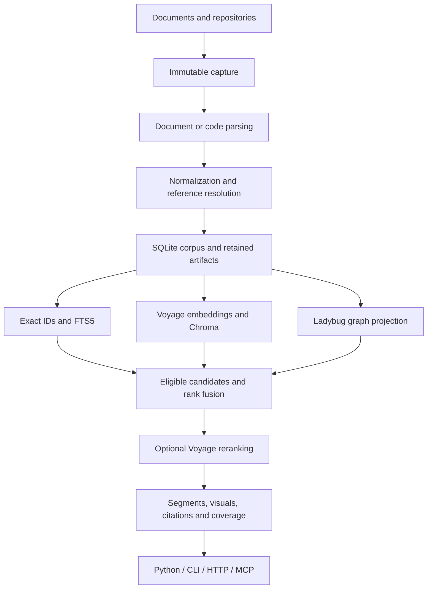
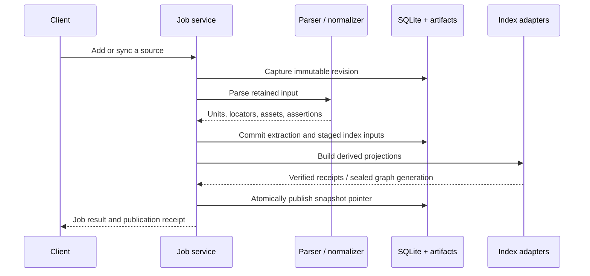
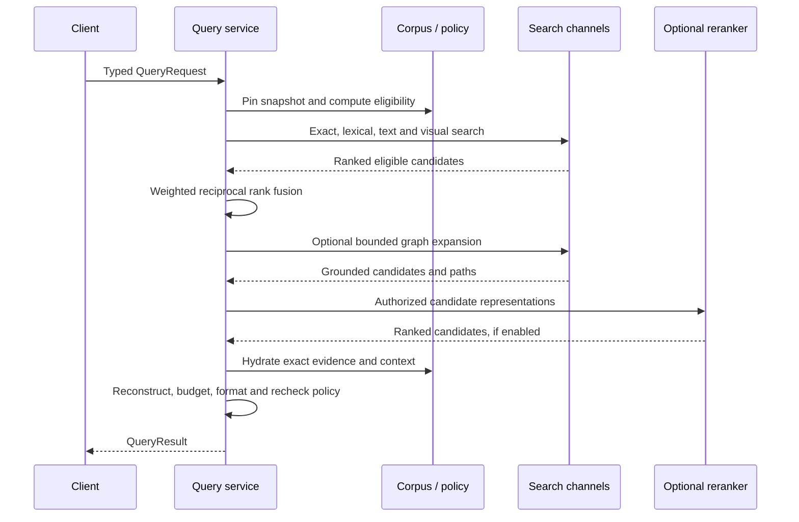

# Engine architecture

Tychora is a local evidence engine. It captures versioned documents and code, builds searchable representations, and returns source evidence with citations through Python, CLI, HTTP and MCP. The calling agent writes the final answer or review.

This walkthrough describes the implemented `0.1.0a1` engine as of the current `main`, rather than treating every item in the design specification as delivered. Read the [review assessment](review-assessment.md) for remaining implementation gaps, especially history retention, traces and strict retrieval.

## From sources to evidence



The distinction between canonical evidence and derived indexes lets the engine change search representations without silently changing source text.

## 1. Application layers and libraries

| Package | Responsibility | Principal technology |
| --- | --- | --- |
| `contracts` | Typed requests, identities, evidence, relations, results and errors | Pydantic |
| `configuration` | Profile packs, registries, schema validation and compatibility | TOML, JSON Schema |
| `ingestion` | Capture and normalize document/code evidence | Native parsers, Docling, Tree-sitter adapters |
| `indexing` | Representations, windows, embedding groups, projection publication | Token counters, provider and storage ports |
| `retrieval` | Eligibility, candidate retrieval, fusion, graph expansion, reconstruction | FTS5/BM25, vector and graph ports |
| `formatting` | JSON, Markdown and agent-oriented evidence output | Deterministic rendering and token budgets |
| `application` | Workspace ownership, jobs, operations and orchestration | Python, AnyIO and bounded workers |
| `ports` | Interfaces for replaceable implementations | Python protocols |
| `adapters` | Actual parser, database and provider implementations | SQLite, Chroma, Ladybug, Voyage, Anthropic |
| `clients` and `interfaces` | Sync/async API, CLI, HTTP and MCP | Typer, Rich, FastAPI, Uvicorn, MCP SDK |
| `evaluation` | Gold datasets, comparisons and metrics | The production query path |

The engine uses explicit orchestration rather than a general RAG framework. Python 3.12 is the supported interpreter. The base package is small relative to the optional document, model and native-index stack. Exact resolved versions live in `uv.lock`; optional dependencies are declared in `pyproject.toml`.

### Dependency direction

Four import-linter contracts in `pyproject.toml` (`[tool.importlinter]`) are the source of truth; `python -m tools.health check` runs them on every pull request.

1. **Layers.** Higher packages may import lower ones, never the reverse: `interfaces` and `clients` (independent of each other), then `api`, `evaluation`, `application`, then `retrieval`, `indexing`, `ingestion` and `formatting` (which may import each other), then `configuration`, `ports` and `contracts`. Evaluation sits above application because it drives the production query path.
2. **Adapters implement ports.** `adapters` never imports `application`, `retrieval`, `indexing`, `ingestion`, `evaluation`, `formatting`, `interfaces`, `clients` or `api`. The application layer and `api` are the composition root and may import adapters.
3. **Storage through ports.** `contracts`, `ports`, `configuration`, `ingestion`, `indexing`, `retrieval` and `formatting` never import `adapters`.
4. **Pure contracts.** `contracts` imports no database client, web framework, command-line library or model SDK.

Today's violations are listed in each contract's `ignore_imports`, one line per import with its file and line. The list may only shrink.

## 2. Identity and versioning

```text
Source → Revision → Extraction → Evidence unit → Search chunk → Returned segment
```

| Object | Meaning |
| --- | --- |
| Source | A registered logical document or repository in a collection |
| Revision | Captured source bytes plus edition and metadata identity |
| Extraction | A particular parser and normalizer result for a revision |
| Evidence unit | A paragraph, rule, table row, symbol, feedback record or figure with provenance |
| Chunk | An exact window used for indexing an evidence unit |
| Segment | Evidence assembled at query time, including matched and contextual material |
| Snapshot | A coherent published set of corpus members and index batches |

Reparsing a document creates a new extraction; changing its original bytes creates a new revision. Switching an embedding model creates a different search representation. These events do not share one undifferentiated document ID.

Hashes bind identities and artifact bytes. They are integrity checks, not proof of source truth. See [why SHA-256](design-choices.md#sha-256-identities).

## 3. SQLite: the canonical structured corpus

The canonical file is `WORKSPACE/corpus.sqlite3`. The adapter uses Python's `sqlite3`, strict tables, foreign keys, JSON validation, WAL and `synchronous=FULL`. Migrations are checksummed; opening a workspace does not silently migrate it.

| Tables | Responsibility |
| --- | --- |
| `workspaces`, `collections`, `kinds` | Workspace state, collection policy and versioned kind definitions |
| `sources`, `revisions` | Registered identities and captured source versions |
| `extractions` | Parser/normalizer fingerprints and extraction products |
| `evidence_units`, `locators` | Source text, hierarchy, page/geometry/code ranges and source references |
| `structured_records` | Schema-validated rules, feedback and other domain records |
| `identifiers` | Exact names and IDs mapped to evidence |
| `artifacts`, `revision_artifacts` | Retained payload identities, status and bindings |
| `assets`, `unit_assets`, `asset_proxies`, `asset_proxy_dependencies` | Visual evidence, descriptions and their exact context dependencies |
| `facet_definitions`, `facet_values` | Typed filterable metadata |
| `review_events`, `assertion_decisions` | Review events and decisions on relationship assertions |
| `chunks`, `lexical_records`, `lexical_fts` | Indexing windows and lexical representations |
| `index_families`, `index_batches`, `vector_records` | Provider/model configuration, index membership, cached inputs and receipts |
| `snapshots`, `snapshot_indexes`, `snapshot_pages`, `snapshot_root_batches` | Published corpus/index combinations: a snapshot names its 256 bucketed membership pages and its slot roots |
| `membership_pages`, `page_members`, `page_batches` | Immutable membership pages shared across snapshots, their members and the index batches each page binds |
| `snapshot_members`, `snapshot_batches` (views) | Per-snapshot members and batches, derived from the page and root tables |
| `jobs`, `job_steps`, `job_events` | Durable operation state and diagnostics |
| `original_payload_tombstones` | Explicit original-payload deletion state |
| `query_runs`, evaluation tables | Query records and registered evaluation data/results |

There is no SQL table per industry-specific document type. Registered schemas and structured records supply most domain variation. The authoritative DDL is `src/tychora/resources/migrations/0001.sql`.

## 4. Retained artifacts

`WORKSPACE/artifacts/` is a content-addressed filesystem store. It retains original files, parser exports, images, manifests and supported rebuild material under SHA-256 identities. SQLite holds bindings to these immutable payloads.

Backup follows explicit, validated retention references. It does not interpret every hash-looking string in arbitrary metadata as a dependency. This distinction matters when rebuilding an index, restoring a workspace, or determining which payloads an original-removal operation can delete.

See [workspace layout](workspaces.md) and [operations](operations.md).

## 5. Configuration and document kinds

`workspace.toml` registers profiles and selects a durable default. Data-only packs define kinds, schemas, facets, relations, modes and output policies. Resolution combines defaults, pack dependencies, the selected pack, workspace overrides and permitted request overrides. Request filters narrow the caller's scope.

| Concept | Meaning |
| --- | --- |
| Kind | What a source is, its schemas and selected normalization strategy |
| Role | How evidence should be interpreted |
| Lane | Its group in formatted output |
| Mode | Appropriate allowed uses and source selection |
| Facet | A typed filter field |
| Relation | A constrained assertion between evidence objects |

Built-in kinds are `law`, `regulation`, `decision`, `standard`, `guidance`, `manual`, `template`, `procedure`, `feedback`, `evidence`, `example`, `rationale`, `research_note`, `code_file` and `architecture_decision`.

The `documents` profile provides offline lexical defaults; `code` adds code-oriented extraction/context; `verified` selects stricter review policies. Separate fingerprints cover acquisition, extraction, indexing, eligibility, query and output. A formatting change therefore need not invalidate embeddings.

Packs can reuse existing algorithms; adding a new normalization algorithm requires code. See [configuration](configuration.md) and [extension boundaries](extensions.md).

## 6. Ingestion



Local acquisition uses configured absolute roots. URL acquisition is explicitly enabled and bounded. Repository capture records source revision and included bytes without executing repository code.

Native parsing handles Markdown, text and structured JSON. The optional Docling adapter handles PDF, DOCX and supported images, retaining full structured output, source references, geometry, pages and image assets. Tables retain physical fragments and row provenance; logical continuations preserve their origins.

The standard Docling configuration currently disables Docling's built-in OCR. Separate selected-region OCR/vision paths exist. Do not infer automatic scanned-document OCR or every upstream Docling feature from the presence of the dependency. See [ingestion improvements](ingestion-roadmap.md).

## 7. Visual evidence

A visual asset retains its image, source hash, locator and contextual associations. OCR and descriptions are derived representations with their own provenance and review status. They help find the original image; they do not automatically become citable source quotations.

Optional Anthropic processing operates on selected, verified image regions and context. Enabling a provider does not grant upload permission. Source/collection authorization and the caller's narrower scope still apply.

Voyage image embeddings use a separate vector family from text embeddings. Rankings are combined later; raw vector coordinates or cosine scores from unrelated spaces are not mixed.

## 8. Code parsing and link resolution

Tree-sitter adapters support Python, JavaScript and TypeScript, including JSX and TSX. They extract symbols, hierarchy, supported reference forms, comments and exact byte/line ranges. A syntax cache is keyed by content, grammar/dialect and adapter options; revision-specific identities are reconstructed separately.

The resolver considers qualified names, explicit visible import bindings and same-file lexical scope. It records resolved, ambiguous or unresolved outcomes. It is not a compiler or runtime call graph. See [language support](extensions.md).

Document foundation references use extracted exact identifiers; missing or ambiguous targets produce diagnostics. This is not a general cross-document citation resolver. Explicit, revision-bound relationships can represent cross-source connections when their endpoints and supporting evidence are supplied.

Returned citations use retained evidence and locators. A mutable external URL is useful context, but is not the sole identity of the cited passage.

## 9. Graph projection

Ladybug is the embedded graph implementation. `Entity`, `Evidence` and `RelationAssertion` nodes express grounded endpoints and assertions. Edges connect assertions to subjects, objects and supporting evidence.

Relation definitions constrain direction, cardinality, endpoint kinds/types, creation method, status, revision binding and required origin/support. Defining `supports` does not manufacture supporting assertions. Parsing or explicit records must supply them.

Graph search performs bounded structural code context and semantic expansion with eligible evidence. It does not currently build LLM-generated community summaries. Graph generations are staged, sealed and verified before snapshot publication.

## 10. Index construction

| Channel | Implementation | Function |
| --- | --- | --- |
| Exact | SQLite identifier lookup | Named rules, symbols and registered identifiers |
| Lexical | SQLite FTS5/BM25 | Terminology, names, identifiers and quoted wording |
| Text | Voyage embeddings + Chroma | Semantic passage search |
| Visual | Voyage multimodal + Chroma | Image evidence search |
| Graph | Ladybug | Supported structural and semantic relations |

Text windows target 512 tokens and use an 800-token soft ceiling, preserving exact adjacent source spans. These are initial heuristics, not a measured optimum. Context capsules include title, kind and heading/symbol paths without changing original text. Compatible contextual models receive grouped windows; independent models use their appropriate representation.

Chroma supplies persistent ANN search. Model, dimension, representation configuration and input hashes distinguish families and cached inputs. SQLite stores record identity and receipts, not an alternative production vector search engine.

Native projections and SQLite cannot share one ordinary transaction. Publication builds and verifies projections before switching the canonical snapshot pointer. See the [review assessment](review-assessment.md) for the current limitation around same-configuration family recomputation.

## 11. Query execution



Fusion sums `channel_weight / (60 + rank)`. Current defaults are exact `2`, lexical `1`, text `1`, visual `0.7`, graph `0.35`. Multiple windows or model families are consolidated to avoid manufacturing extra votes for one evidence owner.

Reranking occurs before final segment selection. Matched windows remain linked to canonical chunk ranges. Reconstruction returns enough source context for interpretation, with citations, lane policies, diversity and output budgets.

Eligibility applies to channels and graph supports; source access is revalidated before delivery. Current strict-mode candidate truncation and historical-edition decision behavior have known issues documented in the review assessment.

## 12. Result and formatters

The versioned `QueryResult` contains `run_id`, `snapshot_id`, `applied_scope`, `segments`, `visuals`, `relations`, `citations`, `coverage`, `checks`, `coverage_gaps`, `decision_requirements`, `warnings` and `budget_contract`. A `trace` field exists but is not currently populated by the query orchestration.

JSON preserves the typed result. Markdown and agent formatters group evidence according to the configured hierarchy, distinguishing authority, standards, feedback, evidence, examples and maintenance material. Token and byte budgets apply to the rendered output.

LLM answer generation, review writing, rule promotion and multi-turn orchestration remain outside the engine. A framework-neutral knowledge adapter example preserves citation metadata; there is no installed Agno-specific adapter.

## 13. Runtime and interfaces

One process owns a workspace's canonical and native handles. An OS lock coordinates ownership; durable jobs, bounded workers and snapshot/artifact leases coordinate work. Parsing can run in separate processes. A serving owner exposes authenticated loopback HTTP and MCP. The Python clients offer sync and async APIs over shared services.

The CLI verbs are `init`, `add`, `search`, `inspect`, `serve` and `manage`. Typer and Rich handle command parsing/display; HTTP uses FastAPI/Uvicorn; MCP uses the official SDK. Companion skills describe discovery, configuration, source registration and evidence inspection.

Backup, restore, health, withdrawal and original deletion have separate semantics. History stores metadata by default; full request replay is not generally available. Expiry timestamps currently do not imply working automatic purge. See [operations](operations.md).

The built-in dashboard, served by `tychora serve`, covers collections, documents, PDF and OCR intake, search, evidence inspection, settings and evaluations; see the [dashboard guide](dashboard.md). Query traces and retention controls are not yet available in it.

## 14. Evaluation, packaging and extension limits

Evaluation runs registered expected/forbidden evidence and locator cases through the actual query path. Channel comparisons and synthetic regression tests validate mechanics. They do not establish live semantic retrieval quality for a new corpus.

`uv` manages environments and locking; Ruff handles lint/format; `ty` checks types; pytest runs tests; Hatchling builds the single wheel/sdist; PyInstaller builds platform-specific executables. Optional weights/tokenizers are provisioned separately. [Distribution](distribution.md) explains target qualification and release limitations.

Vector and graph ports are meaningful extension boundaries. Qdrant and Neo4j adapters are not implemented. Canonical SQLite access is still present throughout application code, so PostgreSQL support requires broader repository/transaction work rather than a single adapter class. See [extension estimates](extensions.md).
