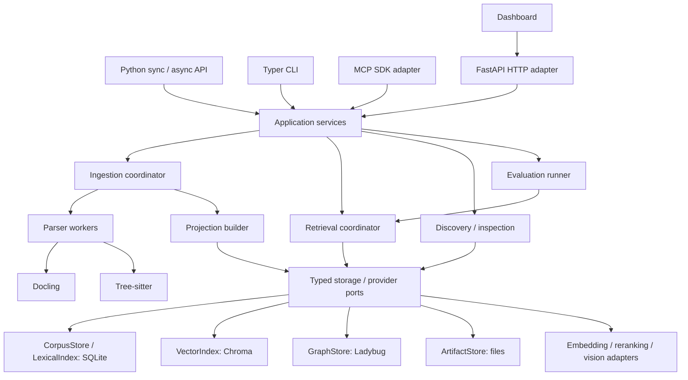
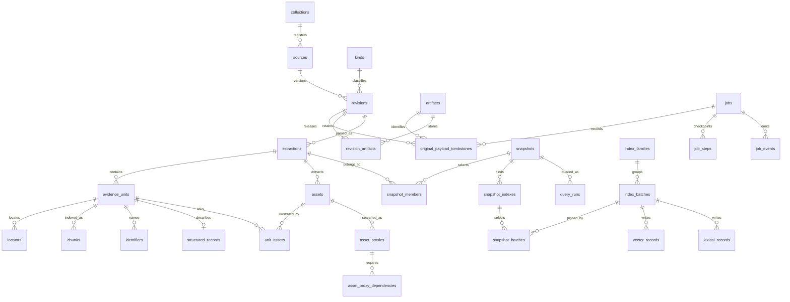

# Tychora — engine specification

Date: 2026-09-10
Status: consolidated specification; product direction accepted, implementation and runtime qualification pending
Companion: [Dashboard specification](2026-09-10-tychora-dashboard-design.md)

This is the single implementation specification for the evidence engine: corpus storage, ingestion, indexes, retrieval, Python API, CLI, MCP/HTTP, configuration, lifecycle, evaluation, security and packaging. The dashboard has a separate specification and consumes these engine contracts.

The product section establishes scope; the following sections define the detailed implementation contracts and acceptance criteria. All sections belong to this specification. Document and code profiles share the same engine. Calling skills and agents own answer writing and review workflows. The dashboard implementation follows the engine's service contracts.

Only the SQL design checks described below have been executed. The application, provider integrations, wheel and standalone executable still require their specified implementation and qualification checks.

## Contents

1. [Product and scope](#product-scope) — Product commitments, CLI, discovery, API boundaries and delivery sequence.
2. [Architecture and application contracts](#architecture) — Modules, libraries, identity, publication, ports, ownership and transport errors.
3. [Configuration, kinds and relationships](#configuration) — Packs, historical kinds, metadata, relations, modes and output compatibility.
4. [Storage schema and invariants](#storage) — SQLite DDL, artifact identities, eligibility, vector collections and graph projections.
5. [Ingestion, indexing and retrieval algorithms](#algorithms) — Document/visual processing, hybrid search, response fitting and evaluation.
6. [Code retrieval](#code-retrieval) — Language adapters, structural context, symbol resolution and code benchmarks.
7. [Lifecycle, backup and recovery](#lifecycle) — Backup closure, original removal, retries, crash recovery and failure cases.
8. [Packaging and distribution](#distribution) — Wheel/executable composition, offline assets and platform qualification.

<a id="product-scope"></a>

## 1. Product and scope

### Product

Tychora is a local application for turning documents and code into discoverable, versioned evidence. People and agents can register sources, ingest them, search across text and images, inspect exact passages and source files, follow documented relationships, and measure retrieval quality.

The application has one set of services exposed through a Python API, CLI, MCP, and HTTP. A browser dashboard is specified now and implemented after those services. It is a corpus and retrieval workbench with saved query runs, rather than a required conversational interface.

Search returns structured evidence and deterministic JSON, Markdown, or agent-oriented formatting. The calling agent writes the final answer or review. Tychora does not presently call a generative model to write answers, produce reviews, or promote proposed rules. Selective vision during ingestion is a separate, explicit capability; its outputs remain labelled derived material.

Public code, documentation, tests, screenshots, examples, package metadata, and Git history use generic terminology, synthetic fixtures, and redistributable public references. Imported code must be reviewed for embedded data and retain applicable license notices. Local corpora, credentials, conversation exports, and machine-specific paths are excluded from distributions through explicit allowlists. Proposed project license: MIT.

#### Representative uses

- Search a software standard together with public regulations and internal implementation guidance, retaining their different roles.
- Retrieve a government template instruction and its corresponding diagram with exact source locators.
- Find reviewer feedback related to a passage, retaining the quoted target, status, and provenance.
- Find a code symbol, inspect its definition at an indexed revision, and explore callers or imports.
- Compare retrieval configurations using a labelled evaluation set and inspect failures.

### Product commitments

1. A small daily command surface; registering a source runs the required configured extraction and indexing stages.
2. Discoverable kinds, filters, collections, available capabilities, corpus coverage, and model configuration.
3. Original source bytes, source revisions, extraction artifacts, normalized evidence, and model-derived material remain distinguishable.
4. Exact identifiers, lexical search, text vectors, image vectors, reranking, and coherent source-context reconstruction coexist.
5. Source access, dates, review states, and usage restrictions apply to every retrieval channel and to exact inspection and relationship traversal.
6. Expensive work is resumable and cached; failed reindexing does not replace a working snapshot with partial results.
7. Graph traversal and vector search use dedicated engines behind replaceable interfaces.
8. Evaluation, observable jobs, and useful failure messages are part of the initial application, not dashboard-only additions.
9. Code retrieval preserves bounded parent/sibling context, language-specific extraction contracts, file-qualified symbol identity and code-specific quality/cache benchmarks.

### Components and dependencies

Transport adapters depend on application services. Services depend on domain contracts and storage/provider interfaces. Concrete adapters implement those interfaces. Domain contracts do not import database clients, HTTP frameworks, CLI libraries, or model SDKs.

| Component | Responsibility |
| --- | --- |
| `contracts` | Source identities, revisions, evidence units, assets, assertions, policies, query contracts |
| `application` | Add/sync sources, execute queries, inspect evidence, traverse relations, evaluate, maintain workspaces |
| `ingestion` | Acquisition, extraction, normalization, locator preservation, quality diagnostics |
| `indexing` | Context groups, exact/lexical/vector/graph projections, checkpoints, snapshot activation |
| `retrieval` | Policy compilation, candidate generation, fusion, reranking, context assembly, response formatting |
| `adapters` | SQLite, Chroma, graph database, Docling, code parsers, Voyage and optional vision providers |
| `interfaces` | Python API, CLI, MCP, HTTP; no separate business logic |
| `evaluation` | Gold sets, replay, metrics, ablations, comparison reports |
| `observability` | Job events, query traces, retention and aggregation |
| `profiles` | Declarative document kinds, role descriptions, metadata fields and query defaults |

Use `uv` for environments, dependency resolution, locking and builds; Ruff for lint/format; `ty` for type checking; pytest for tests. Typer with Rich supplies completion, readable help and progress. These tools have separate roles: Astral's tools do not supply the CLI framework. [uv](https://docs.astral.sh/uv/), [Ruff](https://docs.astral.sh/ruff/), [ty](https://docs.astral.sh/ty/), [Typer](https://typer.tiangolo.com/).

Use Pydantic for validated transport/configuration contracts and JSON Schema, FastAPI for HTTP, and the official MCP Python SDK for transport compliance. Use standard-library SQLite and TOML parsing where sufficient. Heavy parser/provider/storage integrations are packaged as explicit extras with a recommended full installation. Command help and configuration inspection must not load model weights, initialize databases, or construct external clients.

Target Python 3.12 initially. Additional Python/platform support is advertised only after clean installation and integration checks pass. Pin tested provider/model identities and record them with each index build; never silently float an existing index to a newer model.

### Storage decision and interfaces

#### Recommended split

| Interface | Initial implementation | Future adapter |
| --- | --- | --- |
| `CorpusStore` | SQLite: sources, revisions, normalized units, policies, manifests, jobs and activation receipts | PostgreSQL |
| `LexicalIndex` | SQLite FTS5 and exact identifier lookup | PostgreSQL full-text or another lexical index |
| `VectorIndex` | Embedded persistent Chroma; separate collections per compatible embedding family, containing immutable extraction batches | Qdrant or another vector service |
| `GraphStore` | LadybugDB, conditional on the acceptance checks below | Neo4j |
| `ArtifactStore` | Local content-addressed files | Object storage |

SQLite is not the graph traversal engine or a brute-force vector backend in the production profile. GraphStore owns indexed nodes/edges and relationship queries. Original relationship assertions and their derivation are retained in extraction/event artifacts, allowing graph projections to be rebuilt without inferring relationships again. Model vector caches, when enabled, are content-addressed artifacts rather than a second query implementation in CorpusStore.

Chroma provides a persistent embedded Python client. [Client documentation](https://docs.trychroma.com/docs/run-chroma/clients).

LadybugDB is the proposed embedded property graph engine. The original Kuzu repository is archived, so it is not a new dependency candidate. Ladybug has Python distribution and ongoing releases, but those facts do not establish fitness for this application. [Kuzu archive](https://github.com/kuzudb/kuzu), [Ladybug releases](https://github.com/LadybugDB/ladybug/releases), [Python distributions](https://pypi.org/project/ladybug/).

Before adopting Ladybug, require binary installation on the declared OS/Python matrix, persist/reopen, idempotent upsert/delete, bounded traversal, transaction rollback, concurrent service requests, cancellation, forced-termination recovery, and export/rebuild tests. Check exact wheel tags, including minimum macOS versions. If these fail, report the failed acceptance criterion and revise the graph adapter choice; do not substitute SQLite traversal and describe it as equivalent.

A combined graph/vector engine remains an alternative, but is not selected merely because it implements both features. It would have to pass the same independent retrieval, filtering, durability, packaging and migration checks.

#### Portability without pretending every database is identical

Interfaces expose operations such as writing a revision, selecting eligible evidence, writing lexical/vector batches and sealing graph generations, finding ranked candidates, retrieving bounded neighbours and traversing typed paths. They do not expose raw SQL or promise arbitrary Cypher portability. Adapters report supported predicates, transactional guarantees, limits and health. An unsupported required filter fails clearly; it is never silently omitted. Common adapter contract suites enforce result identity, eligibility, lifecycle and errors.

Identifiers use a persisted workspace UUID and stable source/revision/evidence IDs, independent of absolute filesystem location. Embedding-space identity includes provider, model, dimension, input representation version and metric. Code-specific embeddings may occupy a separate space and contribute through rank fusion.

#### Ownership, transactions and index visibility

There is no distributed transaction across SQLite, Chroma and Ladybug. Ingestion commits source material and a manifest, then writes immutable lexical/vector batches within compatible families and builds a full graph generation. Only after readiness checks does one CorpusStore transaction publish the membership and exact slot/batch receipts. Queries pin those bindings. Leases survive client deadlines until all associated backend work exits. Shared FTS statistics are recorded separately: a snapshot fixes evidence membership, not identical BM25 rankings.

Updates reuse unchanged extraction/embedding artifacts and compatible batches; graph v1 builds a full generation for the selected membership. This does not require reembedding the entire corpus. A deleted or withdrawn source becomes ineligible immediately in CorpusStore; physical index cleanup can follow. Reusing stale vector results must never bypass current eligibility.

Ladybug requires shared connections to a single read/write database object rather than independent readers beside a writing process. [Concurrency](https://docs.ladybugdb.com/concurrency/). Tychora therefore has one owner for an open workspace. A standalone command can own it for the command's lifetime. `serve` owns it while running; other commands delegate to that verified local service. A second standalone owner gets an actionable busy error. Parsing may run in bounded workers, but database writes pass through the owner. No automatic background daemon is required.

Read-only corpus operations do not mutate sources or index state. Optional operational history writes are a separately configured capability. Basic help does not acquire the workspace.

### Corpus and discovery model

Core objects are Workspace, Collection, Source, Revision, Extraction, EvidenceUnit, SearchChunk, Asset, RelationshipAssertion, IndexFamily, IndexBatch, PublishedSnapshot, Job and QueryRun. IndexGeneration specifically describes the graph projection.

A Source is a logical item. A Revision identifies original bytes and declared edition or code snapshot, with publication/effective dates where supplied. Identical bytes can have different declared editions. A new revision does not overwrite older evidence or weaken its access classification. Derived extraction versions are recorded independently from source revisions.

An EvidenceUnit has a type, parent, ordering, original or derived text, identifiers and a locator. A document locator can contain heading path, physical page, printed-page label, bounding box and native object reference. A code locator includes repository identity, revision or working-tree snapshot, relative path, line/byte range and qualified symbol. Unknown locators remain unknown; no invented PDF-style pages for a DOCX without a layout-preserving renderer.

Assets contain immutable hashes, MIME type, artifact references and source-region links. Relationships carry typed endpoints, direction, provenance, confidence, assertion status and revision scope. Native links, parser-inferred calls and model-suggested relations are different derivation classes.

#### Semantic kinds are separate from file formats

A PDF may contain a law, standard, manual, template or feedback. A kind definition declares its stable key, label, description, evidence role, required/optional metadata, normalization hints, permitted uses, available relations and representative queries. An adapter declares formats and extraction capabilities separately.

Ship generic presets for documents, standards/regulations, feedback and code. Built-in kinds include law, regulation, standard, guidance, template, manual, feedback, example, research note, code file and architecture decision. Presets are declarative and editable; arbitrary metadata fields do not automatically become filterable. The configuration section defines versioned role/lane/mode registries, concrete kind/relation TOML examples, structured normalization, global applicability versus missing values, and a deterministic hierarchical output profile. Register typed facets explicitly.

`inspect kinds` returns descriptions, examples and requirements, including zero-count configured kinds. `inspect sources` reports accessible source counts, versions, ingestion status and coverage. Discovery also exposes supported filters/operators, relation types, installed adapters, enabled models, limitations and structured request schemas. Counts and diagnostics obey the same access scope as search.

#### Access and dates

Collection scope, source classification, usage policy, review state and allowed provider upload scope are separate concepts. A caller cannot elevate server permissions by supplying a higher clearance in query JSON. Standalone operation uses the configured local principal; server operations intersect request filters with server-granted capabilities.

Publication cutoff and effective-date selection are distinct. Queries choose an unknown-date policy: allow with a warning or exclude; strict temporal presets exclude unknowns. Multiple editions are reported as editions, not automatically labelled contradictions. A contradiction requires an explicit assertion or separately justified detection.

### Ingestion and indexing

The flow is register source → acquire/hash → extract → normalize → validate → commit source revision → build projections → verify → activate snapshot. Each step records its version, inputs, outputs and diagnostics. Retrying a job reuses completed artifacts keyed by hashes and configuration fingerprints. A failed optional enrichment leaves the original evidence intact and marks that capability incomplete.

#### Documents and visual content

Use native Markdown/text parsing for inexpensive faithful structure. Use Docling for rich document extraction, especially PDF and office documents, retaining its structured JSON alongside originals and normalized evidence. Docling documents PDF, DOCX, Markdown and image inputs and JSON serialization. [Supported formats](https://docling-project.github.io/docling/usage/supported_formats/).

Preserve headings, lists, tables, figures, captions, source objects and available geometry. Tables retain physical fragments and per-row provenance; proposed cross-page joins retain their evidence and status. Repeated column labels enrich searchable rows without changing the original source quotation.

Visual assets support original image embeddings and a separate textual retrieval representation. Distinguish caption, OCR and generated description. Selective vision is explicit per profile/provider, cached, and constrained to the smallest useful region. Derived values and inferred annotation targets remain unverified until reviewed; an image description is not an authoritative quotation.

Text and image vectors live in separate embedding spaces. Text-only questions can retrieve linked images; image queries use the matching multimodal provider. Evidence assembly returns the original asset and textual context with source locators. Visual relevance must be evaluated beyond image self-matching.

#### Code

Use Tree-sitter adapters with initially tested Python and TypeScript/JavaScript support; expand the advertised language list with fixtures. Preserve symbol boundaries, decorators, parent scope, imports, comments and exact ranges. Respect Git ignore rules plus workspace excludes; avoid secrets, generated/vendor content and symlink escapes. Git operations inspect source state and never execute repository hooks or code.

Store an explicit indexed snapshot. Dirty working-tree bytes must not be attributed solely to HEAD. Unchanged files reuse extraction/embedding artifacts; deletion removes them from the active snapshot. Historical inspection is revision-qualified. Calls/imports/inheritance are typed, and heuristic name resolution is labelled as such. The [Code retrieval profile](#code-retrieval) makes structural context, a LanguageAdapter port, resolution diagnostics, file/symbol evaluation and four cache benchmark states first-release requirements. Sparse parent/adjacency assertions replace a quadratic set of sibling links. More elaborate graph propagation and relevance/penalty segment scoring remain explicit experiments.

#### Retrieval-related indexing

Build exact identifier, contextual lexical, contextual text-vector, image-vector and graph projections independently. Persist the exact context representation and grouping hash used for embeddings. Protect provider token/batch limits and validate response mapping, dimensions, finiteness and model identity before saving. Model activation requires expected coverage, not merely one existing vector.

### Retrieval and response contract

1. Validate the request and pin a corpus/index snapshot.
2. Resolve caller policy, collection scope, semantic kinds, dates and typed filters.
3. Retrieve eligible exact, lexical and vector candidates; optional graph expansion uses the same policy.
4. Fuse ranks from distinct channels without adding incomparable model scores.
5. Rerank a candidate pool larger than the final output.
6. Reconstruct bounded source context with exact matched units distinguished from included neighbours.
7. Attach linked images and typed relation paths; enforce diversity and a shared response budget.
8. Revalidate returned evidence against current withdrawal/access restrictions and format it.

Each graph path requires eligible endpoints, intermediate nodes, assertion grounding and every required supporting unit. Optional semantic search augmentation uses one-hop traversal; the code preset also supports named parent/sibling structural queries. They share five seeds, at most 32 new units and a 2,000-row work budget; they do not each receive a separate allowance. Explicit relationship inspection is bounded to two hops and 100 edges. Requests can lower configured limits. Relation provenance and confidence remain visible; graph rank expansion is evaluated rather than assumed to improve ranking.

A QueryRequest contains a discriminated question/passage/image input, collection/profile selection, typed filters, requested modalities, context budget and optional previously selected evidence IDs. Advanced candidate counts and model tuning live in configuration or structured request files. The tool accepts passage input directly; hidden generative rewriting and a conversation-memory engine are not part of this release.

A QueryResult contains schema version, run ID, snapshot ID, applied scope, separately ranked `segments` and `visuals`, configured lane IDs, permitted structured-record attachments, exact citations, relevant relations, coverage, typed coverage gaps/decision requirements, warnings and an optional detailed trace with policy and lexical-statistics epochs. Coverage reports what was retrieved and which channels completed; it does not claim that finding a passage proves an answer correct. No matches, partial channel coverage, multiple versions and missing required kinds are distinct states.

Optional profile-defined lane reservations occur during candidate admission and final selection, before formatting; grouping results afterward cannot restore an omitted lane. The pure hierarchical renderer preserves authorized records/citations and supports configured labels and field aliases. Output compatibility and retrieval equivalence have separate fixture gates.

Provider failure preserves successful channel results only if the profile allows degraded retrieval, with an explicit partial result. Strict profiles fail with a typed error. Timeouts, cancellation, retries and provider usage are traceable. External providers receive only authorized inputs; offline mode disables every remote model invocation and never silently switches to a remote fallback.

### CLI and configuration

Five everyday verbs:

| Command | Purpose |
| --- | --- |
| `tychora init` | Create a workspace using documented presets and an explicit processing/provider choice |
| `tychora add PATH` | Register files/folders/repositories and run or resume the configured pipeline |
| `tychora search "question"` | Retrieve evidence; accept a passage/request file or image when needed |
| `tychora inspect SUBJECT` | Discover kinds, sources, capabilities, configuration and runs; open exact evidence or relationships |
| `tychora serve` | Expose the same workspace services through MCP/HTTP |

`inspect` subjects are discoverable nouns, not another set of pipeline-management steps. Typical examples: `inspect kinds`, `inspect sources`, `inspect evidence ID`, `inspect relations ID`, `inspect run ID`.

Less frequent lifecycle operations belong under `tychora manage`: sync registered sources, remove a source, rebuild selected projections, export/import a workspace, check health and run evaluations. Removing sources first withdraws their eligibility. Original-payload removal uses a separate explicit plan and per-revision tombstones; shared files remain while required elsewhere. It does not erase derived evidence, history or external backups. Canonical export copies SQLite and all required retained payloads under leases; import into an empty destination reports omitted native indexes and never calls providers implicitly. [Lifecycle and recovery](#lifecycle) defines these operations. This group does not recreate manual configure-vector/index-text/index-images activation chores: ordinary `add` owns those stages.

Use positional inputs, shell completion and concise help with examples. Human output is readable; `--json` emits only the versioned machine response to stdout, with progress/errors on stderr. Structured error codes and process exit statuses are consistent. Common flags cover workspace, profile, output format and offline execution. Advanced ranking knobs stay out of the default help.

Configuration lives in `tychora.toml`, with source metadata in sidecar manifests or the registry. Precedence is validated defaults → selected preset → explicit versioned pack dependencies → selected pack → workspace config → allowlisted request/CLI overrides; the configuration section defines merge and conflict rules. Credentials are environment/secret references only. `inspect config` shows effective values and their origins with secrets redacted. Configuration is strict: unknown keys or contradictory provider/index settings fail with a useful explanation. Profile upgrades must explicitly map retained historical kind versions or fail with a scoped incompatibility error. Eligibility-cache identity includes the full resolved policy and eligibility request. Embedding changes create a new compatible family; graph representation changes require a new graph generation.

### Programmatic, agent and HTTP interfaces

#### Python API is a primary product interface

The installed `tychora` package exports stable typed clients and contracts. A Python application can open a local workspace or connect to the running workspace service without invoking the CLI, parsing formatted strings, starting an HTTP server unnecessarily, or importing private storage modules. CLI, MCP and HTTP are clients of the same application operations, not the API's implementation.

Provide `Tychora` and `AsyncTychora` clients with equivalent request/result semantics. Both support explicit context-manager lifecycle, a configured principal, injected configuration/providers for embedding and tests, and no global mutable workspace or request scope. Local ownership follows the storage rules above; a framework can retain one client across agent requests.

| Public operation | Typed result/behavior |
| --- | --- |
| `discover` | Kinds, filters, collections, capabilities and usage descriptions |
| `sources.add` / `sources.sync` | Source registration and resumable ingestion job handle |
| `search` | Complete structured QueryResult; formatting is separate |
| `evidence.get` / `assets.get` | Exact source evidence and registered original assets |
| `relations.traverse` | Bounded, policy-filtered paths with assertion provenance |
| `jobs.get` / `jobs.wait` / `jobs.cancel` | Typed job state, progress/events and cooperative cancellation |
| `evaluations.run` | Evaluation job and comparable structured metrics |
| `format_result` | Pure JSON, Markdown or agent-envelope formatting |

SourceInput accepts registered local paths and in-memory text/bytes with explicit source identity and metadata; a framework does not need temporary files just to load a document. Byte/format limits apply before extraction. An external-URL acquisition capability, if enabled, uses configured allowed schemes/hosts, bounded downloads and redirect validation rather than unrestricted server-side fetching.

Requests accept validated models and documented primitive mappings. Responses expose typed fields and lossless schema-versioned serialization. Errors distinguish invalid input, denied scope, not found, busy workspace, missing capability, incomplete index, provider failure, cancellation and timeout. No public API method prints, exits the process, mutates logging configuration, or returns an undocumented SDK object.

Async calls must not block the event loop on parser, embedded database or provider work. Use native async clients where suitable and bounded executors/owner queues for synchronous libraries. Sync entry points do not call `asyncio.run` inside an existing event loop. Timeouts and cancellation propagate to cancellable providers and job checkpoints; completed source/index transactions remain valid when cancellation arrives. Streaming events use the same event schema as HTTP.

RequestScope is immutable per call and intersects the client's granted scope; framework-supplied metadata or filters cannot elevate it. Limits count returned evidence segments, with context expansion accounted for inside each segment's budget. Final ResponseAssembler fitting measures every requested delivered representation, including record/diagnostic overhead; a pure later formatter fails explicitly if its new rendering exceeds the declared cap. Adapters can therefore map framework document limits predictably.

#### Framework adapter contract

A future Agno knowledge integration must be implementable as a small external adapter over the public Python API. It translates a framework query/filter/limit into QueryRequest, converts evidence segments into framework document objects, and retains evidence/source/revision IDs, exact locators, usage role, derived-status flags, asset references and retrieval run ID in metadata. It must not rechunk or reembed Tychora results, rerun a second retriever, parse CLI output, or reach into SQLite/Chroma/graph internals.

Discovery can supply agent instructions and tool descriptions; exact evidence and relationship inspection remain accessible through additional tools. Native image evidence remains an asset reference when a framework document cannot carry image bytes. Unsupported mandatory filters produce a structured failure rather than disappearing during conversion. Framework write methods delegate only when the client has source-write capability; deletion and load completion preserve Tychora's job/snapshot semantics.

Pin the chosen framework version when implementing an adapter instead of assuming one permanent `KnowledgeBase` superclass. Agno's current source exposes `KnowledgeProtocol`, with context/tool discovery and synchronous/asynchronous retrieval hooks. The eventual adapter must implement the interface for the supported Agno version; no Agno runtime dependency belongs in the core package. [Agno protocol source](https://github.com/agno-agi/agno/blob/main/libs/agno/agno/knowledge/protocol.py).

Initial release acceptance includes public API documentation, a framework-neutral adapter example, sync/async parity, event-loop responsiveness, scope isolation, and tests using public exports exclusively. Shipping the Agno adapter itself is a separate integration task.

#### MCP and HTTP

Use a small capability-based MCP surface: `discover`, `search`, `inspect`, `add_sources` and `manage_job`. Exact-source and graph inspection are typed inspect requests; ingestion tools are exposed only when the server principal has write capability. MCP resources expose schemas, kind definitions and evidence/assets through stable URIs. Tool descriptions include concrete input examples and source-use semantics. Implement with the official SDK, including real transport tests. [MCP tools](https://modelcontextprotocol.io/specification/2025-11-25/server/tools), [resources](https://modelcontextprotocol.io/specification/2025-11-25/server/resources).

HTTP has versioned routes for capabilities, collections, kinds, sources/revisions, evidence/assets, relations, query runs, jobs/events, evaluations and settings. The dashboard uses only these routes. Long tasks return job IDs; progress uses reconnectable server-sent events with durable sequence numbers. Idempotency keys bind canonical caller intent: identical retries reuse the captured job, while changed requests under the same key fail with a conflict. A new key captures changes at the same live path.

`serve` exposes HTTP and MCP Streamable HTTP by default. `serve --stdio` exposes MCP over stdio while retaining a private authenticated loopback control endpoint for sibling local clients; stdout remains protocol-only. Both modes share one workspace owner and publish its verified identity/endpoint in a protected runtime file. Stale runtime files are not sufficient evidence that an owner is alive.

The local server binds to loopback and uses a per-install local credential with scoped read/write capabilities and strict origin checks. Remote network exposure is outside the initial deployment profile. Asset endpoints resolve registered artifact IDs, never arbitrary filesystem paths. CLI delegation verifies workspace identity and service credentials.

Companion skills teach configuration, adding documents/code, discovering available kinds/filters, making queries and inspecting sources. They consume discovery schemas rather than maintaining a duplicated hard-coded taxonomy. Skills explain original versus derived content and preserve citations; they do not include private domain workflows.

### History, diagnostics and dashboard dependencies

Persist job progress, adapter health, source/index coverage, query timing, selected IDs, policy/lexical-statistics epochs, filter/model/configuration fingerprints and evaluation reports from the first backend release. Query text, passages, result excerpts and provider request bodies are not retained by default. Default query-run retention is 30 days; explicitly enabled full local history has a separately visible retention setting. Job diagnostic retention is 30 days; source provenance and activation manifests persist for the lifetime of the corpus. Users can disable query history entirely and purge optional operational payloads without deleting sources. Minimal idempotency bindings, pinned acquisition/configuration and terminal job receipts persist so diagnostic expiration cannot cause duplicate writes.

A run with metadata-only history can be inspected diagnostically but cannot reproduce the missing original query. The dashboard labels that limitation. Replay requires the retained request, current authorization, snapshot membership and available/rebuildable projection dependencies, plus supported provider/configuration capabilities. A retained manifest alone is insufficient after graph GC. Missing dependencies are explained before offering a new run. Shared lexical statistics and remote provider revisions can change scores; historical exact-rank replay requires a frozen database/provider environment.

See the dashboard specification for screens, journeys, accessibility, state handling, events and acceptance criteria.

### Verification and release gates

Use synthetic public fixtures and independently reviewed public-source test material. Version labels, identifiers, feedback states, document dates, source roles, code snapshots and graph provenance must remain meaningful during tests. Avoid evaluation leakage by splitting related sources/reviews and generated derivatives together rather than randomly by chunk.

Required tests cover:

- Cross-interface contract parity, pure help/discovery startup, structured errors and no unexpected network calls.
- Immutable revisions, stable IDs across relocation, withdrawals, access/temporal filters across every channel and intermediate graph node.
- Real graph/vector persist/reopen and crash recovery, retries, cancellation and activation races.
- Real Docling extraction on a small PDF/DOCX fixture set plus native Markdown; tables, figures and source locators checked against originals.
- Real code parser fixtures, ignored files, dirty revisions, deleted files and heuristic relation precision.
- Embedding response validation, cache identity, failed-reindex preservation and independent text/image spaces.
- Actual MCP/HTTP requests, scoped writes, path containment, malformed inputs, resource limits and prompt-like source content treated as data.
- Build/install from wheel and source distribution, freeze/qualify final standalone executables, dependency checks, license notices and public-artifact content review; see the distribution section.

Evaluation separates deterministic integrity checks from semantic quality. Exact-ID and forbidden-source cases require zero failures. Report node/document recall, nDCG, citation/locator accuracy, temporal precision, context completeness, relevant-image recall and relationship precision. Compare lexical, hybrid, reranked and graph-expanded variants on the same dataset/split, snapshot, policy epoch and lexical-statistics epoch; report any differences in these controls. Golden assertions identify expected and forbidden source/revision/evidence IDs.

Capture p50/p95 latency, stage durations, peak memory, ingestion throughput, cache reuse and provider usage under declared hardware/corpus/concurrency conditions. No universal speed or semantic quality target is claimed without measurements. Release reports include regressions, missing capabilities and reproducible commands; synthetic hash embeddings never stand in for semantic-quality evidence.

One `tychora` wheel ships the API/CLI/resources with documented extras. Standalone executable targets bundle the supported runtime stack per platform; system Git and explicitly provisioned model weights remain external requirements. The distribution section defines build tools, resource hooks, candidate platforms, artifact contents and clean-machine acceptance; no built binary is claimed yet.

### Delivery sequence

The application is designed as a whole; implementation is divided into testable subprojects with explicit interfaces.

1. **Foundation and storage qualification:** package/tooling, contracts, configuration/kind registry, adapter acceptance probes, workspace ownership, snapshots and policy invariants.
2. **Ingestion and retrieval:** rich documents/visuals, code snapshots, resumable projections, hybrid retrieval, exact inspection and typed graph traversal.
3. **User and agent operation:** documented sync/async Python API, complete CLI, MCP/HTTP, skill guidance, jobs, source lifecycle and diagnostics.
4. **Release quality:** evaluation datasets/harness, real integrations, performance/security review, documentation and distributable package.
5. **Dashboard implementation:** implement the already specified screens against the established API/events; no second retrieval implementation.

Subagent implementation tasks follow these boundaries only after the written design is approved and a detailed implementation plan is prepared. Graph qualification precedes parallel implementation of graph-dependent work. LLM answer generation and more advanced query planning are future additions evaluated through the same contracts, rather than prerequisites for this release.

<a id="architecture"></a>

## 2. Architecture and application contracts

### Runtime topology and dependency direction



Domain objects contain source/evidence identity and policy, not framework clients. Application services coordinate use cases, not HTTP requests. Pipeline stages consume and return typed immutable records. Adapters contain backend syntax, SDK mapping and resource ownership. Dependency construction occurs only at an explicit client/workspace open, not at import time.

Proposed package layout:

```text
src/tychora/
  api.py                    # public Tychora / AsyncTychora clients
  contracts/                # request/result models, IDs, filter AST, error codes
  application/              # add, sync, query, inspect, maintain, evaluate
  ingestion/                # acquire, normalize, provenance, quality checks
  indexing/                 # batches, checkpoints, activation, cache keys
  retrieval/                # eligibility, channels, structural context, fusion, rerank, assemble
  ports/                    # storage, parsers, model providers, clock/events
  adapters/
    sqlite/                 # migrations, repositories, eligibility SQL, FTS
    chroma/                 # collections, eligible-ID search, receipts
    ladybug/                # generations, statements, graph validation
    files/                  # atomic artifact writes, manifests, recovery
    docling/                # structured extraction and normalization mapping
    code/                   # Git capture, language adapters, symbols and structural assertions
    voyage/                 # contextual text, multimodal, text reranking
    vision/                 # optional ingestion-only vision
  interfaces/cli.py
  interfaces/http/
  interfaces/mcp/
  evaluation/
  profiles/                 # generic declarative kinds and presets
  configuration/            # pack resolver, immutable registries, policy compilation
  formatting/               # canonical/hierarchical projections and escaped envelopes
  resources/                # schemas, migrations, packaged skills and later UI assets
```

One Python distribution exports the library and CLI; PyInstaller one-file executables are separate platform-specific release artifacts built from that wheel and the locked full runtime. The recommended installation selects tested extras; base import/help remains lightweight. A future dashboard bundle has its own frontend build and calls HTTP, with no Node runtime required by library users.

### Libraries and version policy

| Layer | Selected library | Why / boundary |
| --- | --- | --- |
| Packaging and environment | `uv`; Hatchling build backend | Reproducible lock, dependency groups, explicit wheel/sdist package allowlists |
| Formatting/lint/types | Ruff, `ty` | Independent lint, formatting and type checks in CI |
| Tests | pytest, pytest-asyncio, HTTPX test client | Unit, integration, async responsiveness and transport tests |
| Contracts | Pydantic 2 | Strict input validation, discriminated unions, serialization and JSON Schema |
| Configuration | `tomllib` + Pydantic + `jsonschema` | Strict TOML contracts; bounded local Draft 2020-12 metadata/record schemas, no remote references |
| Standalone distribution | PyInstaller, release-build dependency only | Explicit hooks/resources; final wheel and one-file platform qualification |
| CLI | Typer + Rich | Positional commands, shell completion, human tables/help and progress |
| HTTP | FastAPI + Uvicorn + HTTPX | Versioned API, async client and service lifecycle; one worker per workspace owner |
| Async integration | AnyIO / standard executors | Bounded offload of blocking libraries, deadlines and cancellation boundaries |
| MCP | Official `mcp==2.2.0` Python SDK, `MCPServer` | SDK protocol lifecycle; no separately versioned third-party FastMCP dependency |
| SQLite | `sqlite3` | Explicit SQL, WAL, FTS5, transactions; no ORM or graph/vector scan layer |
| Vector database | `chromadb==1.5.9` initial candidate | Persistent embedded cosine HNSW; provider-supplied embeddings only |
| Graph database | `ladybug==0.20.3` initial candidate | Embedded property graph; gated by real installation/recovery checks |
| Documents | `docling` + its resolved `docling-core` | Retain structured document JSON, provenance and extracted assets |
| Markdown | `markdown-it-py` | Token structure and source line ranges; no regex-only interpretation of fenced code |
| Code | `tree-sitter`, `tree-sitter-python`, `tree-sitter-typescript`, `tree-sitter-javascript` | Explicit supported grammar wheels; no runtime grammar downloads |
| Source scanning | Git executable + `pathspec` | NUL-delimited Git file inventory and configurable excludes; never execute source code |
| Images | Pillow | Image validation, dimensions, normalized pixels and safe crop handling |
| Providers | `voyageai==0.5.0` initial candidate | Separate text, image and rerank ports; SDK capability checks |
| Optional vision | `anthropic` | Ingestion-only structured region interpretation; model explicitly configured |
| Files/locking | `platformdirs`, `filelock` | Protected runtime locations and workspace ownership; locks on supported local filesystems |
| Token accounting | provider tokenizer for provider limits; `tiktoken` for declared output-budget tokenizer | Record tokenizer identity; no unlabelled claim of exact tokens for every caller/model |

Candidate pins describe the first compatibility matrix to test, not a claim that an installation has run. Other packages are resolved and pinned together in `uv.lock` during implementation; we do not invent untested compatible patch versions. Support Python 3.12 first, SQLite >=3.38 with FTS5/JSON functions and local filesystems. Claim extra Python/OS versions only after binary installation and real adapter tests pass. Chroma's ID-filtering API is a required capability; Ladybug's wheel/platform and single-owner behavior are release gates.

Provider and parser model weights are separate from package versions. Persist model identifier, package version, normalization/chunker version, tokenizer and configuration hash in each build. Optional weights/extensions are acquired during explicit setup, never by `--help`, search fallback or implicit plugin loading.

Primary references: [uv](https://docs.astral.sh/uv/), [Typer](https://typer.tiangolo.com/), [Pydantic](https://docs.pydantic.dev/latest/), [MCP Python SDK](https://github.com/modelcontextprotocol/python-sdk), [selected SDK distribution](https://pypi.org/project/mcp/2.2.0/), [Chroma collection API](https://docs.trychroma.com/reference/python/collection), [Ladybug distributions](https://pypi.org/project/ladybug/), [Docling model](https://docling-project.github.io/docling/concepts/docling_document/), [Tree-sitter Python binding](https://github.com/tree-sitter/py-tree-sitter).

### Identity: six things that must not be conflated

| Object | Identity and lifecycle |
| --- | --- |
| Source | A logical registered document or repository; stable workspace-relative source key |
| Revision | Original bytes/tree manifest, declared edition and immutable source metadata; never overwritten |
| Extraction | One revision processed with a particular parser/normalizer configuration |
| Evidence unit | Source paragraph/rule/row/figure/symbol with its exact structural locator |
| Search chunk | A retrieval window into one evidence unit, with canonical-text offsets |
| Published snapshot | The chosen revision/extraction membership plus completed projection receipts available to a query |

Use persisted UUIDs for workspaces/collections; source IDs are UUIDv5 of collection UUID and normalized registered source key. Other immutable IDs are SHA-256 of a canonical JSON tuple with a domain/version tag. Canonical JSON means UTF-8, sorted object keys, no insignificant whitespace, preserved array order and rejection of NaN/Infinity; text bytes are not Unicode-normalized for source hashing.

- `revision_id = H("revision-v1", source_id, original_sha, edition_key, immutable_metadata_sha)`.
- `extraction_id = H("extraction-v1", revision_id, parser_fingerprint, normalizer_fingerprint)`.
- `unit_id = H("unit-v1", extraction_id, native_ref, ordinal, text_sha)`.
- `chunk_id = H("chunk-v1", unit_id, char_start, char_end, chunker_fingerprint)`.
- `space_id = H("space-v1", modality, provider, model, dimensions, metric, representation_fingerprint)`.
- `vector_record_id = H("vector-v1", family_id, chunk_or_asset_id, exact_input_sha)`.

Changing an edition label can create a new revision even with unchanged bytes. Re-parsing unchanged originals creates a new extraction, preserving original revision identity. Absolute paths and embedding API keys never enter these identities. Source-path relocation changes a registration binding, not evidence IDs.

A repository is one Source. Its original artifact is a sorted file manifest: relative path, file mode, blob SHA and original artifact reference, plus recorded commit and dirty status. Revision artifacts retain every included file. Parse unchanged files from a cache keyed by blob/grammar/parser configuration; normalize their evidence under the new repository revision. This deliberately reuses expensive extraction/embedding computations while still writing revision-qualified units/index references. Initial projection writes can remain O(repository size); measure before claiming sublinear incremental indexing.

### Storage views and atomic publication

The workspace has one canonical SQLite corpus file, one embedded Chroma directory, one Ladybug database and immutable artifact files. SQLite contains source records and projection manifests, not a copy of vector-search or graph-traversal implementations.

A vector/lexical **family** is a physical namespace with one immutable representation/configuration. Persist a family-creation UUID in the creation job and derive `family_id = H("family-v1", workspace_id, config_sha, creation_uuid)`; retries reuse that UUID. Identical configurations may have distinct family IDs for explicitly requested fresh recomputation. Ordinary incremental additions reuse the selected compatible family. Configuration equality alone is never namespace identity. A **batch** is a completed immutable set of entries for an extraction. New source revisions append entries to the same compatible family; changing a model/representation creates a different family. `snapshot_batches` binds the exact sealed batch receipts for every slot; queries search only those batches' eligible entry IDs. Unpublished or old entries in the physical family cannot enter retrieval. Shared FTS statistics can still change scores; record the lexical statistics epoch separately from membership identity.

Graph v1 deliberately uses a full immutable generation. Every graph node key includes generation ID; each new published content snapshot has a completed graph generation resolved against precisely its source membership. This costs O(V+E) copying/storage and avoids stale cross-revision symbol bindings. It reuses stored assertion/parse artifacts and does not repeat embeddings or model extraction. Keep active and previous generations, plus pinned ones; optimize graph deltas only after measurement.

```mermaid
sequenceDiagram
    participant C as Client
    participant O as Workspace owner
    participant A as Artifact store
    participant S as SQLite
    participant I as Index builders
    participant G as Graph store
    C->>O: add(source, idempotency_key)
    O->>S: Compare request digest; persist job and pinned configuration
    O->>A: Capture inputs once for this job
    O->>S: Persist capture manifest and base snapshot ID
    O->>A: Atomic original / extraction / cache artifacts
    O->>S: Commit revision, units, chunks, pending batches
    O->>I: Build lexical and text/image entries
    I-->>O: Durable batch receipts
    O->>G: Build full graph generation from assertion artifacts
    G-->>O: Sealed generation receipt
    O->>S: Validate expected IDs, counts, hashes and membership
    O->>S: BEGIN IMMEDIATE; publish snapshot; COMMIT
    O-->>C: Job complete, snapshot ID, coverage
```

#### Exact publication protocol

1. Acquire the workspace owner; compare/create the durable caller-intent digest under the scoped idempotency key, pin effective configuration/capture once, and record `base_snapshot_id`. A conflicting key fails before work; an identical replay reuses committed inputs. See [Lifecycle and recovery](#lifecycle).
2. Write each artifact into a private staging path, flush/fsync, atomically rename to its hash-derived final path, fsync the containing directory, then add its SQLite reference. Never commit a reference to a not-yet-durable file.
3. Commit revision/extraction objects and source-local batch manifests as one SQLite transaction. No external API or parser runs inside a SQLite write transaction.
4. Build projections under non-active family/batch/generation IDs. Batch completion requires entry-ID/input/value digests, entry count, dimension/config validation and a backend durability receipt. A retry of the same immutable ID with different content is an integrity error.
5. Seal graph generation after validating endpoints, required evidence dependencies and counts. No sealed generation accepts further writes.
6. In one SQLite `BEGIN IMMEDIATE` transaction, compare current active snapshot with `base_snapshot_id`, create the new snapshot membership/slot/batch bindings, verify all required receipts (including one full generation for a graph slot) and switch `active_snapshot_id`. Serialized source jobs use the latest committed membership; a changed base requires rebase/revalidation, not blind overwrite.
7. Publish the completion event after commit. A query holds a lease on its snapshot/index generations until every associated worker/backend operation has actually exited. A client deadline or cancellation ends delivery, not the resource lease; release it in final cleanup after blocking work drains. Leases are in the sole owner process; parser child processes never open databases or canonical artifact paths. The owner copies their inputs by verified hash under a payload lease into private per-job staging before dispatch; children read only those independent copies. Owner threads perform all canonical artifact reads/copies. Owner death therefore ends canonical readers without assuming that its child processes also die. Staging cleanup waits for child exit or explicit fencing/termination, including successor-owner recovery.
8. Revalidate current withdrawal/access-policy epoch before returning or sending a provider request. If policy changed, discard affected work and retry the eligibility phase once; a second change returns a retryable scope-changed error.

Snapshot pinning preserves corpus consistency; it does not grant perpetual access to subsequently withdrawn content. Once a provider request has been sent it cannot be recalled; checks occur before dispatch and delivery.

#### Artifact lifecycle and restore

[Lifecycle and recovery](#lifecycle) specifies consistent backup cuts and transitive payload inventories, leases during copying, shared-original tombstones, durable deletion and request-digest replay. Canonical backups include required file payloads and omit native Chroma/Ladybug files explicitly. Restore preserves snapshot/receipt content identity while marking absent physical batches unavailable. `index_batches.state` is operational availability; a sealed receipt is historical evidence of a build, not proof that its current files exist. A rebuild verifies original contents before restoring readiness; reembedding without matching retained values creates a new indexing identity. No restoration dispatches a provider call implicitly.

#### Failure and recovery matrix

| Crash/failure point | What remains usable | Recovery |
| --- | --- | --- |
| Artifact write before SQLite commit | Previous snapshot | Remove unreferenced staging files after a grace period |
| Parser/normalizer failure | Originals and previous snapshot | Retry extraction without reacquiring unchanged bytes |
| Embedding failure halfway | Prior snapshot and completed cached batches | Resume only failed/missing groups; no old-vector deletion |
| Index committed but receipt absent | Prior snapshot | Reconcile IDs/hashes with intended manifest; record receipt or rebuild |
| Graph sealed before publication | Prior snapshot | Reuse matching sealed generation or GC if job abandoned |
| Publication committed before completion event | New snapshot | Reconcile job against snapshot receipt, append missing completion event |
| Missing/corrupt index after restart | Canonical evidence/exact inspection | Mark family unavailable; explicit degraded search or strict failure, rebuild from artifacts |
| Cancellation | Last active snapshot | Finish/rollback current bounded transaction; stop before next stage |

Startup verifies SQLite integrity/version, active manifests, backend namespaces and expected entries. Large hash/vector audits run as health jobs; activation verifies each newly written batch. A receipt is evidence of a completed write, not a substitute for handling later corruption.

### Public API and replaceable ports

Public contract sketch (interface specification, not implemented code):

```python
with Tychora.open("./knowledge", scope=scope) as kb:
    kinds = kb.discover(DiscoverRequest(subject="kinds"))
    job = kb.sources.add(SourceInput(path="./manual.pdf", kind="manual"))
    kb.jobs.wait(job.id)
    result = kb.search(QueryRequest(question="How is verification recorded?", limit=8))
    exact = kb.evidence.get(result.segments[0].matched_unit_ids[0])

async with AsyncTychora.open("./knowledge", scope=scope) as kb:
    result = await kb.search(request)
```

`SourceInput` is a discriminated union: local file/folder/repository, in-memory text or bytes with metadata, or an explicitly enabled URL-acquisition adapter. QueryRequest is a discriminated question/passage/image input plus typed filters, optional registered relevance hints, selected mode and budgets. Hints never weaken hard filters. `FilterExpr` supports registered-field `eq`, `in`, ordered range, `and`/`or`; unknown fields/operators fail. Registry filter scopes distinguish candidate selectors from all-unit constraints; mixed-scope OR expressions fail validation. Code context/support still obeys source/date/access/review and source-range restrictions. RequestScope is immutable and can only narrow the client's granted collections, access ceiling, uses and provider-upload permissions.

Both clients return the same immutable Pydantic DTOs, never private database handles. They expose no process exit, printing, CLI parsing or global logging side effects. Sync calls use the owner directly; async calls use native async providers and bounded offload for blocking libraries. A synchronous call made inside an async event loop is documented as blocking; use AsyncTychora there. No wrapper nests `asyncio.run` within an existing loop.

| Port | Required operations and semantics |
| --- | --- |
| CorpusStore | `commit_extraction`, `resolve_snapshot`, `compile_eligibility`, `hydrate`, `publish_snapshot`, `withdraw`, `record_review`, `record_assertion_decision`, `append_job_event` |
| LexicalIndex | `write_batch`, `search(eligible_chunks_and_owners, query, candidate_limit)`, `verify_batch`, `drop_batch` |
| VectorIndex | `create_family`, `upsert_batch`, `search(query_vector, eligible_records_and_owners, candidate_limit, work_limits)`, `verify_batch`, `drop_records` |
| GraphStore | `begin_generation`, `upsert_batch`, `seal_generation`, `expand(view, seed_unit_ids, limits)`, `structural_context(view, seed_unit_ids, limits)`, `get_assertions(view, selected_unit_ids, predicates, limits)`, `drop_generation` |
| ArtifactStore | `put_stream`, `open_verified`, `stat`, `pin_payloads`, `collect_unreferenced`; registered refs, typed retention closure, per-SHA write/delete guards and lease-aware cleanup |
| Parser | `extract(original_ref, config) -> ExtractionArtifact`; progress and diagnostics, no database writes |
| LanguageAdapter | `capabilities`, `parse`, `definitions`, `references`, `resolve`, `context_spans`; code-specific typed ingestion contract |
| TextEmbedder | `embed_groups(groups)`, `embed_queries(queries)`, `capabilities` including declared joint/independent contextualization |
| VisualEmbedder | `embed_assets(items)`, `embed_query(text_or_image)`, `capabilities` |
| Reranker | `rank(query, representations) -> indexed_scores`; never invent result IDs |
| VisionProvider | `interpret(region, task_schema) -> DerivedObservation`; ingestion-only |

Ports carry deadline/cancellation context and return typed receipts or errors. Backends that cannot enforce required eligibility before bounded candidate selection are rejected for that operation; increasing an unfiltered top-k and filtering afterward is not equivalent.

An Agno adapter converts QueryResult segments into the framework's document objects and retains unit/revision IDs, locators, roles, asset references and run ID. Framework `limit` counts segments, not hidden neighbour nodes. It uses discover/search/inspect through public clients; it neither reembeds nor reaches into stores. Pin the framework version when implementing its knowledge interface. [Agno's current protocol](https://github.com/agno-agi/agno/blob/main/libs/agno/agno/knowledge/protocol.py) is an integration reference, not a core dependency.

### Process ownership and concurrent clients

One owner holds SQLite write access, the Chroma persistent client and one Ladybug read/write Database object with shared connections. Parsing runs in at most two worker processes initially; all writes use bounded owner queues. External embedding/rerank concurrency starts at two requests/provider and respects configured rate limits. Do not configure multiple Uvicorn workers over one embedded workspace.

```mermaid
sequenceDiagram
    participant P as Python or CLI client
    participant L as Workspace lock/runtime file
    participant O as Existing owner
    participant S as Application service
    P->>L: Try owner lock; read protected endpoint if busy
    alt Owner available
        P->>S: Open embedded resources for client lifetime
        S-->>P: Local typed client
    else Verified service already owns workspace
        P->>O: Authenticated identity/version handshake
        O-->>P: Workspace UUID and protocol capabilities
        P->>O: Versioned request
        O->>S: Same application operation
        S-->>O: Typed result
        O-->>P: Serialized result
    else Busy standalone command or stale/untrusted endpoint
        L-->>P: Busy error with retry guidance
    end
```

`serve` hosts HTTP and MCP Streamable HTTP on loopback. Stdio mode reserves stdout for MCP and exposes a protected local control endpoint for sibling clients. Tokens remain in protected runtime files/environment, never corpora, URLs, public config exports or logs. Default principals are scoped; management/ingestion capabilities are not implied by read access. Authentication and origin checks precede request dispatch.

For the selected MCP SDK, construct `MCPServer.streamable_http_app()` once, mount it at `/mcp`, and explicitly enter its `session_manager.run()` in the host FastAPI lifespan alongside workspace resources. Mounted ASGI applications do not own the host lifespan. Shutdown unwinds sessions, jobs and storage in that order; test startup/restart and client reconnect against the pinned SDK. [SDK ASGI integration](https://py.sdk.modelcontextprotocol.io/run/asgi).

Run tasks are bounded and cooperative: cancellation stops new provider calls/workers and checks between batches. A blocking library operation that cannot be interrupted is allowed to finish its transaction; it cannot publish a cancelled job. Owner shutdown drains bounded work, releases handles and then releases the lock. Abrupt shutdown is covered by the recovery protocol above.

The owner retains bounded query-embedding and result caches as separate resources. The code-profile cache contract defines keys, TTL, purge and four benchmark states; it applies to every modality/profile using those shared caches. A result-cache hit revalidates policy and creates a fresh run ID. Eligibility entries specifically include the resolved eligibility-policy and eligibility-request digests; resolved registry/query/output digests participate in the other relevant configuration and cache identities; configuration changes are pinned per request. Code symbol records persist exact context spans, and extraction/index manifests retain overlapping-range and joint-group dependencies so parent representations cannot bypass child restrictions.

### Errors, events and HTTP contracts

Error envelope: `schema_version`, `code`, `message`, `retryable`, `run_or_job_id`, and permitted diagnostic references. Error codes include `INVALID_REQUEST`, `FORBIDDEN_SCOPE`, `NOT_FOUND`, `WORKSPACE_BUSY`, `CAPABILITY_MISSING`, `INDEX_INCOMPLETE`, `PROVIDER_FAILURE`, `INTEGRITY_ERROR`, `CANCELLED`, `DEADLINE_EXCEEDED`, `SCOPE_CHANGED`, `PROFILE_INCOMPATIBLE`, `BUDGET_TOO_SMALL`, `OUTPUT_BUDGET_EXCEEDED`, `IDEMPOTENCY_CONFLICT`, `ORIGINAL_REMOVED`. CLI maps invalid input to exit 2, operational failures to 1, success to 0, cancellation to 130; JSON error output is on stderr.

The application returns canonical QueryResult with permitted structured records, lanes, gaps and recorded decision requirements. ResponseAssembler performs final deterministic fitting after these attachments, measuring every requested delivered representation under the pipeline budget contract. `format_result` renders an already materialized result under a resolved output profile; it performs no I/O or retrieval. CLI canonical JSON, explicit hierarchical JSON and MCP structured/text projections have the separate contracts defined in the configuration section.

HTTP uses `/v1/discovery`, `/v1/sources`, `/v1/evidence`, `/v1/assets`, `/v1/relations`, `/v1/queries`, `/v1/jobs`, `/v1/evaluations`, `/v1/settings`. Search is `POST /v1/queries`, with explicit hierarchical media negotiation defined in the configuration contract; ingestion is `POST /v1/sources` returning 202 with a job ID; status/cancel/retry are job resources/actions. Exact reads take registered IDs, not arbitrary paths. Read and write methods require separate capabilities. Semantic errors map consistently to 400/403/404/409/410/503/504; internal SDK messages are sanitized. Invalid or too-small response budgets map to 400; PROFILE_INCOMPATIBLE and IDEMPOTENCY_CONFLICT to 409; an authorized removed-original inspection to 410. Output-budget errors in pure formatters use the same typed code as their HTTP adapter.

Events contain `schema_version`, monotonically increasing per-job `sequence`, timestamp, job ID, stage, state, counters and diagnostic refs. SSE resumes after Last-Event-ID; database state is authoritative if old events have expired. A disconnected browser does not cancel a job. GET endpoints are bounded and cursor-paginated. Requests that retry writes supply an idempotency key scoped to workspace/principal/operation. The durable request-digest/capture protocol in [Lifecycle and recovery](#lifecycle) governs key conflicts, changed live paths, concurrent replay and retention.

Operational query history defaults to IDs, counts, timing and configuration fingerprints for 30 days. Full request text/results live only in explicitly enabled retention-controlled artifacts, not mandatory `query_runs` columns. An evidence hash is not a privacy-preserving anonymizer and is not exposed as a substitute for deleted text. Source provenance survives query-history deletion.

### Tests that make this architecture falsifiable

- Load and enforce the schema/foreign keys; duplicate immutable IDs with different hashes fail.
- Pass the lifecycle failure cases: backup closure/corruption and concurrent deletion, shared original binding removal, crash-safe unlink/re-materialization, digest conflicts and same-key capture replay after restart/diagnostic expiry.
- Publish while a query is running: old query keeps its snapshot, next query sees new entries; neither sees a mixture.
- Withdraw evidence during a query: provider dispatch/delivery revalidation rejects the old authorization view.
- Force a process crash at every row in the failure matrix and confirm recoverability without reembedding completed groups.
- Check real graph queries with hidden intermediate/support evidence, immediate assertion rejection, cross-revision symbols, distinct-target pagination and graph GC leases surviving cancelled blocking calls.
- Verify Chroma within-ID search against exhaustive scoring on a small synthetic corpus; include one long unit owning hundreds of windows, bounded adaptive fetching and explicit truncation. Compare ANN recall separately on real embeddings.
- Confirm graph-only and image-only matches survive their reserved admission slots, and excerpt selection retains a match near the end of a long unit.
- Append unpublished FTS rows while retaining a snapshot: membership stays fixed, statistics epoch changes, and ranking caches invalidate.
- Open clients through sync Python, async Python, CLI, MCP and HTTP and compare typed results/policy behavior.
- Ensure event-loop responsiveness with two concurrent queries while a blocking parser runs; verify deadlines and queue bounds.
- Pass the language, symbol-collision, structural-context, resolution-diagnostic and cold/warm/cache acceptance cases in the code profile.
- Install from built wheel in a fresh supported environment; help/import perform no network or state creation.
- Validate custom kinds/relations, global scope, lane reservations and hierarchical output fixtures across transports.
- Warm eligibility in audit mode, then query composition with identical principal/snapshot/explicit filters; verify maintenance-only evidence and disallowed proxies cannot leak through the cache.
- Upgrade a profile while retaining two kind versions: fail activation without the old mapping, then retrieve both after an explicit mapping while preserving each original schema and usage policy.
- Fit long records, localized labels, mandatory warnings and combined MCP representations under the exact aggregate cap; preserve strongest retained matches and fail tiny mandatory-only budgets explicitly.
- Qualify the locked full runtime in final one-file executables on each advertised target, including native databases, document extraction, multiprocessing and external Git behavior.

The storage DDL can be syntax/integrity-checked independently as a design artifact. Graph/backend runtime qualification, provider live checks and retrieval-quality measurements are implementation acceptance tasks; this document does not claim those tests have passed.

<a id="configuration"></a>

## 3. Configuration, kinds and relationships

### Configuration boundary

A domain can supply its vocabulary, kinds, metadata, relationships, query modes and evidence presentation through a local profile pack. It must not need a fork of the engine. Public presets use generic material; organization-specific packs, labels, fixtures and manifests stay outside the project and its release artifacts.

There are three separate concepts: **kind** describes what a source is; **role** describes its evidentiary purpose; **lane** controls grouping and optional diversity in a particular profile. File format selects a parser independently. A PDF can be a standard or feedback; changing a display label never changes its authority or acceptance state.

A role definition requires versioned ID/key, label, description and intended-use description; its classification never grants authority or access by itself. Kind `role` keys resolve against that registry. Lane definitions require a key, label, description, unique citation prefix and mapped kinds; mode definitions require allowed lanes/uses/review states and may declare narrower defaults. Ordering belongs to the profile, not a fixed core enum.

A pack contains `profile.toml`, explicit kind/relation TOML files, local JSON Schemas and optional language/renderer labels. It is data only: no Python imports, shell commands, SQL/Cypher, template execution, remote includes or automatic package installation. Installed Python adapters extend supported extraction algorithms explicitly; a pack can select their registered names/options but cannot invent executable algorithms.

Built-in packs are package resources. A workspace may explicitly reference external local pack directories; canonicalize and authorize the selected root, then keep all includes inside it. Do not scan parent folders or arbitrary environment paths. Record effective values with their origins; redact secrets and private paths when discovery is not owner-authorized.

Example workspace binding in `tychora.toml` (paths are relative to that file):

```toml
schema_version = 1

[profiles.workbench]
path = "./profiles/workbench"

[defaults]
profile = "workbench"
```

`--profile workbench` and the public client's profile selector resolve this same registered binding. The selected directory must contain `profile.toml`; named output settings belong to that resolved profile. Configuration inspection can validate bindings and schemas without opening database/model clients.

### Resolution, identity and storage

Resolution order is validated defaults → selected built-in preset → declared pack dependencies → selected pack itself → workspace configuration → permitted request overrides. Dependencies are explicit `(id, version, digest)` references, topologically sorted; cycles or unresolved/conflicting definitions fail. Kind, relation and schema objects with the same versioned ID must have identical content. Built-in dependency shorthand resolves to the digest bundled with the installed release; external packs require the explicit digest. Lane/mode settings may be overridden by key and are versioned by the effective configuration hash. A changed definition requires a new version; display aliases are explicit. Lists replace as a whole, maps merge by declared keys, and no truthiness-based merging drops `false`, zero or empty lists.

Request overrides are allowlisted typed fields: query, narrower filters, requested mode, output profile and lower resource limits. They cannot load packs, replace registries, loosen granted permissions or raise configured ceilings. Collection/source usage restrictions and caller capabilities always intersect the selected mode. Selecting `inspect` or `audit` does not grant additional access.

The resolved registry is an immutable content-addressed artifact, containing full kind, role, lane, facet, relation, mode and renderer definitions. `config_sha` in snapshot/job/query manifests binds its digest and the effective settings; relation/schema digests also enter graph-family configuration and extraction fingerprints where relevant. `kinds` retains version-qualified kind rows and `facet_definitions` retains typed query registrations. Relation definitions live in this canonical registry artifact, not in a SQL adjacency table. The graph is rebuildable from that registry plus assertion artifacts.

Changing parsing or record rules creates new extractions; changing embedding representation creates a new index family; changing relation semantics creates a new predicate version and graph generation. Changing lane labels or rendering does not reembed. Query/run/result-cache identity still includes the resolved query/output configuration. Eligibility caches also bind the resolved policy and eligibility-request digests from the storage contract; different modes cannot share an entry just because explicit filters match. A request pins those settings along with its snapshot; edits affect subsequent requests. Restrictive policy edits also increment the policy epoch immediately.

#### Historical kind compatibility

A profile upgrade must cover historical kind versions as well as the kind used for new ingestion. At owner-authorized activation, validate the proposed resolved profile against every retained kind version in its declared collections; repeat a scoped check against the requested snapshot membership before retrieval. Perform this before applying lane filters, so an unmapped kind cannot disappear through the filter it cannot resolve. Retained historic snapshots can therefore require additional bindings even if all active editions use the new kind.

An old kind is either directly listed in a lane or has an explicit compatibility entry. No wildcard, latest-version substitution or implicit role inference is allowed. This profile excerpt keeps an older kind in the same presentation lane:

```toml
schema_version = 1

[compatibility.kind_lanes]
"organization_standard@1" = "standard"
```

The old immutable kind definition and metadata/record schemas must be available from the corpus/registry artifact, verified by digest. The mapping assigns a lane only: it does not relabel the stored kind, rewrite its role, revalidate old records with a new schema, relax old uses/review rules or promote trust. Effective use restrictions intersect the original definition, source policy, current mode and granted scope. A direct and compatibility mapping that disagree is an error. Unknown bindings or unresolved original schemas fail validation.

An uncovered readable kind returns `PROFILE_INCOMPATIBLE` with scoped kind IDs and the missing mapping/schema; hidden source identities are not exposed. Profile activation failure preserves the previous active profile. Read-only standalone selection also fails rather than partially installing the new profile. A caller may explicitly choose a narrower source/revision set and retry; there is no implicit drop-old-editions fallback. Actual semantic migration remains a separate operation that creates new revision/extraction identities where required.

### Kinds and record normalization

Each kind requires `id` (version-qualified), stable `key`, `label`, `description`, `role`, `metadata_schema`, `normalizer` and `examples`. It may declare `record_schema`, identifier extractors, facet bindings, default lane and usage restrictions. Unknown metadata is rejected unless its schema explicitly allows it. Schemas use a bounded local JSON Schema subset: object properties/required/additionalProperties, primitive types, enum, bounded arrays and local references. No remote references or executable validators. Validate schema documents and instances with pinned `jsonschema` Draft202012Validator, using only a preloaded local reference registry and explicit format validation for the permitted date formats. Enforce the supported keyword/depth/size limits first. [Validator contract](https://python-jsonschema.readthedocs.io/en/stable/validate/).

The built-in catalog must describe at least these kinds; a bare enum is insufficient:

| Kind | Description / default role | Normalized units |
| --- | --- | --- |
| law, regulation | Primary normative text, with publisher/jurisdiction and declared dates | Articles, numbered paragraphs, annex/table rows |
| decision | Published decision with deciding body, date and reference | Original passages; explicitly supplied structured findings remain distinct |
| standard | Published or internal requirements, with issuer and edition | Identified rules or structured sections |
| guidance, manual | Explanations or instructions whose authority is separately declared | Headings, paragraphs, steps, tables and figures |
| template | Output shape and completion instructions | Fields, slots and instruction blocks |
| procedure | Ordered workflow with preconditions and controls | Steps and linked rules |
| feedback | Attributed comment, target and decision | One annotation/review record per unit |
| evidence | Fact, measurement, claim or research record with declared provenance | One typed record per unit |
| example | Previous or approved illustrative material | Original passages; approval never converts an example into authority |
| rationale | Explanation of a rule or known failure | Maintenance material, excluded from composition by default |
| research_note | Attributed research observations and source references | Sections or supplied records |
| code_file, architecture_decision | Implementation or a recorded design decision | Definitions/source ranges, or decision sections |

Kind assignment applies to a registered source revision. Mixed source material can be registered as separately identified logical sources with explicit original-region provenance; a formatter never changes kind merely to place text in another lane. Structural `unit_type` (paragraph, rule, table row, symbol) is independent of source kind.

Registered normalizers initially cover `structured_sections@1`, `numbered_provisions@1`, `rule_records@1`, `feedback_records@1`, `template_slots@1` and `code_symbols@1`. Rule/feedback/template schemas retain literal requirement or comment, target, provenance, decision/status and foundation IDs. A Markdown rule normalizer uses parser heading tokens plus configured identifier prefixes and field-label aliases; it retains exact heading/body ranges and diagnostics for ambiguous blocks. A pack cannot supply arbitrary regular expressions or turn a generated interpretation into original text. Unsupported custom structures need an installed adapter or schema-conforming records supplied by the caller.

Example kind document (`kinds/standard.toml`):

```toml
schema_version = 1
id = "organization_standard@1"
key = "organization_standard"
label = "Organization standard"
description = "Approved requirements for producing and checking internal work."
role = "normative_reference"
default_lane = "standard"
metadata_schema = "schemas/standard-metadata.json"
record_schema = "schemas/rule-record.json"
normalizer = "rule_records@1"
allowed_uses = ["compose", "audit", "lookup"]
examples = ["Find the requirement identified by STD-12."]

[normalizer_options]
identifier_prefixes = ["STD-"]
requirement_labels = ["Requirement", "Exigence"]
proof_labels = ["Expected evidence", "Preuve attendue"]
```

All references in a pack must resolve during validation. Discovery returns configured zero-count kinds with descriptions, metadata/record schemas, supported normalizer capabilities and examples; source counts remain scoped separately.

### Metadata and scoped filters

Facet registrations define a namespaced key, value type, operators, source binding, `filter_scope` and missing-value semantics. A persisted facet key is semantically immutable: changing its type, binding, filter scope or global-value meaning requires a new namespaced key. A profile may map a stable public alias to that key, pinned in its registry digest; old `facet_values` continue referencing the old key. Only registered fields enter FilterExpr; arbitrary metadata cannot become SQL. `filter_scope=matched_candidates` selects matching evidence; `all_units` also constrains context and relation supports. The code profile defines the two candidate-only code facets. Mixed-scope OR expressions are rejected; conjunctions may separate scoped subtrees.

Some source sets combine project-specific records with globally applicable references. Represent that explicitly: a registry facet can permit `global`, and revision metadata can declare `scope.global_facets=["project"]`. A project query includes exact project matches plus explicitly global records when its profile requests `include_global=true`. Missing metadata alone does not mean global; unknown fields are excluded or diagnosed according to the declared schema. Source-level scope applies to every child; narrower child facets cannot broaden it. Global applicability never bypasses access, dates, review or upload restrictions.

Import bindings can intentionally map an old absent scope value to explicit global applicability. That is a migration rule, recorded with provenance; it is not the default interpretation for all new ingestion. Likewise, an imported inclusive last-effective date is converted to an exclusive following date with the original value retained, or rejected if conversion is invalid. Unknown dates remain unknown.

Relevance hints are distinct from FilterExpr. A profile may register non-policy fields for `QueryRequest.hints`; those fields do not exclude a candidate or become provider instructions. Optional `scoped_rrf_bonus` adds the configured nonnegative bonus per exact hint match after base RRF, with a total per-candidate cap of 0.01, before seed/pool selection; default is disabled. Record each contribution and evaluate the profile against its no-hint baseline. Access, dates, uses and required review predicates can never be converted into hints. A hard filter remains hard even when the same contextual value is supplied as a hint.

### Declarative relationships

A relation definition requires versioned ID/key, label/description, directedness, endpoint kind/unit constraints, permitted derivation methods, default status and revision-binding policy. A relation may declare `diagnostic_category=conflict|limitation|dependency|none` and `requires_decision=true|false` for deterministic projection; this labels an explicit eligible assertion, not a newly inferred judgment. Optional fields include inverse display label, self-link policy, cardinality validation, metadata schema, discovery examples and allowed search/inspection directions. Built-ins include `supports`, `contradicts`, `limits`, `supersedes`, `reviews`, `illustrates`, `derived_from`, `contains`, `precedes`, `calls`, `imports` and `inherits`.

Example custom relation document (`relations/substantiates.toml`):

```toml
schema_version = 1
id = "substantiates@1"
key = "substantiates"
label = "Substantiates"
description = "The subject provides explicitly recorded support for the object."
directed = true
inverse_label = "Substantiated by"
subject_unit_types = ["paragraph", "rule", "review"]
object_unit_types = ["paragraph", "rule"]
methods = ["native", "human", "parser_inferred"]
default_status = "recorded"
self_links = false
cardinality = "many_to_many"
revision_binding = "explicit"
require_origin = true
require_supports = true
search_directions = ["outgoing", "incoming"]
```

In v1 `require_origin` and `require_supports` are required literal `true`; rejecting a false value preserves the graph invariant of eligible origin and a nonempty complete support set. An inverse label does not create another assertion. An undirected predicate uses canonically ordered endpoints for assertion identity; independent observations keep separate identities/provenance. Defining `supports` does not discover support automatically. Assertions come from explicit manifest records, native links or installed parser adapters. Generic packs cannot enable hidden LLM extraction. Model-derived assertions, if supplied through a future adapter, begin as proposed regardless of a permissive default.

Assertions store the **version-qualified predicate ID**. Explicit endpoints reference canonical unit IDs or namespaced identifiers with source/revision bindings; unresolved or ambiguous references become diagnostics, never an arbitrary latest target. Cross-source and cross-revision relations require explicit bindings. `supersedes` records a relationship but does not rewrite effective dates or select a current version. Endpoint/support policy and current assertion decisions still govern traversal.

The graph compiler validates predicates, endpoints, cardinality, origin and all support dependencies before sealing. Search/inspection policy chooses allowed predicate IDs, directions and statuses within that registry. Unknown or unavailable required predicates fail; they are not silently ignored. Endpoint constraints, native structural invariants and query-time traversal budgets are separate. `contains`/`precedes` used by code structural context keep the invariant definitions from the code profile; a pack cannot redefine those reserved IDs.

Graph configuration selects named strategies and their validated options. Basic predicate/direction selection and code structural context are release requirements. Iterative score propagation, per-edge ranking weights and greedy segment scoring remain separately qualified experiments.

### Lanes, modes and selection

The following profile excerpt illustrates the contract; its kind/relation/schema files must be supplied as a complete pack:

```toml
schema_version = 1
id = "standards-workbench"
version = "1.0.0"
extends = ["builtin:documents@1"]
kind_definitions = ["kinds/standard.toml"]
relation_definitions = ["relations/substantiates.toml"]
default_mode = "compose"

[lanes.standard]
label = "Internal standards and templates"
description = "Requirements and output conventions; distinct from primary sources."
citation_prefix = "S"
kinds = ["organization_standard@1", "template@1"]

[modes.compose]
allowed_lanes = ["authority", "standard", "feedback", "evidence", "example"]
required_lanes = ["standard"]
allowed_uses = ["compose"]
original_review_states = ["accepted"]
derived_proxy_policy = "accepted_only"

[modes.audit]
allowed_lanes = ["authority", "standard", "feedback", "evidence", "example", "maintenance"]
required_lanes = ["standard"]
allowed_uses = ["audit"]
original_review_states = ["accepted"]
derived_proxy_policy = "accepted_only"

[retrieval.graph]
semantic = false
predicates = ["substantiates@1"]
directions = ["outgoing", "incoming"]
statuses = ["recorded", "confirmed"]

[checks.relations]
enabled = true
required = false
max_assertions = 100

[selection]
lane_reservation = "one_per_available_lane"

[output]
renderer = "hierarchical-evidence@1"
lane_order = ["authority", "standard", "feedback", "evidence", "example", "maintenance"]
include_empty_lanes = true
locale = "en"
title = "Evidence pack"
envelope_tag = "evidence_context"
```

The generic documents preset supplies those six descriptive lanes and kinds. A resolved kind maps to exactly one lane; conflicts fail validation. New lanes and mode names are supported; no special behavior depends on the English words in this example. Every exposed mode must declare uses/review rules. A read-only lookup mode can inspect a supplied exact ID within its granted uses; it never implicitly bypasses exclusion policy.

Default generic ranking remains global. The optional policies are `one_per_required_lane` and `one_per_available_lane` (every permitted lane represented in the eligible fused pool). They reserve assessment and selection within existing budgets: after exact/graph admission, reserve the strongest remaining fused candidate for each selected lane in configured order, then fill the rerank pool normally. A lane already represented in an admitted slot satisfies its reservation. If slots are insufficient, report that condition. After reranking/assembly, select the best fitting segment per selected lane, then fill remaining positions by rank. Shared token, diversity, policy and segment limits still apply. Distinguish no eligible evidence, candidate-budget omission and output-budget omission; never fabricate a lane or claim corpus-wide absence from a bounded search. The trace records reservations and actual lane coverage.

Requirements are separate from reservations. Each requirement has an ID, description, a bounded `when` expression over mode and explicitly supplied request context (`eq`, `in`, `exists`, `and`, `or`), and expected lanes/kinds/record schemas with a minimum returned count. Evaluate conditions before search; absent context never activates an invented condition. `required_lanes` is shorthand for unconditional minimum-one lane requirements. Evaluate outcomes on authorized selected evidence and return typed unmet requirements with reasons, including unknown coverage caused by channel/budget failure. They cannot establish corpus-wide absence or authorize an automatic workflow decision.

### Output compatibility without a domain-specific core

`search` always returns canonical, versioned QueryResult. Extend its specified contract with permitted `structured_records` attached to units, configured lane IDs, a `budget_contract` recording limits/tokenizer/render targets, and deterministic `coverage_gaps`/`decision_requirements`. Decision requirements arise only from recorded conflicts, unresolved applicable-version choices or explicit input records; retrieval does not invent an instruction requiring human approval.

After selection and before formatting, the application runs a separate **relation/decision inspection stage** when enabled. It asks GraphStore for eligible assertions incident to selected source units, including configured diagnostic predicates, without adding search candidates or reranking. This works with semantic rank expansion disabled. Validate both endpoints, origins and every support using the pinned view and current policy. Use at most 100 returned assertions and the remaining shared 2,000 assertion-occurrence request work budget; deterministic ordering, pagination and deadlines follow the graph contract. Record this consumption separately from ranking expansion. No remaining budget yields a truncated check, not an empty completed check.

The result carries `checks.relations.status=complete|partial|not_evaluated`, checked predicate IDs, and permitted reasons. Disabled/unavailable graph checks are not evaluated; capped work is partial. Empty `conflicts` means none found in that checked scope only when complete. The mode decides whether an incomplete required check makes overall coverage partial or fails strict execution; an optional incomplete check still emits its status/warning. Edition ambiguity comes from temporal selection independently of the graph. Structured decision records are materialized through CorpusStore with the same scope checks. Text from records, context and diagnostic projections shares the output budget; omissions are explicit with inspection references, never silently altered literal quotations.

`format_result(result, output_profile)` is pure: no retrieval, network, filesystem lookup, model or policy promotion. It measures the requested exact rendering against the result's budget contract; a different profile is not grandfathered under a previous measurement. If it cannot fit unchanged evidence and mandatory fields, it returns OUTPUT_BUDGET_EXCEEDED. Only the application response assembler may choose a smaller evidence view; the formatter never silently drops fields. The application materializes authorized fields first. A formatter cannot reorder search to recover missing evidence or restore withheld text. Canonical citations, original/derived status and mandatory coverage warnings survive every projection.

Built-in `hierarchical-evidence@1` provides the following stable projection:

| Field | Source / semantics |
| --- | --- |
| `request` | Sanitized allowed request fields, with explicit profile-defined aliases |
| `hierarchy[]` | Configured lane ID/label and ordered segments; optional empty groups |
| Segment metadata | Kind, authority/publisher, dates, citations, exact ranges, matched/context-only IDs, signals and permitted structured records |
| `answerability` | Compatibility field for deterministic coverage: `sufficient`, `partial`, `insufficient`; never truth or generated answer correctness |
| `answerability.missing_evidence` | Required-lane gaps, including reason and bounded-search qualification |
| `answerability.human_decisions` | Recorded, permitted decision requirements |
| `conflicts` | Eligible explicit conflicting assertions and separately identified edition ambiguity |
| `citations`, `visual_evidence`, `retrieval_trace` | Authorized originals, selected assets and actual channel/provenance diagnostics |
| `budget_contract` | Token/byte caps, tokenizer and exact delivered target fingerprints; actual measured counts stay in operational metrics |

`insufficient` means zero returned evidence for the requested task; `partial` means evidence exists but required channels/lanes or a configured decision condition is incomplete; `sufficient` means those deterministic conditions pass. The canonical coverage object and warnings remain available. Neither `sufficient` nor a zero-gap result asserts that a source is true or the task is answered.

Formatting configuration supports lane order/labels/prefixes, localized literal labels, title, envelope tag, empty-lane behavior, coverage-status display aliases and schema-validated field aliases. An external status label is a presentation alias only; its underlying meaning remains deterministic coverage. Alias sources are an allowlist of canonical request/result/structured-record paths; collisions and missing required fields fail. Envelope tags use a restricted identifier syntax and payload strings are escaped so source text cannot terminate the wrapper. Profile labels and invariant contract fields remain separate. Literal wording can reproduce an external consumer's presentation while invariant source-use rules cannot be removed. This is a fixed renderer with parameters, not a general scripting/template language.

The API keeps rendering explicit. CLI `--json` returns canonical QueryResult; an explicitly selected output profile with `--format json` returns its versioned projection. MCP structured content remains canonical and can add the selected rendered envelope as text; HTTP `POST /v1/queries` defaults to canonical `application/json`; an explicit output profile plus `Accept: application/vnd.tychora.evidence-hierarchy+json` selects the versioned hierarchical projection. Unsupported media/profile combinations fail negotiation. CLI `--json` and conflicting explicit format switches fail validation rather than guessing. All transports use the same formatter and display its renderer/profile/schema versions. The response assembler measures all requested delivered representations: MCP canonical content plus an agent envelope counts both copies, while HTTP content negotiation measures only the selected response representation. The pipeline contract defines deterministic final fitting and failure behavior. External framework adapters consume canonical evidence, not Markdown.

Import manifests may bind external document/version/node identifiers through dedicated identifier namespaces. Output aliases may select those preserved identifiers when unambiguous; canonical IDs remain available and missing mappings fail explicit compatibility validation. Generated IDs, raw ranking scores and result order are not promised identical after changing parsing/models.

Compatibility acceptance has two separate gates: (1) frozen canonical-result fixtures must reproduce the selected JSON schema, hierarchy, metadata and exact rendering, normalizing only declared volatile fields such as run IDs/timings; (2) a corpus migration/retrieval comparison checks expected and forbidden original evidence, roles, dates and relations. Private expectations run locally with external fixtures. Public CI uses synthetic fixtures only. Passing format snapshots alone cannot establish retrieval equivalence.

### Validation and discovery acceptance

`inspect config` validates and explains effective settings; `inspect kinds`, `inspect relations` and API/MCP discovery expose definitions, examples, endpoint constraints, mode availability and capability limits. Relation-definition discovery is distinct from traversing evidence relationships. Dashboard configuration uses these same schemas and diagnostics.

Required implementation fixtures cover: loading a custom kind and predicate without code changes; unknown schema/adapter/predicate rejection; duplicate IDs/cyclic includes; immutable registry replay; scope-global versus unknown metadata; mode exclusion in all channels; allowed context under candidate-only filters; unresolved/cross-revision endpoints; optional lane reservations under tight budgets; localization/envelope escaping; structured feedback projection; exact-output snapshots; withdrawn evidence excluded from every renderer. Additional acceptance cases require: audit then composition under identical snapshot/principal/explicit filters; a changed proxy policy with a warm eligibility cache; old/new kind editions after a profile upgrade; missing and conflicting historical mappings; unchanged old metadata schemas; and profile-specific rendering overhead near the token limit. Adding a pack must not modify public source files or require publishing its contents.

<a id="storage"></a>

## 4. Storage schema and invariants

### Physical layout and ownership

```text
knowledge/
  tychora.toml
  .tychora/
    corpus.sqlite3                 # source records, FTS, manifests, jobs/history
    vectors/                       # Chroma-owned files; never edited directly
    graph/knowledge.lbdb           # Ladybug-owned files; one owner
    artifacts/sha256/ab/cd/<hash>   # original, extraction, assertion, vector-cache bytes
    staging/<job-id>/               # incomplete writes; not queryable
    runtime/owner.json              # protected endpoint/UUID, no corpus contents
    runtime/owner.lock
```

Artifact filenames are content hashes, not inferred source filenames. MIME type, original locator and artifact role are in SQLite. Writes use temporary file + fsync + atomic rename before referencing the final artifact in a transaction. Verify a file's SHA-256 when it enters the store and when a registered original is opened for indexing; scheduled full integrity scans catch later corruption. Do not follow symlinks out of the artifact root.

SQLite is canonical for source identity, normalized evidence, mutable access/withdrawal state, publication manifests and operational records. Original extraction/assertion artifacts allow rebuilding derived graph/vector/lexical representations. Graph edges are not traversed in SQLite; vectors are not scored there. A cached embedding is an optional immutable binary artifact, not an alternative vector database.

### Relational model



#### Tables and reasons they exist

| Family | Tables | Important distinction |
| --- | --- | --- |
| Workspace/config | `schema_migrations`, `workspaces`, `collections`, `kinds` | Migration version differs from source and model version |
| Originals | `sources`, `revisions`, `artifacts`, `revision_artifacts`, `original_payload_tombstones` | Logical source, immutable edition and retained original payload are distinct |
| Extraction | `extractions`, `evidence_units`, `locators`, `assets`, `unit_assets`, `asset_proxies`, `asset_proxy_dependencies` | A parser upgrade must not overwrite an old cited extraction |
| Structured semantics | `structured_records`, `identifiers`, `facet_definitions`, `facet_values`, `review_events`, `assertion_decisions` | Rules/feedback stay typed; exact identifiers are not semantic matches |
| Search | `chunks`, `index_families`, `index_batches`, `vector_records`, `lexical_records`, `lexical_fts` | Index windows and cache representations are not the quoted source |
| Publication | `snapshots`, `snapshot_members`, `snapshot_indexes`, `snapshot_batches` | Completed per-source work is invisible until a snapshot publishes it |
| Operations | `jobs`, `job_steps`, `job_events`, `query_runs` | Job state, event stream and query retention have distinct lifecycles |
| Evaluation | `evaluation_datasets`, `evaluation_cases`, `evaluation_runs`, `evaluation_results` | Gold labels, execution settings and outcomes must be independently versioned |

`structured_records` stores one versioned schema-validated record associated with an evidence unit, with `record_type` equal to `rule`, `feedback`, `template_slot`, `code_symbol` or another registered type. This retains a generic core without creating a different physical database for every document kind. Required queryable fields have typed facets; arbitrary JSON is not automatically searchable or a source of SQL expressions.

A rule record requires identifier and requirement, with optional proof/control/foundation identifiers and declared status. Feedback requires literal annotation, target locator or quote, observation/action, author provenance and status; unknown values are explicit nulls. A generated interpretation is a separate derived record, never a rewrite of the literal annotation. These schemas belong to the kind registry and are versioned by digest.

### SQLite DDL contract

The following is an executable schema sketch for design validation, not an installed application migration. It includes the reference/uniqueness constraints that implementations must preserve. SQL adapters use prepared parameters; no source text supplies identifiers or clauses. Immutable rows are append-only through repository methods; published data is removed only by explicit retention/GC transactions. `STRICT` tables and JSON checks require the declared SQLite feature baseline.

```sql
PRAGMA foreign_keys = ON;

CREATE TABLE schema_migrations (
  version INTEGER PRIMARY KEY,
  checksum TEXT NOT NULL,
  applied_at TEXT NOT NULL
) STRICT;

CREATE TABLE workspaces (
  workspace_id TEXT PRIMARY KEY,
  schema_version INTEGER NOT NULL,
  active_snapshot_id TEXT REFERENCES snapshots(snapshot_id),
  policy_epoch INTEGER NOT NULL DEFAULT 0,
  lexical_statistics_epoch INTEGER NOT NULL DEFAULT 0,
  created_at TEXT NOT NULL
) STRICT;

CREATE TABLE collections (
  collection_id TEXT PRIMARY KEY,
  workspace_id TEXT NOT NULL REFERENCES workspaces(workspace_id),
  slug TEXT NOT NULL,
  title TEXT NOT NULL,
  access_floor INTEGER NOT NULL DEFAULT 0 CHECK(access_floor BETWEEN 0 AND 3),
  policy_json TEXT NOT NULL CHECK(json_valid(policy_json)),
  UNIQUE(workspace_id, slug)
) STRICT;

CREATE TABLE kinds (
  kind_id TEXT PRIMARY KEY,
  definition_hash TEXT NOT NULL,
  label TEXT NOT NULL,
  description TEXT NOT NULL,
  role TEXT NOT NULL,
  definition_json TEXT NOT NULL CHECK(json_valid(definition_json))
) STRICT;

CREATE TABLE sources (
  source_id TEXT PRIMARY KEY,
  collection_id TEXT NOT NULL REFERENCES collections(collection_id),
  source_key TEXT NOT NULL,
  source_type TEXT NOT NULL CHECK(source_type IN ('document','repository')),
  registration_json TEXT NOT NULL CHECK(json_valid(registration_json)),
  access_floor INTEGER NOT NULL CHECK(access_floor BETWEEN 0 AND 3),
  withdrawn_at TEXT,
  created_at TEXT NOT NULL,
  UNIQUE(collection_id, source_key)
) STRICT;

CREATE TABLE artifacts (
  artifact_sha TEXT PRIMARY KEY CHECK(length(artifact_sha)=64),
  size_bytes INTEGER NOT NULL CHECK(size_bytes>=0),
  media_type TEXT NOT NULL,
  storage_key TEXT NOT NULL UNIQUE,
  payload_state TEXT NOT NULL DEFAULT 'present'
    CHECK(payload_state IN ('present','delete_pending','deleted')),
  payload_deleted_at TEXT,
  created_at TEXT NOT NULL,
  CHECK((payload_state='deleted')=(payload_deleted_at IS NOT NULL))
) STRICT;

CREATE TABLE revisions (
  revision_id TEXT PRIMARY KEY,
  source_id TEXT NOT NULL REFERENCES sources(source_id),
  kind_id TEXT NOT NULL REFERENCES kinds(kind_id),
  original_sha TEXT NOT NULL REFERENCES artifacts(artifact_sha),
  edition_key TEXT NOT NULL,
  metadata_sha TEXT NOT NULL,
  title TEXT NOT NULL,
  published_on TEXT,
  effective_from TEXT,
  effective_until TEXT,
  access_rank INTEGER NOT NULL CHECK(access_rank BETWEEN 0 AND 3),
  declared_review_state TEXT NOT NULL,
  allowed_uses_json TEXT NOT NULL CHECK(json_valid(allowed_uses_json)),
  metadata_json TEXT NOT NULL CHECK(json_valid(metadata_json)),
  captured_at TEXT NOT NULL,
  CHECK(effective_from IS NULL OR effective_until IS NULL OR effective_from<effective_until),
  UNIQUE(source_id, original_sha, edition_key, metadata_sha),
  UNIQUE(revision_id, source_id)
) STRICT;

CREATE TABLE revision_artifacts (
  revision_id TEXT NOT NULL REFERENCES revisions(revision_id),
  role TEXT NOT NULL,
  source_ref TEXT NOT NULL,
  artifact_sha TEXT NOT NULL REFERENCES artifacts(artifact_sha),
  PRIMARY KEY(revision_id, role, source_ref)
) STRICT;

CREATE TABLE extractions (
  extraction_id TEXT PRIMARY KEY,
  revision_id TEXT NOT NULL REFERENCES revisions(revision_id),
  parser_fingerprint TEXT NOT NULL,
  normalizer_fingerprint TEXT NOT NULL,
  document_artifact_sha TEXT NOT NULL REFERENCES artifacts(artifact_sha),
  assertions_artifact_sha TEXT REFERENCES artifacts(artifact_sha),
  diagnostics_artifact_sha TEXT REFERENCES artifacts(artifact_sha),
  created_at TEXT NOT NULL,
  UNIQUE(revision_id, parser_fingerprint, normalizer_fingerprint),
  UNIQUE(extraction_id, revision_id)
) STRICT;

CREATE TABLE evidence_units (
  unit_id TEXT PRIMARY KEY,
  extraction_id TEXT NOT NULL REFERENCES extractions(extraction_id),
  parent_id TEXT,
  ordinal INTEGER NOT NULL CHECK(ordinal>=0),
  unit_type TEXT NOT NULL,
  native_ref TEXT NOT NULL,
  boundary_key TEXT NOT NULL,
  heading_path_json TEXT NOT NULL CHECK(json_valid(heading_path_json)),
  text TEXT NOT NULL,
  text_sha TEXT NOT NULL,
  text_origin TEXT NOT NULL CHECK(text_origin IN ('source','ocr','derived')),
  citable INTEGER NOT NULL CHECK(citable IN (0,1)),
  declared_review_state TEXT NOT NULL,
  attributes_json TEXT NOT NULL CHECK(json_valid(attributes_json)),
  UNIQUE(extraction_id, ordinal),
  UNIQUE(unit_id, extraction_id),
  FOREIGN KEY(parent_id, extraction_id)
    REFERENCES evidence_units(unit_id, extraction_id) DEFERRABLE INITIALLY DEFERRED
) STRICT;

CREATE TABLE locators (
  locator_id TEXT PRIMARY KEY,
  unit_id TEXT NOT NULL REFERENCES evidence_units(unit_id),
  fragment_ordinal INTEGER NOT NULL,
  locator_type TEXT NOT NULL CHECK(locator_type IN ('document','code','text','image')),
  artifact_sha TEXT NOT NULL REFERENCES artifacts(artifact_sha),
  source_ref TEXT NOT NULL,
  physical_page INTEGER CHECK(physical_page IS NULL OR physical_page>=1),
  page_label TEXT,
  line_start INTEGER,
  line_end INTEGER,
  byte_start INTEGER,
  byte_end INTEGER,
  geometry_json TEXT CHECK(geometry_json IS NULL OR json_valid(geometry_json)),
  details_json TEXT NOT NULL CHECK(json_valid(details_json)),
  UNIQUE(unit_id, fragment_ordinal)
) STRICT;

CREATE TABLE assets (
  asset_id TEXT PRIMARY KEY,
  extraction_id TEXT NOT NULL REFERENCES extractions(extraction_id),
  artifact_sha TEXT NOT NULL REFERENCES artifacts(artifact_sha),
  asset_type TEXT NOT NULL,
  native_ref TEXT NOT NULL,
  locator_json TEXT NOT NULL CHECK(json_valid(locator_json)),
  caption TEXT NOT NULL DEFAULT '',
  declared_review_state TEXT NOT NULL,
  UNIQUE(extraction_id, native_ref, artifact_sha)
) STRICT;

CREATE TABLE unit_assets (
  unit_id TEXT NOT NULL REFERENCES evidence_units(unit_id),
  asset_id TEXT NOT NULL REFERENCES assets(asset_id),
  role TEXT NOT NULL,
  PRIMARY KEY(unit_id, asset_id, role)
) STRICT;

CREATE TABLE asset_proxies (
  proxy_unit_id TEXT PRIMARY KEY REFERENCES evidence_units(unit_id),
  asset_id TEXT NOT NULL REFERENCES assets(asset_id),
  origin_type TEXT NOT NULL CHECK(origin_type IN ('caption_copy','ocr','description','structured_values')),
  derivation_sha TEXT NOT NULL REFERENCES artifacts(artifact_sha)
) STRICT;

CREATE TABLE asset_proxy_dependencies (
  proxy_unit_id TEXT NOT NULL REFERENCES asset_proxies(proxy_unit_id),
  required_unit_id TEXT NOT NULL REFERENCES evidence_units(unit_id),
  PRIMARY KEY(proxy_unit_id,required_unit_id),
  CHECK(proxy_unit_id<>required_unit_id)
) STRICT;

CREATE TABLE structured_records (
  unit_id TEXT PRIMARY KEY REFERENCES evidence_units(unit_id),
  record_type TEXT NOT NULL,
  schema_hash TEXT NOT NULL,
  data_json TEXT NOT NULL CHECK(json_valid(data_json))
) STRICT;

CREATE TABLE chunks (
  chunk_id TEXT PRIMARY KEY,
  unit_id TEXT NOT NULL,
  extraction_id TEXT NOT NULL,
  ordinal_in_unit INTEGER NOT NULL,
  char_start INTEGER NOT NULL CHECK(char_start>=0),
  char_end INTEGER NOT NULL CHECK(char_end>char_start),
  context_group_key TEXT NOT NULL,
  chunker_fingerprint TEXT NOT NULL,
  token_count INTEGER NOT NULL CHECK(token_count>0),
  UNIQUE(unit_id, ordinal_in_unit, chunker_fingerprint),
  FOREIGN KEY(unit_id, extraction_id) REFERENCES evidence_units(unit_id, extraction_id)
) STRICT;

CREATE TABLE identifiers (
  namespace TEXT NOT NULL,
  normalized_value TEXT NOT NULL,
  original_value TEXT NOT NULL,
  unit_id TEXT NOT NULL REFERENCES evidence_units(unit_id),
  PRIMARY KEY(namespace, normalized_value, unit_id)
) STRICT;

CREATE TABLE facet_definitions (
  facet_key TEXT PRIMARY KEY,
  value_type TEXT NOT NULL CHECK(value_type IN ('text','number','boolean','date')),
  operators_json TEXT NOT NULL CHECK(json_valid(operators_json)),
  filter_scope TEXT NOT NULL DEFAULT 'all_units'
    CHECK(filter_scope IN ('all_units','matched_candidates')),
  definition_hash TEXT NOT NULL
) STRICT;

CREATE TABLE facet_values (
  id INTEGER PRIMARY KEY,
  revision_id TEXT REFERENCES revisions(revision_id),
  unit_id TEXT REFERENCES evidence_units(unit_id),
  facet_key TEXT NOT NULL REFERENCES facet_definitions(facet_key),
  ordinal INTEGER NOT NULL DEFAULT 0,
  text_value TEXT,
  number_value REAL,
  boolean_value INTEGER CHECK(boolean_value IS NULL OR boolean_value IN (0,1)),
  CHECK((revision_id IS NOT NULL)+(unit_id IS NOT NULL)=1),
  CHECK((text_value IS NOT NULL)+(number_value IS NOT NULL)+(boolean_value IS NOT NULL)=1)
) STRICT;
CREATE UNIQUE INDEX facets_revision_unique ON facet_values(revision_id,facet_key,ordinal)
  WHERE revision_id IS NOT NULL;
CREATE UNIQUE INDEX facets_unit_unique ON facet_values(unit_id,facet_key,ordinal)
  WHERE unit_id IS NOT NULL;
CREATE INDEX facets_text ON facet_values(facet_key,text_value);
CREATE INDEX facets_number ON facet_values(facet_key,number_value);

CREATE TABLE review_events (
  review_event_id INTEGER PRIMARY KEY,
  revision_id TEXT REFERENCES revisions(revision_id),
  unit_id TEXT REFERENCES evidence_units(unit_id),
  asset_id TEXT REFERENCES assets(asset_id),
  state TEXT NOT NULL CHECK(state IN ('unreviewed','needs_review','accepted','rejected')),
  actor_id TEXT NOT NULL,
  reason_artifact_sha TEXT REFERENCES artifacts(artifact_sha),
  created_at TEXT NOT NULL,
  CHECK((revision_id IS NOT NULL)+(unit_id IS NOT NULL)+(asset_id IS NOT NULL)=1)
) STRICT;
CREATE INDEX review_revision_latest ON review_events(revision_id,review_event_id DESC);
CREATE INDEX review_unit_latest ON review_events(unit_id,review_event_id DESC);
CREATE INDEX review_asset_latest ON review_events(asset_id,review_event_id DESC);

CREATE TABLE assertion_decisions (
  decision_id INTEGER PRIMARY KEY,
  assertion_id TEXT NOT NULL,
  provenance_artifact_sha TEXT NOT NULL REFERENCES artifacts(artifact_sha),
  provenance_record_id TEXT NOT NULL,
  state TEXT NOT NULL CHECK(state IN ('recorded','proposed','confirmed','rejected')),
  actor_id TEXT NOT NULL,
  reason_artifact_sha TEXT REFERENCES artifacts(artifact_sha),
  created_at TEXT NOT NULL
) STRICT;
CREATE INDEX assertion_decisions_latest ON assertion_decisions(assertion_id,decision_id DESC);

CREATE TABLE index_families (
  family_id TEXT PRIMARY KEY,
  channel TEXT NOT NULL CHECK(channel IN ('lexical','text','image','graph')),
  backend TEXT NOT NULL,
  provider TEXT,
  model TEXT,
  dimension INTEGER CHECK(dimension IS NULL OR dimension>0),
  config_sha TEXT NOT NULL,
  config_json TEXT NOT NULL CHECK(json_valid(config_json)),
  backend_namespace TEXT NOT NULL,
  created_at TEXT NOT NULL
) STRICT;

CREATE TABLE index_batches (
  batch_id TEXT PRIMARY KEY,
  family_id TEXT NOT NULL REFERENCES index_families(family_id),
  extraction_id TEXT REFERENCES extractions(extraction_id),
  input_manifest_sha TEXT NOT NULL REFERENCES artifacts(artifact_sha),
  expected_count INTEGER NOT NULL CHECK(expected_count>=0),
  actual_count INTEGER CHECK(actual_count IS NULL OR actual_count>=0),
  entry_ids_sha TEXT,
  state TEXT NOT NULL CHECK(state IN ('pending','building','ready','failed','removed')),
  receipt_json TEXT CHECK(receipt_json IS NULL OR json_valid(receipt_json)),
  UNIQUE(batch_id,family_id),
  UNIQUE(family_id,extraction_id)
) STRICT;

CREATE TABLE vector_records (
  record_id TEXT PRIMARY KEY,
  batch_id TEXT NOT NULL REFERENCES index_batches(batch_id),
  chunk_id TEXT REFERENCES chunks(chunk_id),
  asset_id TEXT REFERENCES assets(asset_id),
  input_sha TEXT NOT NULL,
  embedding_cache_sha TEXT REFERENCES artifacts(artifact_sha),
  CHECK((chunk_id IS NOT NULL)+(asset_id IS NOT NULL)=1),
  UNIQUE(batch_id,chunk_id),
  UNIQUE(batch_id,asset_id)
) STRICT;

CREATE TABLE lexical_records (
  rowid INTEGER PRIMARY KEY,
  batch_id TEXT NOT NULL REFERENCES index_batches(batch_id),
  chunk_id TEXT NOT NULL REFERENCES chunks(chunk_id),
  identifiers TEXT NOT NULL,
  title TEXT NOT NULL,
  headings TEXT NOT NULL,
  body TEXT NOT NULL,
  context TEXT NOT NULL,
  UNIQUE(batch_id,chunk_id)
) STRICT;
CREATE VIRTUAL TABLE lexical_fts USING fts5(
  identifiers,title,headings,body,context,
  content='lexical_records',content_rowid='rowid',
  tokenize='unicode61 remove_diacritics 2'
);
CREATE TRIGGER lexical_insert AFTER INSERT ON lexical_records BEGIN
  INSERT INTO lexical_fts(rowid,identifiers,title,headings,body,context)
  VALUES(new.rowid,new.identifiers,new.title,new.headings,new.body,new.context);
  UPDATE workspaces SET lexical_statistics_epoch=lexical_statistics_epoch+1;
END;
CREATE TRIGGER lexical_delete AFTER DELETE ON lexical_records BEGIN
  INSERT INTO lexical_fts(lexical_fts,rowid,identifiers,title,headings,body,context)
  VALUES('delete',old.rowid,old.identifiers,old.title,old.headings,old.body,old.context);
  UPDATE workspaces SET lexical_statistics_epoch=lexical_statistics_epoch+1;
END;
CREATE TRIGGER lexical_no_update BEFORE UPDATE ON lexical_records BEGIN
  SELECT RAISE(ABORT,'lexical records are immutable; replace the batch');
END;

CREATE TABLE snapshots (
  snapshot_id TEXT PRIMARY KEY,
  workspace_id TEXT NOT NULL REFERENCES workspaces(workspace_id),
  parent_snapshot_id TEXT REFERENCES snapshots(snapshot_id),
  membership_sha TEXT NOT NULL,
  config_sha TEXT NOT NULL,
  manifest_sha TEXT NOT NULL REFERENCES artifacts(artifact_sha),
  published_at TEXT NOT NULL
) STRICT;

CREATE TABLE snapshot_members (
  snapshot_id TEXT NOT NULL REFERENCES snapshots(snapshot_id),
  source_id TEXT NOT NULL,
  revision_id TEXT NOT NULL,
  extraction_id TEXT NOT NULL,
  is_default INTEGER NOT NULL CHECK(is_default IN (0,1)),
  PRIMARY KEY(snapshot_id,revision_id),
  FOREIGN KEY(revision_id,source_id) REFERENCES revisions(revision_id,source_id),
  FOREIGN KEY(extraction_id,revision_id) REFERENCES extractions(extraction_id,revision_id)
) STRICT;
CREATE UNIQUE INDEX snapshot_default_source ON snapshot_members(snapshot_id,source_id)
  WHERE is_default=1;

CREATE TABLE snapshot_indexes (
  snapshot_id TEXT NOT NULL REFERENCES snapshots(snapshot_id),
  slot TEXT NOT NULL,
  family_id TEXT NOT NULL REFERENCES index_families(family_id),
  required INTEGER NOT NULL CHECK(required IN (0,1)),
  PRIMARY KEY(snapshot_id,slot),
  UNIQUE(snapshot_id,slot,family_id)
) STRICT;

CREATE TABLE snapshot_batches (
  snapshot_id TEXT NOT NULL,
  slot TEXT NOT NULL,
  family_id TEXT NOT NULL,
  batch_id TEXT NOT NULL,
  PRIMARY KEY(snapshot_id,slot,batch_id),
  FOREIGN KEY(snapshot_id,slot,family_id) REFERENCES snapshot_indexes(snapshot_id,slot,family_id),
  FOREIGN KEY(batch_id,family_id) REFERENCES index_batches(batch_id,family_id)
) STRICT;

CREATE TABLE jobs (
  job_id TEXT PRIMARY KEY,
  operation TEXT NOT NULL,
  principal_id TEXT NOT NULL,
  idempotency_key TEXT,
  request_digest TEXT NOT NULL CHECK(length(request_digest)=64),
  effective_config_sha TEXT NOT NULL REFERENCES artifacts(artifact_sha),
  captured_inputs_sha TEXT REFERENCES artifacts(artifact_sha),
  state TEXT NOT NULL CHECK(state IN ('queued','running','cancelling','cancelled','failed','complete')),
  base_snapshot_id TEXT REFERENCES snapshots(snapshot_id),
  result_snapshot_id TEXT REFERENCES snapshots(snapshot_id),
  request_artifact_sha TEXT REFERENCES artifacts(artifact_sha),
  created_at TEXT NOT NULL,
  updated_at TEXT NOT NULL,
  error_code TEXT,
  UNIQUE(principal_id,operation,idempotency_key)
) STRICT;

CREATE TABLE original_payload_tombstones (
  revision_id TEXT NOT NULL REFERENCES revisions(revision_id),
  artifact_sha TEXT NOT NULL REFERENCES artifacts(artifact_sha),
  removal_job_id TEXT NOT NULL REFERENCES jobs(job_id),
  removed_at TEXT NOT NULL,
  PRIMARY KEY(revision_id, artifact_sha)
) STRICT;
CREATE INDEX tombstones_artifact ON original_payload_tombstones(artifact_sha);

CREATE TABLE job_steps (
  job_id TEXT NOT NULL REFERENCES jobs(job_id),
  step_key TEXT NOT NULL,
  input_sha TEXT NOT NULL,
  state TEXT NOT NULL,
  output_artifact_sha TEXT REFERENCES artifacts(artifact_sha),
  completed_count INTEGER NOT NULL DEFAULT 0,
  total_count INTEGER,
  attempt INTEGER NOT NULL DEFAULT 0,
  PRIMARY KEY(job_id,step_key)
) STRICT;

CREATE TABLE job_events (
  job_id TEXT NOT NULL REFERENCES jobs(job_id),
  sequence INTEGER NOT NULL,
  event_type TEXT NOT NULL,
  payload_json TEXT NOT NULL CHECK(json_valid(payload_json)),
  created_at TEXT NOT NULL,
  PRIMARY KEY(job_id,sequence)
) STRICT;

CREATE TABLE query_runs (
  run_id TEXT PRIMARY KEY,
  snapshot_id TEXT NOT NULL REFERENCES snapshots(snapshot_id),
  principal_id TEXT NOT NULL,
  scope_digest TEXT NOT NULL,
  policy_epoch INTEGER NOT NULL,
  lexical_statistics_epoch INTEGER NOT NULL,
  config_sha TEXT NOT NULL,
  state TEXT NOT NULL,
  metrics_json TEXT NOT NULL CHECK(json_valid(metrics_json)),
  result_ids_json TEXT NOT NULL CHECK(json_valid(result_ids_json)),
  retained_payload_sha TEXT REFERENCES artifacts(artifact_sha),
  created_at TEXT NOT NULL,
  expires_at TEXT NOT NULL
) STRICT;

CREATE TABLE evaluation_datasets (
  dataset_id TEXT PRIMARY KEY,
  name TEXT NOT NULL,
  version_sha TEXT NOT NULL UNIQUE,
  manifest_sha TEXT NOT NULL REFERENCES artifacts(artifact_sha),
  created_at TEXT NOT NULL
) STRICT;

CREATE TABLE evaluation_cases (
  dataset_id TEXT NOT NULL REFERENCES evaluation_datasets(dataset_id),
  case_id TEXT NOT NULL,
  split TEXT NOT NULL CHECK(split IN ('development','test')),
  family_key TEXT NOT NULL,
  payload_sha TEXT NOT NULL REFERENCES artifacts(artifact_sha),
  PRIMARY KEY(dataset_id,case_id)
) STRICT;

CREATE TABLE evaluation_runs (
  evaluation_id TEXT PRIMARY KEY,
  dataset_id TEXT NOT NULL REFERENCES evaluation_datasets(dataset_id),
  snapshot_id TEXT NOT NULL REFERENCES snapshots(snapshot_id),
  job_id TEXT NOT NULL REFERENCES jobs(job_id),
  policy_epoch INTEGER NOT NULL,
  lexical_statistics_epoch INTEGER NOT NULL,
  config_sha TEXT NOT NULL,
  hardware_json TEXT NOT NULL CHECK(json_valid(hardware_json)),
  aggregate_json TEXT NOT NULL CHECK(json_valid(aggregate_json)),
  created_at TEXT NOT NULL
) STRICT;

CREATE TABLE evaluation_results (
  evaluation_id TEXT NOT NULL REFERENCES evaluation_runs(evaluation_id),
  case_id TEXT NOT NULL,
  result_artifact_sha TEXT NOT NULL REFERENCES artifacts(artifact_sha),
  metrics_json TEXT NOT NULL CHECK(json_valid(metrics_json)),
  PRIMARY KEY(evaluation_id,case_id)
) STRICT;

CREATE INDEX revisions_source_dates ON revisions(source_id,published_on,effective_from,effective_until);
CREATE INDEX units_extraction_boundary ON evidence_units(extraction_id,boundary_key,ordinal);
CREATE INDEX chunks_extraction_group ON chunks(extraction_id,context_group_key);
CREATE INDEX batches_family_extraction ON index_batches(family_id,extraction_id,state);
CREATE INDEX vector_chunk ON vector_records(chunk_id,batch_id);
CREATE INDEX vector_asset ON vector_records(asset_id,batch_id);
CREATE INDEX members_extraction ON snapshot_members(extraction_id,snapshot_id);
CREATE INDEX queries_expiration ON query_runs(expires_at);
```

#### Validation beyond SQL

Artifact metadata remains after original-payload deletion so provenance foreign keys stay valid. `payload_state` is current global byte availability; `original_payload_tombstones` permanently removes serving permission for one historical revision/artifact binding even when shared bytes remain. Required-reference walkers distinguish live payload dependencies from provenance-only hashes, using the same rules for backup, purge and GC. Writers and deleters share a per-SHA guard; active readers/builds/backups hold leases. A missing `present` file is corruption. Tombstone validation and lifecycle recovery are defined in the linked lifecycle contract, not inferred from foreign keys alone.

`jobs.request_digest` binds canonical caller intent independently of mutable defaults. `effective_config_sha` pins first-acceptance defaults/registry; `captured_inputs_sha` pins acquisition bytes once captured. These bindings and the minimal keyed result survive optional diagnostic retention. A reused key with a different digest is rejected before scheduling or modifying work; a same-key retry never rereads a committed capture. Repository methods enforce immutability and current capability checks.

`index_batches.state` is mutable physical/build availability. Sealed `receipt_json`, batch content identity and snapshot bindings remain immutable across collection/restore. Restoring absent native indexes sets availability to `pending`, preserving historical receipts; queries require current readiness. Receipts bind sorted entry records `(record_id, input_sha, value_sha)` with a versioned canonical digest. Vector value hashes use the actual stored, post-normalization little-endian float32 bytes; graph value hashes use canonical assertion/node/edge records. Family IDs include a persisted creation nonce, allowing deliberate recomputation with the same config hash in a distinct namespace. Rebuilds can reuse identity only after verifying those digests; remote replacement values require new indexing identity. Restore/rebuild events record new physical verification separately from sealed content receipts.

Dates are strict ISO dates. Effective intervals are `[effective_from, effective_until)`; null `effective_until` means open-ended, while null start/publication dates mean unknown. Strict mode requires only the dates used by requested predicates: a publication cutoff requires `published_on`; an effective-date predicate requires `effective_from`, never a non-null end. Omitted dates are not guessed. SQLite CHECK clauses do not validate every date string; contract validation does. Source metadata corrections create a new revision; review state changes append an event. The latest applicable event by event ID overrides declared state, without rewriting the quoted text. Revision-level rejection restricts all descendant evidence regardless of a child acceptance event.

`access_floor` is current minimum classification at collection/source level. Registration/re-ingestion can raise it but cannot automatically lower it. Review/withdrawal/access and assertion-decision mutations increment the workspace policy epoch in the same transaction. Secrets and principal authentication material are outside this schema. Local server capabilities map to an immutable granted RequestScope.

Enforce same-extraction asset links, locator span bounds, exact chunk substring bounds, type-compatible facets, schema-validated structured records, channel-compatible batches, and one immutable batch for each `(family, extraction)`; changing its expected inputs requires a new family or extraction. Graph batches have no single extraction: their input manifest hashes the entire selected membership. Sealing/publication verifies these conditions, plus required zero-count batches when a source has no applicable image assets. Each published slot binds exact ready batch IDs through `snapshot_batches`: non-graph batch extractions must belong to that snapshot, with one required batch per selected extraction applicable to the slot; a graph slot binds exactly one ready full generation. A later batch in the same physical family cannot become visible to an old snapshot. Evaluation results must reference a case in their run's dataset; enforce this in the evaluation repository transaction.

`asset_proxies` maps each proxy unit to exactly one asset; an asset can own several caption-copy/OCR/description/value proxies. These units always have `citable=0` and separate derivation artifacts. Every proxy has a nonempty dependency set of original source units from its extraction. Reject cyclic/proxy dependencies and cross-extraction asset links. Original caption units remain independently citable and link through `unit_assets`; a copied caption does not replace them. Proxy chunks enter asset ranking only, subject to asset/source/dependency eligibility and the explicit retrieval-proxy policy. A `needs_review` description can be a labelled retrieval aid in a permissive profile without being accepted evidence.

Assertion decisions reference the stable assertion ID and immutable artifact record; validate that binding before appending because the assertion itself lives in a file/graph rather than a SQL adjacency table. Latest rejected/proposed decisions immediately block normal traversal through the policy overlay. Every graph receipt stores `decision_sequence_max`; any assertion with a decision newer than that applied watermark is blocked in that generation until a rebuilt generation applies the decision. This includes confirmations and re-acceptance, so a stale recorded edge cannot be accidentally reactivated. Restrictive decisions remain blocked regardless of the watermark. Keep original assertion observations unchanged.

Code uses existing rows: revision artifacts retain files; a non-searchable file-container unit owns top-level definitions; `code_symbol` structured records and registered `code.*` facets describe definitions; exact identifier namespaces preserve file/revision-qualified identity. Symbol records persist dependency-bound `context_spans` for parent declarations and referenced imports; these refer to actual source units and cannot quote empty file containers. The extraction artifact also maps overlapping source ranges to every owning unit; index manifests carry complete representation/group dependencies. Per-reference resolved/ambiguous/unresolved records live in immutable diagnostic artifacts. Cross-record validation and lookup keys are specified in the code profile. `facet_definitions.filter_scope` distinguishes matched-candidate selectors from constraints applying to all support/context units. Code symbol-kind/name facets are candidate selectors; path/language and all authorization/date/use constraints remain all-unit. Mixed-scope OR expressions are rejected; conjunctions can be split into validated scoped subtrees. No SQL adjacency table is introduced.

The resolved kind/role/lane/facet/relation/mode/renderer registry is an immutable `artifacts` object referenced through configuration/snapshot manifests. Relation definitions require no SQL adjacency table. Predicate version/schema digests bind assertion artifacts and graph-family configuration. Facet keys are semantically immutable; changed type/scope/global semantics require a new key with an explicit registry alias, preserving old facet values. Explicit global-facet applicability is validated revision metadata; missing values are not automatically global.

Kind definitions are immutable per version-qualified `kind_id` (for example `standard@1`), with a human-facing stable key in the JSON definition. Updating the description/schema creates a new kind version; old revisions retain theirs. A profile determines which registered version new ingestion uses. Historical revisions retain their original kind/schema/use restrictions. Query profiles require an explicit lane binding for every kind version in their selected readable corpus membership; missing bindings fail with PROFILE_INCOMPATIBLE, never silently exclude a retained edition. The configuration compatibility contract defines upgrade preflight and exact version mappings.

#### Query-critical indexes and eligibility

The main eligibility query joins snapshot_members → sources/collections → revisions → extractions → evidence_units/chunks, then applies version selector, access floors, allowed uses, review states, dates and typed facets. It materializes separate context-eligible and matched-candidate unit sets (the latter also applies selection-only facets), plus eligible chunk/asset IDs and compatible ready vector-record IDs, joining the exact batches selected by `snapshot_batches`. Every representation is also checked against its overlapping source-range and contextual-group dependencies; parent units cannot expose forbidden child text. Non-searchable file-container IDs form a separate permitted structural-unit set for graph grounding; they are never text candidates. Proxy IDs are a separate allowed retrieval set; they do not enter citable source-unit eligibility. This is not a persisted global permission table. Cache it only by `(snapshot_id, policy_epoch, granted_scope_digest, eligibility_policy_digest, eligibility_request_digest)`. The policy digest hashes the resolved registry/mode, permitted lanes/uses, original/proxy review rules, facet aliases/global semantics, source-range/group dependency rules and eligibility-compiler version. The request digest hashes the normalized complete FilterExpr, revision selector/IDs, dates/unknown-date policy and global-scope options. Do not substitute only the caller's explicit filters. Query text and rendering labels alone need not invalidate eligibility, but any effective eligibility change must. Cache hits still undergo delivery/provider-dispatch policy-epoch validation with the same pinned mode; final-result and query-embedding caches retain their distinct contracts.

Revision-selection precedence is: exact `revision_ids`, otherwise `all`, otherwise `current`; each still undergoes all policy/date filters. Explicit IDs and `all` retain every qualifying requested member. Undated `current` uses `is_default`. When an effective date or publication cutoff is supplied, `current` evaluates **all retained editions first**, applies those predicates, then chooses the latest known applicable date per source (effective start for an effective-date query, otherwise publication date; publication date is the secondary key). Tied/overlapping winners are all returned with an ambiguity warning; never choose one by hash. In permissive mode undated editions are supplemental, clearly uncertain results, and never replace a dated winner. At most one extraction per revision belongs to one published snapshot; old extraction revisions remain inspectable by explicit ID if retained and permitted. A snapshot may contain many editions of one source, so historic document retrieval does not depend on retaining every former workspace snapshot.

Do not hold a SQLite read transaction open during provider calls. Read membership and eligibility at one policy epoch, pin the logical snapshot in the owner, then recheck epoch before external dispatch/delivery. Hydration always uses stable IDs from that pinned extraction membership.

FTS5 body/context rows are immutable and transactionally indexed by triggers. Query BM25 with weights `5,3,2,1,0.5` and ascending score; join against eligible rows before LIMIT. A separate exact-ID path preserves punctuation/case rules that the Unicode tokenizer may erase. FTS corpus statistics include all retained physical rows, even other/unpublished batches. Snapshots therefore freeze evidence membership, **not bit-identical BM25 ranking**. `lexical_statistics_epoch` increments transactionally on row insertion/deletion and explicitly on rebuild. Record it with query/evaluation runs and in ranking-cache keys; execute the lexical read and epoch capture in one short SQLite read transaction. Comparable A/B evaluations pause lexical writes/GC/rebuild for the run and use one policy/statistics epoch. Historical exact-rank replay requires a frozen database backup, not just a snapshot ID. Scores are not calibrated confidence measures. Bulk stale-family cleanup and FTS rebuild are explicit maintenance jobs. [FTS5 reference](https://www.sqlite.org/fts5.html).

Enable `foreign_keys=ON`, `journal_mode=WAL`, `synchronous=FULL` and a bounded busy timeout on the owned SQLite database. WAL is for local storage, not shared network-file concurrency. Migrations have checksums, preflight/backup and explicit schema compatibility; opening for query never silently runs an incompatible migration. Canonical backup captures a consistent SQLite backup plus the complete typed required-payload closure under owner-held leases; native projections are omitted explicitly. Restore/deletion/idempotency follow [Lifecycle and recovery](#lifecycle). [WAL](https://www.sqlite.org/wal.html), [backup API](https://www.sqlite.org/backup.html).

### Chroma collections and vector records

One collection per compatible family: `ty_<workspace_hash>_<channel>_<family_hash>`. The full workspace/config/model IDs are validated in collection metadata. Text and image are always separate, including when both have 1,024 dimensions. Code may choose a separate text embedding family. HNSW uses cosine, with initial `ef_search=200`; construction settings remain explicitly recorded defaults until measured.

A vector record has immutable record ID, normalized finite vector, chunk/asset binding, input hash and family/batch identity. Chroma stores the vector and minimal technical metadata. Canonical text, access decisions and citations come from SQLite. Set `embedding_function=None`; pass `query_embeddings`, never `query_texts`, to avoid a hidden embedding provider. Chroma's current API supports `query(..., ids=eligible_ids, include=['distances'])`. [Collection API](https://docs.trychroma.com/reference/python/collection).

Before search, intersect intended IDs with verified present backend IDs and mark missing expected IDs as incomplete coverage. Search only the resulting eligible set. Candidate budgets count distinct unit/asset owners, not windows. The adapter receives a record-to-candidate map compiled from canonical bindings.

Partition large eligible-ID sets into disjoint partitions of at most 5,000. In each partition request `min(2*k, partition_size)` records initially; double the requested count for partitions whose tail can improve the current kth unique candidate, or all nonexhausted partitions if fewer than k unique candidates exist. Merge by cosine distance/record ID, collapse owners by best distance, and retain supporting window IDs. Stop at k unique candidates with no potentially improving tail, exhaustion, deadline, or the work cap. HNSW remains approximate, including its tail-based stopping heuristic; measure recall rather than claiming exact global top-k. Re-sort collapsed candidates and assign dense integer ranks 1..n.

Initial per-family work bounds are 64 partitions and 20,000 returned records counted across all requests, plus the query deadline. If these limits prevent completion, report `candidate_search_truncated` with permitted counters; strict coverage fails. A too-large eligibility set returns a size/capability error, not a dropped filter or silently omitted partition. Admission caps and maximum ANN work are separate settings.

Point identity includes the exact contextual input hash. Context changes invalidate the affected group's entries even if one chunk's body remains the same. A vector cache artifact has little-endian float32 bytes plus a manifest with dimension, space/input hash, checksum, unit-normalization policy and provider metadata; it is never unpickled. A compatible source refresh can import cached vectors under new record IDs without calling the provider. Family migration/rebuild is offline when all required caches are present; missing caches require explicit authorized reembedding.

### Ladybug graph projection

A full graph generation is an index batch in the graph family. Its receipt binds generation ID to snapshot membership/assertion-artifact hashes and the applied assertion-decision sequence watermark. The build reads decisions at that watermark; later decisions are handled by the immediate policy overlay until a subsequent rebuild. Project evidence-qualified occurrences, not merged global concepts: a symbol named `validate` in two repositories has two entity IDs. Cross-source equivalence is an explicit assertion.

Proposed schema, verified against documentation but requiring runtime qualification:

```cypher
CREATE NODE TABLE Entity(
  pk STRING PRIMARY KEY, generation_id STRING, entity_id STRING,
  kind STRING, display_name STRING, content_hash STRING
);
CREATE NODE TABLE Evidence(
  pk STRING PRIMARY KEY, generation_id STRING, evidence_id STRING,
  revision_id STRING, extraction_id STRING, locator_json STRING,
  content_hash STRING
);
CREATE NODE TABLE RelationAssertion(
  pk STRING PRIMARY KEY, generation_id STRING, assertion_id STRING,
  predicate STRING, status STRING, confidence DOUBLE, method STRING,
  origin_evidence_id STRING, required_support_ids STRING[],
  artifact_hash STRING, artifact_record_id STRING, content_hash STRING
);
CREATE REL TABLE GroundedIn(FROM Entity TO Evidence, MANY_ONE);
CREATE REL TABLE Subject(FROM RelationAssertion TO Entity, MANY_ONE);
CREATE REL TABLE Object(FROM RelationAssertion TO Entity, MANY_ONE);
CREATE REL TABLE SupportedBy(FROM RelationAssertion TO Evidence);
```

`pk=H(generation_id, external_id)`. Ladybug relationship records cannot have user-defined primary keys, so a first-class assertion node carries identity/provenance; its Subject/Object/SupportedBy edges are structural. MANY_ONE enforces at most one target, while sealing verifies exactly one grounding/subject/object. [DDL](https://docs.ladybugdb.com/cypher/data-definition/create-table/).

Assertion status is `recorded`, `proposed`, `confirmed` or `rejected`; method is independently `native`, `parser_inferred`, `human` or `model`. Registered predicates specify endpoint constraints, direction/inverse label and diagnostic purpose, as defined in the configuration section. Defaults cannot promote model-derived assertions or weaken required supports. Default traversal allows recorded/confirmed assertions in the sealed generation after excluding IDs blocked by current assertion decisions; proposed/rejected relations do not enter normal search. A parser-inferred call is thus inspectable without pretending a human verified it. Confidence is a heuristic score, not a probability. All underlying source review/access restrictions still apply.

The JSONL assertion artifact stores the registered version-qualified predicate ID, subject/object external IDs, complete supporting-unit IDs, optional exact support/target character spans, origin locator, derivation fingerprint and dependency bindings. Validate any support span against its canonical unit text; an omitted span means unit-level grounding, never an invented quotation range. Independent observations of one relationship have separate assertion IDs. An assertion requires all its listed supports; alternatives must be separate assertions, not a permissive OR across mixed restricted supports.

`Evidence.evidence_id` equals canonical `evidence_units.unit_id`; seal-time validation checks its revision/extraction and locator against SQLite. The GraphStore accepts **unit IDs** as seeds, resolves their grounded entities internally, and returns target unit IDs plus assertion/support IDs and path metadata. Internal graph primary keys never stand in for public evidence IDs.

The code structural-context operation uses the same generation and decision overlay. Sparse `contains` and `precedes` assertions support explicit parent/sibling/adjacency patterns; same-parent lookup is a bounded child-parent-child pattern, not general two-hop semantic search. All parent/end/support units must be permitted, and returned candidates must be searchable source units. Structural and semantic operations receive applicable subsets of one coordinator-owned five-seed list and a shared remaining candidate/work budget; a two-assertion sibling path consumes two work units.

Traversal uses repeated bounded one-hop semantic graph queries. Example outgoing page (the incoming variant reverses seed direction and applies candidate eligibility to the returned endpoint):

```cypher
MATCH (u:Entity)-[:GroundedIn]->(ue:Evidence),
      (a:RelationAssertion)-[:Subject]->(u),
      (a)-[:Object]->(v:Entity),
      (v)-[:GroundedIn]->(ve:Evidence)
WHERE ue.evidence_id IN $seed_unit_ids
  AND u.generation_id = $gid AND v.generation_id = $gid
  AND a.generation_id = $gid AND ue.generation_id = $gid
  AND ve.generation_id = $gid
  AND ue.evidence_id IN $eligible AND ve.evidence_id IN $eligible
  AND ve.evidence_id IN $candidate_eligible
  AND a.origin_evidence_id IN $eligible
  AND a.status IN $statuses AND a.predicate IN $predicates
  AND NOT (a.assertion_id IN $blocked_assertion_ids)
  AND size(a.required_support_ids) > 0
  AND all(eid IN a.required_support_ids WHERE eid IN $eligible)
RETURN ue.evidence_id, ve.evidence_id, a.assertion_id,
       a.required_support_ids, a.predicate, a.status, a.confidence,
       a.pk, u.pk, v.pk
ORDER BY CASE a.status WHEN 'confirmed' THEN 0 ELSE 1 END,
         a.confidence DESC, ve.evidence_id, a.pk, u.pk, v.pk
SKIP $offset LIMIT $page_size;
```

Every admitted frontier and every required supporting unit passes the same pinned generation/eligibility check, so a hidden intermediate cannot connect otherwise visible results. Page a deterministic sealed view (initial page size 128) with a one-row lookahead; merge incoming/outgoing page streams by the same status/confidence/target-ID tuple before applying global admission limits; deduplicate targets against initial candidates and previous pages. Search augmentation stops at 32 new unit IDs or 2,000 inspected eligible assertion rows across all seeds/directions, whichever comes first. Distinguish candidate-cap truncation, edge-work truncation and true exhaustion. Policy epoch changes restart the view; pagination must not span different overlays. Explicit relationship inspection instead budgets returned edges, with its own 100-edge cap. SupportedBy edges must match the support-ID list at seal time. [List predicates](https://docs.ladybugdb.com/cypher/expressions/list-functions/), [prepared statements](https://docs.ladybugdb.com/get-started/prepared-statements/).

`eligible` in the graph contract is the union of context-eligible source units and structural containers, constrained by all-unit filters and current policy; `candidate_eligible` contains only searchable source evidence. Structural containers can support a traversal without being returned as passages.

Only unsealed generations accept upserts. Retry compares immutable content hashes; conflicting data fails. Merge nodes and structural edges separately because MERGE matches a complete pattern. Store nodes/edges in bounded single-writer transactions, using connections from one owning Database object. [MERGE](https://docs.ladybugdb.com/cypher/data-manipulation-clauses/merge/), [concurrency](https://docs.ladybugdb.com/concurrency/).

GC removes only unreferenced and unleased generations: assertions first, then entity/evidence stubs, with structural edges detached. Retain active/previous plus pinned evaluation/query generations. Snapshot manifests persist after graph GC; exact evidence remains accessible, but replay must rebuild a missing graph generation before claiming identical capabilities. Neo4j supplies its own constraints/queries for the same GraphStore contract; arbitrary Cypher portability is not promised.

### Design validation performed

The SQL block was executed on SQLite 3.53.2 in memory on 2026-09-10: **39 application tables plus one FTS5 virtual table**, with empty `foreign_key_check` and `integrity_check=ok`. Thirty fixture/negative SQL checks passed, covering snapshot batch filtering, distinct-unit FTS grouping, insert/delete statistics epochs, immutable lexical rows, family/extraction uniqueness, cross-family/cross-revision foreign keys, invalid ranges/JSON, review/vector ownership, proxy constraints, registered facet scopes, payload-state/timestamp consistency, required job digest/configuration, scoped key uniqueness, and per-revision tombstone uniqueness/foreign keys. These SQL checks do not execute backup, deletion, idempotency replay or response-fitting algorithms; their failure-case acceptance fixtures remain implementation work.

These checks validate the documented SQL and selected constraints. Cross-record publication rules, temporal/profile semantics, Ladybug Cypher, real Chroma/Docling integration and provider quality remain implementation acceptance tests. No application or live-provider validation is claimed by this design check.

<a id="algorithms"></a>

## 5. Ingestion, indexing and retrieval algorithms

All numeric defaults below are initial evaluation settings, not claims of optimality. Store their complete configuration digest with runs/builds. Search returns evidence, never an LLM-written answer or review.

### Source acquisition and deterministic normalization

#### Native documents

Markdown is parsed into block tokens with `markdown-it-py`; preserve headings, paragraphs, fenced code, lists, tables and source line ranges. Do not turn a heading inside a code fence into document structure. Identified rules and template slots remain one semantic evidence unit even when their indexing windows are split. Plain text preserves paragraph breaks and line references. Contextual titles/labels enrich indexes but never replace original quote text.

Docling receives immutable registered PDF/DOCX/image originals and an explicit conversion configuration. Retain its complete structured JSON and available page/figure/table images. Map `self_ref`, hierarchy, reading order and provenance into normalized units. A source locator records page number, page dimensions, bounding-box values and coordinate origin. Store Docling `charspan` with its coordinate domain; it is not automatically a raw PDF byte offset. DOCX pagination remains unknown unless a separate layout-preserving renderer supplies it. [Docling model](https://docling-project.github.io/docling/concepts/docling_document/), [figure export](https://docling-project.github.io/docling/_generated/examples/export_figures/).

The normalizer emits `ExtractionArtifact {revision_id, parser_fingerprint, units, assets, assertions, diagnostics}`. Database insertion happens later in the owner process. Reject duplicate native references/IDs, invalid geometry, impossible ranges and missing source dependencies before committing normalized records. An optional unsupported feature yields an explicit diagnostic; it must not silently degrade a table into confident prose.

#### Tables across pages

Store every physical table fragment, its cell grid, header rows, caption, page and bbox. A logical table is a relation over retained fragments. Row evidence preserves actual fragment locators and repeats column labels only in its indexing representation.

Proposed continuation heuristic:

1. Hard reject nonadjacent pages, incompatible column counts, an intervening same/higher-level heading, or an explicit different table number.
2. Score adjacent compatible fragments: matching normalized headers `0.35`, matching caption/table number `0.20`, same heading path `0.15`, normalized horizontal overlap >=0.9 `0.10`, preceding fragment in bottom 20% and following in top 20% `0.10`, explicit continuation marker `0.10`.
3. Score >=0.85 becomes a high-confidence derived continuation; 0.60–0.85 becomes proposed; lower remains separate. Missing features contribute zero. These are heuristics, not calibrated probabilities or human acceptance.
4. Drop a repeated header from the assembled data only when normalized column labels match exactly; retain the original fragment. A derived logical table never overwrites either source table or manufactures a source-wide bbox.

High-confidence continuation may supply context in ordinary retrieval with its derivation visible. Strict provenance profiles expose the separate fragments until confirmation. Maintain positive/negative fixtures for coincidentally similar adjacent tables and headers repeated in unrelated sections.

#### Figures, OCR and feedback

An asset retains actual pixels/hash, original caption and source links. `asset_proxies` binds each caption-copy/OCR/description/value proxy unit to exactly one asset; `asset_proxy_dependencies` records every original unit supplied as context. Proxy units are never citable. Original caption units remain independent source evidence. Proxy windows enter the asset candidate pool only. Native text/local OCR is attempted before configured remote vision; failed/ambiguous regions create a diagnostic and optional small crop for interpretation. Each remote task declares a response schema and source candidates.

Vision cache key: `H(image_bytes_sha, task, model, prompt_schema_version, supplied_context_sha)`. Cache literal transcription separately from interpretation. Inferred annotation targets must be one of supplied candidate IDs; otherwise remain unresolved. Native annotation target geometry is preferred when available. Derived numbers, descriptions and proposed feedback have review state `needs_review` and are not presented as verified quotations.

#### Code

1. Obtain Git-tracked and permitted untracked paths using NUL-delimited read-only Git commands; apply Git ignore rules and workspace excludes. Never execute repository code, hooks, filters or submodules. Read blobs/files directly under a bounded registered root.
2. Capture each included file's bytes/hash and a sorted repository manifest; record commit and dirty status. Verify files did not change during capture; retry a moving file and fail a persistently unstable capture rather than mixing revisions.
3. Use grammar-specific Tree-sitter extraction for Python and TypeScript/JavaScript definitions, qualified symbols, decorators, docstrings, imports, calls and inheritance. Cache parse artifacts by file hash + grammar/parser fingerprint.
4. Preserve byte/line ranges and hierarchy; split large definitions for indexing while retaining the complete source unit and scope. Uncovered meaningful source regions get text units; parser errors are recorded.
5. Resolve symbols within the same indexed repository revision: exact qualified symbol first, explicit import binding second, unique same-module/scope name third. Ambiguous matches remain proposed/unresolved. Never resolve an old revision's import to the latest target by accident.
6. Cross-repository resolution requires an explicit revision-qualified dependency mapping. Cross-document identifier links with multiple possible editions remain unresolved unless the source/date binding selects one.

The code-profile LanguageAdapter contract is required: it defines declaration/parent/import spans, file-qualified definition keys, per-reference resolution outcomes and discoverable syntax capabilities. Index native `contains` and immediate same-scope `precedes` assertions for bounded structural context; do not construct all sibling pairs. Store symbol records/facets and immutable diagnostic artifacts as mapped in that profile.

Assertions such as `calls`, `imports`, `inherits`, `contains`, `precedes`, `cites`, `reviews`, `supports` and `supersedes` have type, direction, method and exact support evidence. Parser inference does not become a human decision.

### Search windows and contextual groups

A canonical evidence unit is a source object. A chunk is an index window into it. Initial text windows target 512 tokenizer tokens, a soft ceiling of 800, and zero overlap. Use paragraph/sentence boundaries or AST child boundaries where possible. A long atomic unit can produce several windows with exact Unicode-codepoint offsets into its normalized source text. The evidence fetch API can still return the entire original unit.

`boundary_key` identifies an allowed assembly boundary: document section/article, physical/logical table, or source file/parent symbol. `context_group_key` groups ordered windows from one extraction and coherent section/file scope. Neither grouping crosses source revisions or unrelated documents. A deterministic context capsule contains title, kind and heading/symbol path. Provider input is an ordered nested list: `[capsule, window1, window2, ...]`; discard the capsule vector and map the remaining group/chunk indices exactly.

For code, omit mutable commit labels from the embedding capsule so unchanged file/scope content can reuse an embedding cache; revision-qualified citation identity remains outside the representation. Cache keys include the whole group text/context digest, provider/model, output dimensions and representation version. Changing one group's context invalidates all vectors affected by that joint contextualization.

Initial contextual provider settings: `voyage-context-4`, 1,024 dimensions, float32; SDK `contextualized_embed(..., input_type='document', enable_auto_chunking=False)`. Queries use the same model with `input_type='query'`. Validate SDK parameter mapping in a provider contract test; do not assume a REST field name from a guide is identical to its SDK keyword.

The current guide lists 32K total prechunked tokens versus 120K for auto-chunking, while generic constraints elsewhere still state 120K. Start at 24K/group and 28K/request, including capsule tokens, and never enable provider rechunking to evade a limit. Also respect documented group/chunk counts. Exact installed-tokenizer counting is required; if token counting is unavailable, refuse that configuration rather than rely on a character estimate at the hard boundary. [Contextual guide](https://docs.voyageai.com/docs/contextualized-chunk-embeddings), [API reference](https://docs.voyageai.com/reference/contextualized-embeddings-api).

Multimodal inputs pair locator/caption context with actual image pixels using `voyage-multimodal-3.5`, 1,024 dimensions and `truncation=False`. Start at 32 assets and 100K estimated multimodal tokens per batch, while enforcing the provider's per-image/per-input/request bounds. Oversized images are rejected or receive an explicitly recorded derived resize; never silently discard an image by truncation. Text-vector dimensions matching image-vector dimensions do not make them the same space. [Multimodal guide](https://docs.voyageai.com/docs/multimodal-embeddings), [API reference](https://docs.voyageai.com/reference/multimodal-embeddings-api).

Code may use the explicit contextual or independent-window embedding profile defined in the code specification. Joint contextualization and ordinary code-model inputs have different cache/representation semantics; both preserve one vector per indexed window.

Every response must have the expected number of entries, unambiguous index mapping, the configured dimension, finite values and nonzero norm. Normalize to unit length under an explicitly recorded cosine policy before storage; record the input/output hashes. Failed validation saves no completed receipt. Retry transient transport/rate failures with bounded exponential backoff; invalid payload/model/access errors fail without blind retries.

### Eligibility before candidate selection

Resolve and pin the validated registry/mode before compiling eligibility. Kind-to-lane mapping, uses, review rules, typed facets and conditional evidence requirements come from the [configuration section](#configuration). An unknown mode or predicate fails validation; profile selection cannot widen the granted scope.

Compile `EligibilityView {snapshot_id, policy_epoch, scope_digest, eligibility_policy_digest, eligibility_request_digest, selected_batch_ids, revision_ids, source_unit_ids, context_unit_ids, structural_unit_ids, proxy_unit_ids, chunk_ids, asset_ids, vector_record_ids, blocked_assertion_ids}` once per request. Resolve source/collection membership, all current access floors, allowed uses, source/child review state, withdrawal, date policy and registered facets. Unknown/malformed filters fail closed.

Reviewable source material and derived retrieval descriptions have separate eligibility rules. The generic profile accepts original units in `unreviewed` or `accepted` state; `needs_review` and rejected originals require explicit policy or remain excluded. Strict verified evidence requires `accepted` state. An asset proxy in `unreviewed`, `needs_review` or `accepted` state may locate the original only when `allow_derived_proxies` is enabled and its asset, source and **all** original context dependencies pass their policies. Rejected proxies never participate. Proxy eligibility never upgrades it into a quoted source. Strict profiles default to accepted proxies only. Index visibility and model-upload permission are separate: a locally accessible unit may still be forbidden to a remote reranker.

Queries choose `current`, `all`, or explicit revision IDs. Explicit IDs take precedence and still undergo every policy/date filter; `all` keeps all qualifying retained editions. Undated `current` uses the snapshot's declared default. With either effective date or publication cutoff, evaluate all retained editions **before** choosing the current historical edition: apply half-open effective intervals and the publication cutoff, then prefer the latest applicable effective start (if requested) or publication date, with publication date as secondary ordering. Preserve tied/overlapping winners and warn about ambiguity. Null effective end is open-ended, not an unknown date. Strict mode excludes unknown start/publication dates only when that field is needed by the requested predicate; permissive mode reports unknown editions separately without replacing a known dated winner. Latest is never an arbitrary maximum edition string.

`context_unit_ids` applies all-unit filters/current policy; `source_unit_ids` is its matched-candidate subset after selection-only facets. Permitted non-searchable file containers belong only to `structural_unit_ids`; they may ground a graph scope but cannot become a quoted search result. Graph grounding/support checks use context and structural eligibility; matched-candidate hydration additionally applies selection-only facets. Code symbol-kind/name facets are matched-candidate selectors; path/language and authorization/date/use filters also apply to context/support. Validate filter scopes and reject mixed-scope OR expressions as specified by the code profile.

Use matched-candidate IDs to constrain exact/FTS/ANN results, and context-eligible IDs for labelled neighbours/support. Both sets obey mandatory policy/date/source constraints. Every source/provider representation also requires all overlapping range dependencies; joint embeddings require their complete group dependencies. Apply these views to assets, graph nodes, required relation supports and final citations. Check before every candidate LIMIT and again before output/provider dispatch. Graph path count limits cannot hide an unauthorized intermediate node and still return its downstream target.

### Hybrid search and graph augmentation

```mermaid
sequenceDiagram
    participant C as Python / CLI / MCP / HTTP
    participant R as Retrieval service
    participant S as Corpus and lexical store
    participant P as Provider ports
    participant V as Vector store
    participant G as Graph store
    C->>R: QueryRequest and granted RequestScope
    R->>S: Pin snapshot; compile eligibility
    S-->>R: Allowed units, entries and policy epoch
    par Exact and lexical
        R->>S: Exact IDs and filtered BM25
        S-->>R: Ranked source candidates
    and Text and image embeddings
        R->>P: Authorized query inputs
        P-->>R: Separate query vectors
        R->>V: ANN restricted to eligible record IDs
        V-->>R: Text and visual candidates
    end
    R->>R: Deduplicate; weighted RRF
    opt Structural or semantic graph profile
        R->>G: Eligible bounded structural context and/or semantic expansion
        G-->>R: Supported candidate IDs and paths
        R->>R: Add one graph rank contribution
    end
    R->>P: Rerank bounded textual representations
    P-->>R: Scores mapped by original candidate index
    R->>S: Exact source units, allowed neighbours and assets
    R->>R: Assemble; budget; revalidate policy
    R-->>C: Structured evidence, citations, coverage and trace
```

| Parameter | Initial value |
| --- | ---: |
| Exact candidate cap / explicit identifiers per request | 32 / 16 |
| BM25 candidates | 80 distinct owners per text/asset candidate pool |
| Text ANN candidates per configured text family | 80 distinct owners per text/asset candidate pool |
| Image ANN candidates | 24 distinct assets |
| RRF constant | 60 |
| Channel weights: exact / lexical / text / visual / graph | 2.0 / 1.0 / 1.0 / 0.7 / 0.35 |
| Textual rerank pool | 64; up to 32 exact and 8 graph-only reserved slots |
| Graph search augmentation | Shared 5 seeds / 32 new units / 2,000 eligible assertion rows; semantic 1 hop, structural named parent/sibling patterns |
| Explicit relationship inspection maximum | 2 hops, 100 edges |
| Final text segments | 8 |
| Maximum segment / rendered textual context budget | 1,200 / 6,000 tokens |
| Diversity | 2 segments per document or code file by default |
| Final visual assets | 3; one native multimodal and one selected-text companion reservation |

Request text (question or supplied passage) is limited to 2,000 provider-query tokens initially. Longer input returns an actionable limit error, allowing the calling agent to split it or issue several explicit queries; no hidden summarization, truncation or LLM query rewriting is introduced. Image-only queries run the visual channel and inspect linked source context without inventing a text query.

#### Exact and lexical channels

Identifier namespaces define normalization and case sensitivity. A structured identifier request avoids regex guessing; free text additionally runs registered extractors for conventional rule/article/symbol IDs. `exact_only=true` bypasses semantic expansion, graph augmentation and reranking. No exact hit means an empty result with coverage, not lexical fallback.

Build a bounded FTS MATCH expression from application-tokenized terms; user text is never raw MATCH syntax. Select at most 32 distinct terms after a versioned profile stop-word list: descending frequency, then descending token length, then first occurrence. Include up to four explicitly quoted phrases of at most eight terms each within the same 32-term budget. Escape embedded quotes, quote each term/phrase, and join clauses with **OR**. Phrases receive adjacency semantics; arbitrary user operators never do. Identifiers also use the equality channel independently. An empty lexical expression yields no lexical candidates, not an invalid MATCH. Persist the generated expression only when query-payload retention permits it.

Use FTS5 `unicode61 remove_diacritics 2`; populate identifiers, title, headings, body and context separately. Score with `bm25(lexical_fts, 5.0,3.0,2.0,1.0,0.5)` ascending. Within one short read transaction, capture the statistics epoch and materialize scored matching rows joined to eligible chunks and exact selected batches. Group by typed owner (unit/asset), retaining the best score and matching window IDs **before** the candidate LIMIT. Use a materialized scoring CTE to avoid evaluating the FTS auxiliary function outside its MATCH context. Return independently limited text and asset lists with dense integer ranks. Exact-code identifiers retain a dedicated equality path because tokenization can split punctuation. [SQLite FTS5](https://www.sqlite.org/fts5.html).

ANN budgets likewise count unique owners. Search source-window and asset-proxy eligible sets as separate pools, with bounded adaptive record fetching/deduplication described in the storage contract. All pools share the per-family work budget. Record retrieved-window and distinct-candidate counts; hitting the work limit is explicit truncation, never a claim that 80 unique candidates were searched.

#### Rank fusion

For candidate x, use `RRF(x) = sum(weight[channel] / (60 + rank[channel,x]))`. Ranks are one-based; absent channels contribute zero. Collapse multiple matching windows to the best rank per evidence unit in each channel before fusion, preventing long sources from gaining votes solely through repeated chunks. Keep supporting window IDs for later assembly. An explicitly enabled registered relevance-hint strategy may add its bounded bonus after base RRF; it never changes eligibility or creates a channel vote. Tie-break with stable candidate ID. The channel weights are configuration defaults; the RRF reference does not establish their optimal values. [RRF paper](https://cormack.uwaterloo.ca/cormacksigir09-rrf.pdf).

Candidates have typed keys: unit or asset. Original text units enter the textual ranking. Caption/OCR/description proxy chunks explicitly owned by an asset map to that asset's ranking, rather than pretending the description is an authoritative text unit. Image ANN adds a visual vote to asset candidates; it does not add cosine values to text-vector scores. For each text embedding family, sort unique candidates by best cosine distance and assign integer ranks 1..n. Across families take each candidate's minimum integer rank, sort by that value and stable ID, and assign a fresh dense rank 1..n for the single text-channel vote. This explicit rank merge avoids extra votes merely from configuring more models; record both family ranks and the merged rank.

#### Optional graph expansion

The coordinator selects one list of the five best eligible source-unit seeds after initial fusion. Semantic and structural strategies receive applicable subsets of that same list, with no refilling. GraphStore resolves their grounded entities internally and returns canonical target unit IDs; internal graph keys never require ad hoc hydration. Expand allowed predicates one hop, validating every grounding/support and excluding currently blocked assertion IDs. Paginate eligible assertion rows until 32 new units or the 2,000-row work cap, deduplicating against initial candidates. Use a one-row lookahead to distinguish exhaustion from truncation. Rank returned unique targets by path length, confirmed-before-recorded status, descending heuristic confidence and stable ID; contribute once as the graph channel. Several paths to the same target do not multiply votes.

Reserve up to eight graph-only candidates **inside** the 64-entry rerank pool after exact admission. Then fill from ordinary fused rank. This reservation matters: a graph-only RRF score of `0.35/61` would otherwise lose even to a rank-80 single-channel text candidate. It guarantees assessment, not final selection. Report graph additions, admitted/discarded counts and relation/support paths without exposing hidden-object counts. Graph proximity is a reason to inspect evidence, not a factual inference.

The default document profile leaves graph rank augmentation off; exact relationship inspection remains available. The code preset enables bounded structural-context selection; calls/imports/inheritance rank expansion remains optional. Structural and semantic strategies share the existing seed/candidate/work/rerank budgets. The code profile specifies 16/16 new-candidate and 4/4 rerank reservations, deterministic interleaving and returning unused slots. They contribute once to the graph channel, never twice for the same unit. Measure against semantic-disabled and structural-disabled baselines. No automatic community-summary or entity-extraction LLM is required for this graph capability.

#### Text reranking and visual selection

Build the 64-entry rerank pool in this order: up to 32 distinct exact candidates; up to eight graph-only candidates not already admitted (shared by structural/semantic strategies when both are enabled); then optional profile lane reservations from remaining candidates; remaining positions by fused textual rank. Deduplicate at every admission and return unused reservations to the fused pool. In normal hybrid mode reservation guarantees assessment, not automatic top position. `exact_only` remains deterministic lookup.

Each representation includes source kind/title/heading and exact matched windows, capped at 1,200 provider tokens. Start at its strongest matched window (best channel rank, channel weight as tie-break, then source offset), then include nonoverlapping supporting windows in relevance order while budget permits. Never take an unrelated prefix of the entire unit. If a window itself is too large, take an explicitly flagged exact subrange of that window. Report omitted-match counts and canonical ranges. Graph-only candidates use the assertion's supported target span where available, otherwise a labelled leading source excerpt. For code, permitted exact parent/import context spans may share this representation budget; they never displace a winning match. These are ranking inputs, not final quotations.

Use a configured Voyage text reranker. Initial candidate `rerank-3` is preview and must pass capability/access validation before activation; do not silently replace it if unavailable. Keep query <=2,000 tokens and `truncation=False`, validate supported per-input and repeated-query aggregate limits, and reduce the batch or reject a too-large request before sending. Returned indices must map one-to-one to supplied candidates; missing/duplicate/out-of-range indices fail validation. Scores order that query's textual candidates and are not calibrated probabilities. [Reranker guide](https://docs.voyageai.com/docs/reranker), [API](https://docs.voyageai.com/reference/reranker-api).

A text-only reranker does not inspect image pixels. Select the independent `visuals` list after text assembly: reserve the best eligible native multimodal hit first when that channel returned one; reserve one distinct image companion of the strongest selected text segment when available (segment rank, explicit figure/table/caption link priority, source ordinal/asset ID); fill remaining positions by asset RRF. Cap the union at three and deduplicate by asset ID. With a caller budget of one, the native multimodal reservation takes precedence; unused reservations return to the fused asset pool. An asset already admitted can satisfy several reasons without consuming another slot.

Record `selection_reasons` as a set of `multimodal_match`, `proxy_match`, `source_link`, and `reserved_multimodal`/`reserved_companion` where applicable. These admission rules preserve a pixel-based match with a weak proxy; they do not assert its factual relevance. Source-linked companions do not acquire a made-up similarity score.

### Source segment reconstruction

RSE-style assembly uses canonical anchor ranges to locate relevant evidence and returns coherent exact source spans. [dsRAG](https://github.com/D-Star-AI/dsRAG) motivates this distinction; the deterministic algorithm here is explicitly specified:

Before assembly, normalize each candidate into `AnchorRange {unit_id, char_start, char_end, origin, indexed_window_id?}`. Use a retrieved window when available; otherwise a validated graph target-support span; for exact-only lookup, the full identified unit; finally a labelled source-unit range for a graph target lacking a narrower support span. Origins are `index_window`, `assertion_support`, `exact_unit` or `unit_fallback`. Exact and graph anchors without an indexed window retain an empty window-ID list; never fabricate one.

1. For each ranked unit, select its strongest anchor using retained channel rank/weight/offset where available. Begin the exact excerpt at that anchor, not at an unrelated prefix. Expand left/right to paragraph, sentence or AST boundaries only while the 1,200-token rendered segment budget permits. If the anchor itself exceeds the budget, keep a labelled subrange with `match_truncated=true`; whole-unit exact anchors use a leading excerpt with an explicit full-unit fetch reference.
2. Admit additional nonoverlapping anchored intervals in relevance order. Nearby ranges may coalesce if their intervening source text is eligible and fits; distant matches remain separate excerpts of the same unit. Store canonical `[char_start,char_end)` ranges and omitted-match counts. A skipped match is never silently called covered.
3. Group admitted intervals by extraction/boundary key. Merge adjacent matched units only if all included spans fit. Fill at most one missing ordinal only when the **entire** gap unit is eligible, shares the boundary and fits; otherwise keep separate segments. Add at most one neighbour at each end only with the remaining budget. Never bridge a denied unit or cross source revisions/file scopes.
4. Preserve table headers, row-to-fragment locators, figure captions and AST context. A reconstructed table cites each physical fragment; it has no invented single physical page. Large neighbours never displace the actual matched interval.
5. Code segments can attach separately labelled `context_excerpts` for exact parent declarations and relevant imports (at most 160 tokens within the segment budget), as defined in the code profile. Siblings that survive reranking are matched evidence, while added declarations/imports remain context-only. Never present noncontiguous spans as one continuous quotation. Deduplicate overlapping original-file ranges.
6. Deduplicate overlapping segments. Rank by strongest matched candidate, then number of distinct matched units, then source order/ID; added context does not increase relevance. Multiple disjoint matches from one long unit can therefore produce separate segments, subject to the same diversity limit.
7. Apply an enabled profile lane-reservation policy first within all existing budgets, then fill by rank. Select up to eight segments, generally two per document or per code file; a whole repository is not one diversity bucket. Exact lookup may relax diversity, never request budgets. Missing required source roles are reported as coverage gaps, not manufactured quota matches.
8. Provisionally allocate the 6,000-token output budget; final enforcement after all attachments belongs to ResponseAssembler below. Before selecting text, reserve `min(200 * visual_limit, floor(total_budget / 10))` tokens for visual labels/proxies (600 by default). Select text once within the provisional remainder, then choose visuals using those selected segments and fit their labelled proxies within the reservation. Unused space may remain; no circular companion/text re-selection is needed. A source excerpt carries `complete=false`, exact ranges and a full-unit fetch reference. Never trim away the winning match merely to retain surrounding context.

After selection, perform configured bounded relation/decision inspection independently of graph rank expansion, using the remaining shared assertion-work budget. Preserve its complete/partial/not-evaluated status; empty conflicts never stand for an unperformed check. Before rendering, materialize authorized structured-record attachments keyed to their source units, lane IDs, unmet evidence requirements and recorded decision requirements. Apply the same dependency rules to embedded quotations, target references and record fields; a structured record cannot bypass source restrictions. Hierarchical rendering is a separate pure projection, specified in the configuration contract.

`matched_unit_ids` and `context_only_unit_ids` are distinct; canonical anchor ranges/origins and available indexed window IDs are retained in details. Returned quotes are source substrings, not capsule text or generated OCR interpretations. Derived descriptions are in labelled fields with original assets attached.

Output token accounting uses a configured, recorded tokenizer (initially `cl100k_base` for the textual envelope), and callers may provide a compatible counter through the Python API. This is an explicit budgeting convention, not a promise that every agent model counts identically. Image bytes are separate registered resources with count/size limits; inline image requests have a separate visual-input budget.

#### Final response fitting and ownership

`ResponseAssembler` owns the final evidence view and its output budget. The earlier segment/visual selection is provisional. After relation checks and record materialization, the assembler constructs `BudgetContract {max_tokens, tokenizer_id, render_targets, max_response_bytes}` and renders/counts the **exact delivered representations** before returning. The initial token cap is 6,000 and byte cap is 1 MiB; both can be lowered. Each target records renderer/profile/schema fingerprints and serialization settings. Canonical and hierarchical JSON use the declared stable serialization; Markdown/agent output includes its exact headings, escaping and wrapper. Count the sum when multiple representations are delivered, including duplicate evidence in MCP structured content plus text. Protocol framing is outside the token cap and inside a separately bounded transport message limit; image bytes remain separately limited asset resources.

The Python API returns a canonical QueryResult and measures that target by default. CLI/HTTP resolve their chosen target before search. MCP defaults to canonical content only; explicitly requested rendered text adds a second target. Disable an SDK-generated text echo for canonical-only delivery, or count that echo as a second representation if it cannot be disabled; transport tests inspect the actual blocks. Internal representations never delivered to that caller are not counted. Runtime fields such as final timing values are populated before the last count. The delivered budget receipt contains limits, tokenizer and target fingerprints; actual serialized token/byte counts are recorded separately in operational metrics, avoiding a self-referential count field. Serialize once after final fitting and deliver those verified bytes without appending further diagnostics. Never exclude receipts, warnings or metadata from counting merely because they are not source prose.

The mandatory core includes identity/schema/snapshot, source-use and original/derived labels, policy/coverage/check status, compact warning/omission codes and exact citations for retained evidence. Required decision/conflict summaries remain mandatory when their evidence remains selected. Optional diagnostic explanations, full trace details and record bodies can have explicit omission stubs with authorized inspection references; literal quotations and structured objects are indivisible and never rewritten to fit.

If the aggregate delivered representations exceed either cap, the assembler applies this finite omission order and rerenders after each change:

1. Remove optional detailed trace/explanation payloads, retaining summary counts, status and warning codes.
2. Omit optional full record/diagnostic payloads in reverse owner-admission order, then descending stable record ID. Keep their type/ID/omitted-budget marker and inspection reference. Profile-required record payloads are retained with their owner or cause that whole owner to be omitted later.
3. Remove context-only parent/import/neighbour excerpts in reverse segment admission order, updating exact ranges and context-only IDs.
4. Remove additional nonwinning matched intervals and nonreserved visual companions in reverse admission order. Preserve the strongest admitted match per retained segment; omitted-match counts remain explicit.
5. Remove entire nonreserved segments/assets in reverse admission order, then reserved ones in reverse reservation priority. Never remove the last matched evidence item merely to return a successful empty search. If no legal nonempty view and its mandatory metadata fit, return `BUDGET_TOO_SMALL` with an actionable minimum-budget diagnostic rather than silently discard the winning match.

After each omission, recompute citations, lane/record requirements, completeness/omission counters and the applicable diagnostic summaries from retained evidence only. Relation-check status may remain partial after fitting, never become complete solely because inspected owners were omitted. No new retrieval or graph traversal occurs during this fitting pass. Existing lane reservations are priorities within the cap, not promises that override it. Selection gaps distinguish output-budget omission from absent evidence.

A true zero-hit result still needs its mandatory core to fit; otherwise it also returns `BUDGET_TOO_SMALL`. Error envelopes are bounded separately (8 KiB) and never contain source bodies. Global core/warnings are always mandatory. A required source record is mandatory for its retained owner: omit the whole owner under the ordered fitting rules if allowed, never its required record alone. If the remaining mandatory core and last evidence owner still exceed the cap, fail rather than drop them to simulate success. Later standalone `format_result` calls preserve the evidence unchanged and either fit the new rendering or return `OUTPUT_BUDGET_EXCEEDED`; callers can explicitly request a new search/view with a different budget/profile. Cached results undergo the same current delivery-target measurement after fresh run fields and policy validation.

Acceptance fixtures cover: long feedback records added to an almost-full response; expanded localized labels; mandatory warnings larger than a tiny budget; simultaneous MCP canonical/envelope output; required-lane evidence omitted under a cap; immutable quoted fields after record omission; cached response with new run fields; and later reformatting under a more verbose profile. Assert identical fitting decisions across Python/CLI/MCP/HTTP for the same targets/tokenizer/profile, and no delivery beyond either cap.

### QueryResult example and error semantics

```json
{
  "schema_version": "1",
  "run_id": "run_example",
  "snapshot_id": "snapshot_example",
  "budget_contract": {
    "max_tokens": 6000,
    "tokenizer_id": "cl100k_base",
    "max_response_bytes": 1048576,
    "render_targets": [{
      "renderer": "canonical-json@1",
      "profile_digest": "example-profile-digest",
      "schema_digest": "example-schema-digest",
      "serialization": "canonical-json-v1"
    }]
  },
  "coverage": {"status": "complete", "completed_channels": ["exact", "lexical", "text"], "warnings": []},
  "segments": [{
    "segment_id": "segment_example",
    "source_id": "source_example",
    "revision_id": "revision_example",
    "extraction_id": "extraction_example",
    "kind": "standard",
    "role": "normative_reference",
    "text": "Record the verification outcome and its supporting evidence.",
    "matched_unit_ids": ["unit_requirement"],
    "context_only_unit_ids": [],
    "complete": true,
    "citations": [{"unit_id": "unit_requirement", "physical_page": 12, "source_ref": "section-4"}],
    "signals": ["exact", "lexical", "text", "rerank"]
  }],
  "visuals": [],
  "relations": [],
  "trace": {"rerank_candidates": 16, "tokenizer": "cl100k_base"}
}
```

This is synthetic contract data, not a source quotation. `coverage.status=complete` means enabled required retrieval stages completed; it does not mean the question is answered or the evidence is true. A valid zero-hit search is complete with zero matches. Channel failure yields `partial` only if the configured profile permits it; strict mode returns a typed failure. A missing optional channel is reported unavailable, not falsely completed. No result is labelled “supported” merely because some text matched.

No-match, incomplete-index, denied-scope and provider-failure conditions are separate. Diagnostics do not reveal restricted source names, excluded passages, hidden relationship counts or secrets. Cached queries include complete query/image hash, snapshot, policy epoch, lexical statistics epoch, filters, scope, model/profile fingerprints and budgets; in-memory result-cache default TTL is five minutes. Query embeddings use a separate bounded cache keyed by exact prepared input and provider/space/scope identity. Filter-only changes may reuse embeddings but not bypass eligibility compiled/cached under the full resolved policy and eligibility-request identity. Result-cache hits create new run IDs and revalidate policy; see the code profile for the shared cache contract. Offline execution disables external provider construction/calls rather than merely omitting the API key.

### Evaluation and algorithm acceptance

Configuration compatibility uses synthetic packs to verify lane/mode exclusions, custom relations, scoped/global sources, records and exact renderer snapshots. Rendering equality is checked on fixed canonical results; retrieval migration separately compares expected/forbidden evidence and date semantics. Profiles cannot promise identical rankings after changing models/chunking.

A gold case contains request, split/family key, expected and forbidden source/revision/unit/asset IDs, graded relevance, required exact spans, locator expectations and permitted relation paths. Separate code/documents/visuals and strict-policy slices. Dataset edits create new immutable versions. Split related editions, derivatives and feedback events together to prevent near-duplicates from crossing development/test boundaries.

| Metric | Calculation / gate |
| --- | --- |
| Recall@k | Relevant returned IDs / all gold relevant IDs |
| MRR | Mean reciprocal first relevant rank, zero if absent |
| nDCG@k | Sum `(2^grade-1)/log2(rank+1)`, normalized by ideal ordering |
| Version precision | Correct-version matches / returned version-labelled matches |
| Policy leakage | Forbidden returned objects / returned objects; zero failures required |
| Segment completeness | Required gold source spans covered / required spans |
| Locator precision | Correct audited locators / returned audited locators |
| Visual recall | Relevant returned asset IDs / expected relevant asset IDs |
| Relationship precision | Valid returned assertions/paths / judged returned assertions/paths |
| Runtime | p50/p95 stage and total duration, memory, index bytes, throughput and retry work |

Report sample counts and N/A for empty denominators; no automatic perfect scores for empty evaluations. Compare lexical-only, hybrid, reranked, graph-augmented and visual-linked variants on the same snapshot/configured split and policy/statistics epoch. Pause lexical mutations/GC/rebuild during the comparison; policy changes invalidate comparability. Save per-case outputs so metric changes can be inspected in the dashboard. A snapshot alone does not freeze corpus-wide FTS scoring statistics.

Initial integrity gate is no exact-ID, wrong-version, forbidden-source or invalid-locator regression on the reviewed integrity suite. Semantic thresholds are set from the first independently labelled benchmark; do not derive them from deterministic fake embeddings. Report image text-to-image relevance, not only image-to-itself retrieval. Table continuity and symbol resolution get negative examples as well as happy paths. Required algorithm cases include: many windows owned by one unit; a matching window near the end of a 10,000-token unit; two distant matches in one unit; 64 strong textual candidates plus a graph-only target; a top native image with no useful proxy; cutoff-only historical retrieval; and a relation whose support or status changes during a query.

Code acceptance additionally separates file and file-qualified-definition metrics, needle/exploratory queries, resolution rates from gold edge correctness, and four cold/warm/cache benchmark states. Use the identities, denominators and fixtures in the [Code retrieval profile](#code-retrieval).

Record hardware, corpus size, concurrency, provider identities, model capability records and tokenizer with every performance run. Provider cost is unknown unless dated pricing inputs and units are explicitly available. An algorithm change is accepted through a reviewed quality/latency comparison, not through adding complexity alone.

<a id="code-retrieval"></a>

## 6. Code retrieval

### Required capabilities and experiment boundary

The first release must preserve code structure through ingestion, search and inspection. A matching method must retain its parent declaration and exact source location; relevant nearby definitions and methods in the same scope must be discoverable within a bounded context request. Structural proximity suggests candidates, not relevance or correctness.

Required: a language-adapter contract; revision-qualified file/symbol identities; deterministic structural-context selection; explicit code embedding profiles; reference-resolution diagnostics; file/symbol and exploratory-context evaluation; cold/warm/cache benchmarks. These capabilities share the generic evidence engine and five daily CLI verbs. They do not introduce code editing or generated answers.

Optional experiments: iterative graph score propagation with predicate/direction weights and decay; relevance/penalty-based greedy segment scoring; graph bridge interpolation. Each requires a named strategy fingerprint and an ablation against the required structural baseline. Neither a graph relationship nor a neighboring definition earns an automatic score bonus in the default profile.

### Language adapter contract

`LanguageAdapter` is an ingestion port underneath the code parser, independent of database and transport clients. A registered adapter provides:

| Operation | Contract |
| --- | --- |
| `capabilities()` | Language/dialects, extensions, grammar package/version, supported declaration/reference forms and known limitations |
| `parse(file_bytes, options)` | Immutable syntax result, encoding/line map and diagnostics; no source execution |
| `definitions(syntax)` | Definition kind, name, qualified scope, original byte span, decorator/export span, declaration/header span, parent reference and optional overload discriminator |
| `references(syntax)` | Reference form, spelling, source span, owning scope, import binding and candidate-resolution inputs |
| `resolve(references, symbol_catalog)` | Deterministic target/candidate identities and reasons inside one indexed repository revision; no runtime introspection |
| `context_spans(definition)` | Exact parent-declaration and referenced-import spans with source dependencies; never a generated source summary |

The versioned adapter fingerprint includes grammar, extraction rules, resolver rules and options; the extraction/normalizer fingerprints include it. Changing resolution semantics creates a new extraction. Additional languages install explicitly through tested packages; parser/model downloads never occur during help or search.

Initial qualification targets are Python and JavaScript/TypeScript, including separately declared JSX/TSX support. Advertise a dialect only once its fixtures pass. The interface must accommodate receiver methods, implementation blocks, namespaces, overloads and definitions expressed through calls for later language adapters, without hard-coding those cases into the generic retriever.

Source lines are one-based inclusive; byte ranges are half-open in the captured file; normalized-text character ranges are half-open Unicode-codepoint offsets. Keep the mapping between them. Unsupported encodings or syntax produce explicit diagnostics and, where faithful decoding is possible, labelled text fallback. Syntax error recovery must not fabricate a resolved call. An empty or unsupported file is recorded in coverage, not silently presented as fully parsed.

### Canonical storage mapping

Use the existing SQLite records and graph projection; no new adjacency tables or vector storage are required.

| Object | Canonical representation |
| --- | --- |
| File | `revision_artifacts` with relative path and captured blob; a non-searchable `code_file` container unit with empty text, `citable=0`, file metadata and original-artifact locator |
| Definition | `evidence_units` with original text, parent unit, ordinal and exact `locators`; `structured_records(record_type='code_symbol', schema_hash=...)` holds the validated symbol record |
| Search representation | `chunks` into the definition or uncovered source text; metadata/capsules never become quoted code |
| Exact identity | `identifiers` namespaces for file-qualified symbol identity and qualified/short-name aliases; aliases may return several definitions |
| Filters | Registered `code.language`, `code.path`, `code.symbol_kind`, `code.qualified_name` facets; source/revision scope remains mandatory |
| References | Immutable extraction diagnostic artifact with per-reference records and resolution outcomes; resolved relations also enter the assertion artifact |
| Structure | `contains` and `precedes` assertions in the graph generation, validated against canonical parent/order metadata |

A `code_symbol` record requires `relative_path`, `language`, `symbol_kind`, `name`, `qualified_name`, `declaration_span`, `parent_unit_id` (nullable), `overload_discriminator` (nullable), `definition_key`, `context_spans[]`, and `adapter_fingerprint`. Each persisted `context_spans` entry requires `source_unit_id`, canonical `char_start/char_end`, original-file byte/line locator, `reason` (parent declaration or referenced import), and complete `dependency_unit_ids`. Keep imports as original citable units in uncovered source regions; empty file containers cannot supply quoted text. The list is produced during normalization, then read without reparsing at query time. Spans include their byte/character coordinate domain and source-unit binding. Cross-record checks enforce the same extraction and parent as the evidence unit. A normalized file key is `(source_id, revision_id, relative_path)`; never use an absolute machine path.

`definition_key = H("code-definition-v1", revision_id, relative_path, language, qualified_name, symbol_kind, discriminator)`. The discriminator is the adapter's stable overload/signature key where available, otherwise the declaration's start byte. Repeated definitions of the same name therefore remain distinct. `unit_id` remains the exact extraction-qualified citation identity; neither key is promised to survive edits that move an otherwise indistinguishable definition. Evaluation stores both the expected definition key and exact evidence/ranges when applicable.

Nested definitions overlap in the original file. Build a source-range dependency map in the extraction artifact and bind every chunk, context span and provider input to the units whose text it covers. Full-class representations require every covered child to be permitted; an accepted parent cannot reveal a rejected method. Bounded declaration spans may remain usable when their ranges do not overlap the rejected body. Never silently remove a method and present the remaining text as a complete class.

Index windows can avoid covered child bodies by keeping parent declaration/direct-body intervals separate, preserving exact canonical ranges. If a stored representation includes a now-forbidden range, exclude it. Joint embeddings additionally depend on every member/capsule range of their contextual group; their manifests retain that complete dependency set. A policy change can therefore make an otherwise matching vector unavailable until an explicitly authorized rebuild. Lexical and exact inspection still check their own range dependencies. Full-file/parent fetches require permission for all contained ranges or return an explicit unavailable/partial response; no fabricated continuous quotation.

Assign `code.path` and `code.language` consistently to definitions, uncovered source units and file containers so all-unit facets can be evaluated on every context/support dependency. A file container may participate in scope/eligibility checks without being a quote or search candidate. Native `contains` assertions connect each definition to its immediate lexical parent; top-level definitions belong to the file container. `precedes` links adjacent definitions within the same immediate parent in source order. Include both endpoint units as required supports. Non-searchable file containers belong to a separate permitted structural-unit set; the graph may use that set for grounding, but returned search candidates must still pass source-evidence eligibility. The graph uses these sparse O(n) assertions; it does not materialize all same-class or same-file pairs.

### Bounded structural context

The `code` preset enables structural context. Semantic calls/imports/inheritance expansion remains independently configurable. `exact_only` bypasses all context expansion; callers can explicitly inspect relationships afterward.

`GraphStore.structural_context(view, seed_unit_ids, limits)` returns candidate source units, relation paths, source-order distance and reasons: `same_parent`, `preceding_definition`, `following_definition`. It uses the same sealed generation, assertion decision watermark and eligibility overlay as semantic graph traversal. Sibling lookup is the explicit two-link pattern child → parent → child; this does not enable arbitrary two-hop semantic expansion. Hidden/rejected parents, intermediate definitions or required supports cannot connect visible results. Immediate adjacency never jumps over an ineligible definition.

Code facets declare filter applicability. `code.symbol_kind` and `code.qualified_name` constrain matched candidates only; `code.path`, `code.language`, source/revision/date/access/review and upload rules constrain every candidate, support and context span. Other facets default to all-unit scope. A class declaration may accompany a method-only result as labelled context, but never become a matched class result. Source-range permission dependencies use context eligibility, not candidate-selection facets.

The registry uses `filter_scope=matched_candidates|all_units`. Separate these constraints at request validation; reject an `or` mixing scopes rather than guessing its projection onto context. An `and` may contain separately scoped subtrees. Source authorization and mandatory date/use constraints cannot be reclassified as candidate-only filters.

Initial limits and admission order:

1. The coordinator chooses one top-five source-unit seed list after base exact/lexical/vector fusion. Structural selection receives only code definitions in that list; semantic selection receives its applicable subset. Neither strategy refills its subset or chooses five additional seeds in mixed corpora.
2. Per seed, consider the immediate preceding/following definition, then at most two nearest additional siblings excluding those neighbors and existing base candidates. Sibling order is source-ordinal distance, then preceding before following, then stable unit ID. Include a relation reason for every admitted candidate.
3. Structural and semantic expansion share **32 new unit candidates and 2,000 inspected eligible assertion rows** per request. Initially reserve 16 candidate positions for each enabled strategy; return unused positions to the other strategy in its deterministic order. With only one enabled, it may use all 32. Deduplicate against base hits and each other before consuming a position. Both operations receive the same remaining-budget object; each inspected assertion occurrence costs one work unit, so a sibling path with two contains assertions costs two (including repeated links in separate matches). Graph-internal scans/sorting remain bounded by the request deadline, not by a claim that output-row limits bound all database work. Exhaustion and work-limit truncation are distinct.
4. All expansion candidates enter the existing graph ranking channel once. Structural candidates use seed rank, structural priority (immediate neighbor before other sibling), source distance and ID. Interleave structural and semantic ranked lists round-robin, structural first, to assign the channel's dense ranks; candidates appearing in both get one vote and retain both reasons.
5. Within the existing eight graph-only rerank reservations, reserve four for each enabled strategy; return unused reservations and deduplicate before filling the rest of the 64-entry pool. When only one expansion strategy is enabled, it can use all eight. These are assessments, not final-result guarantees.

A bounded parent declaration/import context is different from a sibling candidate. For reranking representations and again for final selected definitions, include at most 160 tokens of exact context spans, measured with that stage's tokenizer: parent declaration first, then explicit imports actually referenced by the definition. Use the persisted context-span list and the appropriate provider/output tokenizer at each stage. Context is dropped before the matched excerpt when space is tight. Every context span and all its dependencies undergo eligibility and remote-upload checks before entering a reranker or response.

Returned segments retain the generic `text`, match anchors and citations, and may add `context_excerpts[] = {unit_id, char_start, char_end, text, locator, reason}`. These excerpts count against the existing 1,200-token segment and total response budgets. Keep noncontiguous parent/import excerpts separately labelled; do not concatenate them and claim one continuous source range. A sibling selected by the reranker is its own matched evidence; an added declaration/import is `context_only`. Deduplicate overlapping original-file ranges so a class and its matched method do not repeat the same body without adding evidence.

```mermaid
sequenceDiagram
    participant R as Retrieval coordinator
    participant G as Graph store
    participant S as Corpus store
    participant P as Reranker
    R->>R: Base candidates; shared five seeds; applicable code subset
    R->>G: Eligible structural context and optional semantic expansion
    G-->>R: Unit IDs, paths, reasons and truncation
    R->>R: Shared caps; deduplicate; reserved admission
    R->>S: Anchors and permitted declaration/import spans
    S-->>R: Exact representations and dependencies
    R->>P: Same bounded textual rerank pool
    P-->>R: Ranked candidate indices
    R->>S: Hydrate selected source ranges
    R-->>R: Budget text plus separately labelled context excerpts
```

### Embedding profile and cache behavior

Code embeddings remain a declared family choice, with the same exact/lexical and rerank paths. `code-contextual` uses the pinned contextual model and coherent source groups. `code-independent` uses an ordinary code model, embedding each capsule plus window independently; the adapter preserves the group-to-window output mapping but declares `contextualization=independent`. It must never describe independent vectors as jointly contextualized.

For initial qualification compare `voyage-context-4` against the currently documented `voyage-code-4`, at 1,024 dimensions, on identical code units and output budgets. Keep `voyage-code-3` available as an explicitly selected compatibility/baseline model. The documentation lists these as distinct model choices; availability and SDK/tokenizer limits must pass real capability checks. This is a comparison requirement, not a claim that one model has won. [Voyage text models](https://docs.voyageai.com/docs/embeddings), [contextual models](https://docs.voyageai.com/docs/contextualized-chunk-embeddings).

Keep `code-contextual` as the initial default candidate until that comparison supports an explicit preset revision. Model/representation changes create a new family; no hidden per-query model switching, cross-space cosine comparison or double text-channel vote. Independent inputs are keyed by exact capsule/window bytes and provider options; joint inputs include the entire contextual group hash. Declaration/import dependencies supplied in capsules participate in upload policy checks and cache invalidation.

Add an owner-local **query-embedding cache**, separate from the final-result cache. Default: LRU, 256 entries, five-minute TTL, in memory only. Keys include workspace, principal/upload-scope digest, non-secret provider credential-binding ID, endpoint/model, space/representation fingerprint, dimensions/dtype/input type/options and exact prepared input hash. Key material and vectors are not query-history payloads and are not logged. Purging a workspace's query caches releases both caches; expiry/owner shutdown removes entries. Ordinary query-history retention is configured independently.

A filter change may reuse an identical query embedding but must re-run eligibility and retrieval. Final-result caching still requires the full snapshot/policy/statistics/filter/configuration key and delivery-time policy check. A cached result gets a new run ID and current run timings, with `cache_hit=true` and a permitted originating-run reference; it never reuses the old operation's identity. Offline mode permits no remote calls or provider construction, including on cache misses; report unavailable channels or use explicitly configured local capabilities.

### Resolution diagnostics

Each extracted reference records `reference_id`, source unit/span, language/reference form, spelling, owning scope, adapter fingerprint, and exactly one state: `resolved`, `ambiguous`, `unresolved`. Resolved means one selected target with a stated static-resolution rule; it does not mean a human verified the relationship. Ambiguous records retain candidate IDs/reasons without inventing a selected endpoint. Cap stored alternatives at 20 with an explicit truncation flag and build-level candidate count; unknown external targets remain unresolved.

Keep unsupported reference syntax and parser recovery diagnostics separate from the extracted-reference denominator. Report counts/rates by language and reference form: `resolved/extracted`, `ambiguous/extracted`, `unresolved/extracted`; empty groups are N/A. Rates sum to one only within the declared extracted set. Independently measure gold-labelled edge precision/recall, including target and predicate correctness; a uniquely resolved wrong target must fail that evaluation.

Diagnostics are immutable extraction artifacts accessible through source/job inspection with current scope checks. Restricted target names/counts are not exposed to another scope; aggregate rates must be computed from permitted records, with unavailable fields labelled. Omit reference records whose candidate/support disclosures cannot be authorized from public diagnostic rates; label the result scope-limited without revealing omitted counts. Global build counts belong to owner-authorized diagnostics. This prevents a resolution report from becoming an access-control side channel.

### Evaluation and performance acceptance

Gold cases tag language, `needle` (specific definition/behavior) or `exploratory` (several units/relationships), and expected/forbidden file, definition and exact source identities. Keep related repositories, editions and derivatives in the same development/test family.

Report file Recall@k/MRR using `(source, revision, path)` and symbol Recall@k/MRR using `definition_key`; deduplicate multiple windows of one definition. For each case, walk returned segments in their actual order and assign first-occurrence ranks to distinct file/definition IDs. Report both budgets and counts; a file hit cannot satisfy a symbol target. Context-only mentions or a call spelling do not count as a retrieved definition. Separate exploratory required-unit/relationship recall, returned-unit precision and exact-span completeness under the same final token budget; more context is not automatically better.

Required fixtures:

- Same short name in two files, repeated qualified names across repositories/revisions, overloads and name occurrences in comments/calls; only the expected definition counts.
- Nested classes, decorated/exported definitions, async functions, long methods with an end-of-body match, uncovered top-level statements, and partial syntax with faithful text fallback.
- Relevant distant sibling plus irrelevant adjacent method; structural candidates are assessed, and final precision/completeness is measured against the baseline without structural expansion.
- An entry-point query requiring its downstream implementation, a hidden parent/support, an accepted class containing a rejected method, a method-only facet with permitted class-header context, a mixed-corpus shared seed list, a large class, and a tight budget. Verify shared expansion caps and no lost winning anchor or leaked relationship.
- A correct local target, an external unresolved target, two plausible targets, and an unambiguous wrong resolution. Diagnostic rates and gold correctness must remain distinguishable.
- Incremental no-op, one-file edit, deletion, rename and dirty capture. Count parsed files, embedded windows and written projection records separately; full graph generation cost remains visible.

Benchmark the same published corpus, query set, configuration and output budget in four states:

| State | Resources / caches | Required instrumentation |
| --- | --- | --- |
| Cold owner | Fresh process; no database/provider handles; empty query-embedding/result caches | Startup plus request time; existing indexes, not re-ingestion |
| Warm resources | Open handles/provider clients; exact input absent from both caches | Embedding/rerank request counts and stage times |
| Warm query embedding | Same resources and cached exact embedding; result cache bypassed | Zero query-embedding calls; retrieval/rerank still executed as configured |
| Warm result | Valid final-result entry | No retrieval/provider calls; policy revalidation and new run record still occur |

Record OS page cache and any provider/model cache conditions separately; process-cold does not imply disk-cold or provider-cold. Report sample counts, p50/p95, stage times, provider calls and token/image volume, cache hits, selected units and output tokens. Do not compare warm-result latency with cold uncached quality runs as if the algorithm improved.

Instrument cache keys and calls with synthetic inputs: changed query/model/options/context must miss; filter changes can reuse embeddings but not invalid result entries; changed revision, policy/statistics epoch or scope invalidates results. Withdrawal before TTL expiry cannot return old evidence. Expiry, explicit cache purge and history purge have separate tests. Cached and bypassed runs must satisfy the same evidence/authorization contract.

The baseline release gate is all deterministic identity, range, policy, budget and cache-isolation cases passing plus a published code retrieval comparison. Semantic improvements require independently labelled cases; no numerical quality promise follows from fake embeddings. Add optional weighted-graph and greedy-segment experiments only as separate configuration rows, reporting ranking, context quality and latency together.

The generic [configuration contract](#configuration) registers version-qualified predicates and facets. The code structural adapter resolves its fixed invariant relation definitions through that registry; a user pack cannot replace the meanings of reserved structural predicates.

### Interfaces and dashboard

The public Python clients expose structural context through `relations.traverse` with a typed `relation_view='structural'` option and through the code search profile; MCP uses its existing typed `inspect` tool. Discovery lists supported languages/dialects/reference forms, available code embedding profiles and context limits. Exact file/symbol inspection uses registered IDs and original snapshots.

The dashboard adds language/parser/resolution coverage to source diagnostics; structural selection reasons and separately highlighted parent/import excerpts to the reader; file/symbol and needle/exploratory slices to evaluations; and explicit benchmark/cache-state labels to performance comparisons. These are backend contracts now; UI implementation remains a later phase.

<a id="lifecycle"></a>

## 7. Lifecycle, backup and recovery

These contracts refine the existing backup/import, source-removal, destructive original-deletion and idempotent-write operations. SQLite remains canonical; Chroma and Ladybug remain rebuildable projections. An operation is complete only after its durable receipt describes what actually happened.

### Default backup and restore

#### Default mode: canonical backup

`manage export` defaults to `canonical` mode. It produces a self-contained directory/archive containing:

- A consistent SQLite backup, including source/revision/extraction records, current policy and tombstones, exact snapshot/batch bindings, retained operational/evaluation records, and the copied lexical tables/FTS data.
- Every payload required by the copied database's retained typed roots, including originals and repository files, extraction/assertion/diagnostic artifacts, resolved registries and schemas, index input manifests, retained query/evaluation payloads, and referenced embedding caches. Include all registered artifacts marked `present` or `delete_pending` as additional conservative backup roots, even if logically unreferenced, so no copied availability row falsely promises absent bytes. Walk typed manifest references transitively; neither a filename list nor database foreign keys alone establish completeness.
- A versioned `backup-manifest.json` inventory of each included payload's hash, size, media type and relative archive path; intentional tombstones; the database hash; workspace/schema/config versions; captured policy/statistics epochs; snapshot IDs; and an explicit list of omitted native projection namespaces.

The copied database defines the retention cut. A tombstoned historical original binding does not itself require payload retention; its metadata/tombstone remain. A backup still includes bytes marked present or pending deletion at that cut, even if their original binding was removed. Deletion already durably reconciled to `deleted` is represented as intentional absence. Therefore export may contain tombstoned bytes whose physical cleanup had not finished; it is not a substitute for finishing an original-payload purge. A payload reached through a required retention dependency is required: a missing or corrupt original, extraction, registry or retained referenced cache fails this backup; it is not silently classified as optional. A null cache reference means no cache was promised.

`backup-manifest.json` has `schema_version=1`, backup/workspace IDs, capture time, policy/statistics epochs, schema/config digests, database inventory entry, artifact entries, retained snapshot IDs, tombstones and per-channel rebuild requirements. The final completion receipt binds its SHA-256. Relative payload paths are hash-derived, never caller filenames. Unknown required reference schemas fail export/import rather than being skipped. Only registered typed references are followed; provenance-only hashes may intentionally lack payloads.

Default mode **omits Chroma's native directory and Ladybug's native database files**. It retains their manifests/receipts and rebuild inputs. It is a source-preserving, rebuildable backup, not a promise of identical native indexes or historical ranks. If some vectors have no retained cache, the manifest declares that rebuilding those entries requires their configured embedding provider. Restoration itself performs no provider calls. Re-running extraction or embedding must use an explicitly authorized maintenance operation, and missing historical capabilities produce a declared unavailable projection rather than replacement semantics.

Exact-environment replay is outside the initial canonical-backup guarantee. A future separately qualified mode would require a quiescent export of native projection files plus recorded compatible engine/runtime/model configuration. The first release rejects requests for that unsupported mode; a canonical backup never promises reproducible remote-model behavior.

#### Capture protocol and lifetime

1. Acquire the owner's maintenance barrier for publication/reference mutations, artifact deletion and projection GC. Ordinary read queries may continue. Finish or roll back any current bounded write transaction. Reconcile pending deletions before the cut: `delete_pending` with a durably absent file becomes `deleted` with a deletion timestamp; `present` with a missing file is corruption and fails export.
2. Copy SQLite with the SQLite backup API while SQLite mutations are paused. The copy has one definite policy/membership/statistics cut; do not assemble it by copying a live database file and forgetting its WAL.
3. Derive the transitive payload inventory from that copy using registered manifest schemas. While deriving the inventory, keep deletion blocked. Missing required payloads fail the operation. Convert the global deletion barrier to a backup lease on the complete inventory before resuming mutations. No payload may disappear between inventory discovery and lease acquisition.
4. Copy each pinned payload into a private destination staging area and verify its size/hash. Native projection GC may resume because canonical mode does not copy those files. Source withdrawal or a new snapshot after the cut does not change the captured backup.
5. Write the final manifest, verify the complete inventory and database integrity, flush payloads/manifest, fsync directories, then atomically publish the completed destination on a supported local filesystem. A destination lacking the final verified completion receipt is incomplete and cannot be imported. Never overwrite an existing completed backup implicitly.
6. Release backup leases only after copying and all associated filesystem workers have exited, including after cancellation. A crash leaves an incomplete destination, not a successful backup. Restart may verify/resume it against the fixed inventory or discard its staging area.

Backup is an owner-authorized whole-workspace operation, not a scoped query export. It can contain private originals, resolved packs and retained operational payloads. Current source-use/provider restrictions are retained in the copied database. Runtime tokens, owner endpoints/locks, credentials, temporary uploads and unrelated files are excluded. The receipt states the capture time/epochs: later withdrawal or deletion does not retroactively erase an already exported backup.

#### Restore protocol

Restore defaults to a new, empty destination. An existing workspace is never merged or replaced by ordinary import. Verify the entire archive inventory and reject path traversal, escaping symlinks, duplicate paths and unsupported schema/manifest versions before activating it. Extract to private staging and verify database integrity/foreign keys and referenced payload closure there.

The backup is data: never execute an included pack, migration, query, trigger or view. Validate SQLite schema objects against the supported, trusted schema before querying imported tables; reject unexpected objects and load no extensions. Size/count/decompression limits apply before activation.

Preserve original stable workspace/source/evidence IDs and captured policy/tombstone state; generate fresh runtime credentials and owner files. Restore does not start a server, run jobs or construct remote providers. Report that policy is restored as of the backup cut; it cannot know restrictions introduced afterward in another workspace copy. Opening/serving the restored workspace uses current owner grants and explicit capability configuration.

For omitted native projections, preserve the sealed historical `receipt_json`, entry identities/digests and snapshot bindings. Set only their copied operational `index_batches.state` to `pending` before activation: that field describes physical availability, not a new content receipt. Record the transition in the restore job. Exact inspection and retained lexical data can operate under current eligibility; strict requests requiring missing channels fail, while explicitly permitted degraded searches report them. No query may trust a historical ready receipt without checking current batch availability.

An explicit rebuild may reuse a historical batch only when the retained inputs reproduce its original record IDs, counts, input/value digests and graph assertions. Write a separate verification event/receipt for the rebuilt namespace; never replace the sealed historical receipt or mutate snapshot membership. Sealing receipts bind sorted `(record_id, input_sha, value_sha)` records; vector value digests use finite post-normalization little-endian float32 stored bytes. Graph digests bind canonical node/edge/assertion records. Family identity includes its persisted creation nonce; a fresh family can have the same configuration digest in a distinct namespace. A provider call without retained vector caches is not proof of the old values: authorize new indexing under a new family/build identity and publish a new snapshot, leaving historical projections unavailable when equality cannot be established. Backend-native ANN layout may differ even for identical vectors, so rebuilt ranks are not guaranteed identical.

First reconcile jobs whose completed publication receipt is already present. Remaining copied queued/running/cancelling jobs become failed with an interrupted-by-restore diagnostic; import never resumes remote calls or publishes their pending work automatically. A later authorized retry uses the ordinary manifest/reconciliation protocol. Copied pending physical deletions remain suspended until explicit owner maintenance; restore does not run purge workers automatically. Atomic destination activation and a restore receipt complete the operation.

### Withdrawal, original-payload release and shared artifacts

`remove_source` remains an immediate eligibility withdrawal: set the source withdrawal state and increment `policy_epoch` atomically. Physical cleanup is separate. It is not an assertion that every copy of source content has been erased.

The explicitly destructive original-payload operation is `purge_originals` in this contract. It requires an already withdrawn source and an explicit set of retained revisions. Its plan enumerates original bindings: `revisions.original_sha`, original repository manifests/files, and any original-role `revision_artifacts`. Generated figures, normalized text, extraction JSON, embeddings, query history and external backups are **not** erased by this operation; disclose that scope in the plan/result. Comprehensive content erasure is not promised by the original-payload operation.

Original deletion removes a binding's ability to serve original bytes; it does not delete the immutable revision or break its foreign keys. Append a tombstone for each selected `(revision_id, artifact_sha)` original binding. Tombstones are permanent for that historical binding and survive backup/restore. Explicit inspection of its original returns `ORIGINAL_REMOVED`, even when the same bytes remain physically present for another source. Normalized evidence, if separately retained and currently permitted, must identify the missing original and cannot claim that re-extraction remains possible.

Every artifact reference has a retention meaning. Original bindings and their original locators retain payloads only while that binding is not tombstoned. Metadata-only provenance hashes remain valid after a tombstone and do not themselves force the payload to remain. Other non-tombstoned originals, extraction/registry/evaluation payload dependencies, active build roots and filesystem/query/backup leases continue to retain their required payloads. Registered manifest reference walkers distinguish required payload dependencies from provenance-only hashes; do not treat every SHA-shaped string as a reference or ignore nested required references.

After an acquisition has terminally completed and its revisions are durable, original-byte hashes in its retained capture/job manifests are provenance-only: the revision's original bindings own payload retention. Active or not-yet-bound captures remain required roots. Thus retaining an idempotency record/capture manifest does not silently defeat an explicit purge of all of its published original bindings. The same typed-reference rules govern backup closure and garbage collection.

An artifact shared by two sources or roles is not unlinked while any live payload reference remains. The removal result distinguishes `binding_removed_payload_deleted`, `binding_removed_payload_retained_shared`, and `binding_removed_payload_pending_lease`. Shared retention counters/details are management-only, not query diagnostics. Removing source A cannot make source B's original or extraction unreadable.

#### Durable deletion protocol

1. Under the owner, validate the requested original bindings and current withdrawal state; compute the proposed reference impact. Stop affected ingestion jobs from publishing/reacquiring those bindings during this operation.
2. In one SQLite transaction append binding tombstones, increment `policy_epoch`, and mark zero-live-reference payloads `delete_pending`. Commit before unlinking. Existing queries revalidate eligibility; active filesystem readers keep their leases until they exit.
3. For each pending SHA, serialize the reference recheck and physical unlink against new artifact bindings. Recompute live roots and leases immediately before deletion. If a new live reference exists, return the payload to `present` and report shared retention; if leased, defer the unlink without claiming physical completion.
4. Unlink only the registered hash-derived payload, fsync its containing directory, then commit `payload_state='deleted'`. Keep the artifact metadata row. A crash after tombstoning/before unlink leaves a safe pending deletion; a crash after durable unlink/before the final SQL update is reconciled from `delete_pending` plus observed absence. Missing files still marked `present` are corruption, not an intentional deletion.
5. Complete the job with the per-binding/per-payload outcome. Deferred physical work has an explicit pending state and is resumed by owner recovery/maintenance. Do not claim all requested payload bytes were erased while shared roots or leases retain them.

A subsequent new source can explicitly ingest identical bytes into the CAS again, after hash verification, and restore global payload availability. It does not clear an older revision's binding tombstone. Raw hash access is not a public authorization shortcut: serving originals always resolves an authorized, live revision binding first.

Before creating a new required binding, an artifact writer takes the same per-SHA guard and verifies durable payload availability, re-materializing and hash-verifying bytes when needed; an existing metadata row or `delete_pending` state alone is never proof that the payload exists.

### Idempotent writes

Every write request has a canonical `request_digest`, whether or not the caller supplies an idempotency key. Hash a domain/API-version tag, workspace/principal/operation identity, and canonical validated **caller intent**: normalized source bindings/locators, supplied metadata/options, inline/uploaded content hashes and explicit configuration references. Do not include secrets, timestamps, current job state or freshly resolved mutable defaults. Preserve omitted-setting markers in caller intent; do not fill them with current defaults before comparing an existing key. This comparison requires no reread of live source bytes. Resolve default configuration once for a new job and retain its immutable registry/config artifact through `jobs.effective_config_sha`, separately from optional request diagnostics.

Atomically create or locate the job using the existing `(principal_id, operation, idempotency_key)` uniqueness constraint. If the key exists, compare its stored request digest before returning/resuming anything. Equal digests reuse that job and its pinned inputs/settings; unequal digests return `IDEMPOTENCY_CONFLICT`/HTTP 409 without modifying or scheduling work. Concurrent equal requests create one job; concurrent unequal requests cannot both be accepted under the same key. Replay still checks the caller's current capability and response-disclosure permissions.

A local pathname identifies acquisition intent, not a promise that its bytes never change. Once a job has durably captured its file/tree/sidecar inputs, a request-identical retry **does not reread that pathname**: it returns/resumes the original capture even if the live file later changes. The response identifies that captured revision and replayed job. To ingest later bytes at the same path, submit a new key or a new sync operation. Inline/upload bytes or an explicitly supplied immutable content digest are part of caller intent; changed supplied bytes/digest under the same key conflict.

Before a first durable capture exists, retry may finish acquisition from the current path; no original-byte identity has yet been promised. Persist the capture manifest and actual captured hashes/time before any extraction/indexing/provider stage. Recovery never quietly substitutes new live bytes for an already committed capture. A missing committed capture is an integrity/recovery error, not permission to recapture under the old job.

The durable idempotency binding outlives optional request-body/job-diagnostic retention. Retain at least job identity, request digest, terminal state and result reference for the workspace lifetime; purging diagnostic payloads does not free a used key for another request. A replay whose original detailed response was deliberately removed returns its surviving job/result metadata with an explicit retention limitation, never new ingestion.

### Storage bindings and transport mapping

The [SQLite schema](#storage) declares:

- `artifacts.payload_state` (`present`, `delete_pending`, `deleted`) and `payload_deleted_at`. Artifact identity, size and content digest remain immutable; availability changes explicitly. The deletion timestamp is present exactly in the `deleted` state and is cleared after verified re-materialization.
- `jobs.request_digest` and `jobs.effective_config_sha`, required immutable bindings. `jobs.captured_inputs_sha` is null until acquisition commits and thereafter immutable. Its typed manifest binds captured originals/sidecars, hashes and acquisition settings. Retaining the capture manifest does not indefinitely retain tombstoned original payloads after publication.
- `original_payload_tombstones(revision_id, artifact_sha, removal_job_id, removed_at)`, keyed by `(revision_id, artifact_sha)`. The removal repository validates that each denotes an original binding of that revision; this union of root-original, repository-manifest and original-role references is not expressible as one existing foreign key. Tombstones are append-only and cannot be cleared by ordinary registration.

Artifact-payload leases accompany existing owner-local snapshot/index leases; all canonical artifact reads/copies run in owner threads. Parser children receive independent, hash-verified private staging copies and never open canonical artifact paths or databases. Owner death ends canonical readers, so no persistent CAS reader-lease table is needed; it does not imply that children die. Successor cleanup retains child staging until exit or explicit fencing/termination. Initial staging copies hold ordinary payload leases until copying actually exits. Existing jobs/steps/events retain backup/deletion receipts and recovery state; no separate backup database is required. Minimal keyed job receipts and their effective configuration/capture bindings are not subject to diagnostic-history expiration.

Owner management exposes `purge_originals`, canonical export and import through Python and typed maintenance requests under the existing `manage` CLI and `/v1/jobs` HTTP namespace. They are management capabilities, not part of a reader's MCP tools. `purge_originals` requires explicit revision IDs and `confirm_original_removal=true`; the default is a read-only removal plan. A plan reports its policy/reference cut and is revalidated at execution. The dashboard must show the plan's scope/outcomes before submitting that flag.

Map `IDEMPOTENCY_CONFLICT` to HTTP 409. A permitted inspection of a removed original returns `ORIGINAL_REMOVED`/410; an unauthorized caller receives the normal scope/not-found response without disclosing tombstones or sharing. Missing required backup members return `INTEGRITY_ERROR`; unsupported schema/capability errors remain distinct. Restore activation emits a management receipt listing unavailable channels and interrupted jobs.

### Failure-case acceptance

- Restore a canonical backup onto a clean machine without the source workspace, external pack directory or native vector/graph files. All untombstoned originals/extractions/registry resources open by verified hash; omitted channels are explicit and no provider is called. Restored batches remain unavailable until verification; altered reconstructed vector values fail old-batch verification and can only publish under a new family/snapshot.
- Delete/corrupt one required backup member: import fails before activation. Test a nested registry/repository manifest reference, not only direct SQL references; reject malicious paths/symlinks/duplicate entries.
- Publish/withdraw/purge during backup copying: the completed backup matches its recorded cut, and pinned payloads survive until every copier exits. Crash/cancel before completion cannot produce an importable success receipt. Include logically unreferenced registered present payloads; reconcile pending-but-already-unlinked payloads before the cut and suspend remaining deletion work after restore.
- Remove A's original where B or another retained role shares its SHA: A's original API returns `ORIGINAL_REMOVED`; B remains readable; the physical-retention reason is accurate.
- Crash the owner with a parser child alive: its private input remains independent of canonical artifact GC, and staging cleanup waits for the child to exit or be fenced/terminated.
- Release the last original binding while an original reader or backup holds a lease: logical removal is immediate, unlink is deferred, and physical success is not reported early.
- Crash before/after tombstone commit, unlink, directory fsync and final state update: recovery distinguishes pending deletion from corruption and never removes a newly referenced payload.
- Reingest identical bytes under a new authorized source: global payload availability returns, but the old binding tombstone remains effective. Backups taken after deletion preserve that distinction.
- Repeat an identical keyed write concurrently and after restart: exactly one job/capture/publication results. Change metadata, options, supplied bytes or an explicit content reference under the key: HTTP 409 with no new work.
- Modify a live path after its capture, then retry the same request/key: reuse the old committed capture. Submit a fresh key: capture the new bytes. Remove a committed capture: fail rather than silently rereading the path.
- Purge optional job/request diagnostics and replay the key: retain the binding and terminal metadata; never reuse the key as a fresh write. Restore copied in-flight jobs without automatically resuming external calls.

### Backup sequence

```mermaid
sequenceDiagram
    participant C as Owner client
    participant O as Workspace owner
    participant S as SQLite
    participant A as Artifact store
    participant B as Backup destination
    C->>O: Export canonical backup
    O->>O: Pause metadata publication and deletion
    O->>S: Backup consistent database cut
    S-->>O: Copied database
    O->>A: Resolve typed closure and pin all required payloads
    O->>O: Resume mutations; keep payload leases
    O->>B: Copy database and verified pinned payloads
    O->>B: Verify closure, fsync, publish completion receipt
    O->>A: Release leases after all copy workers exit
    O-->>C: Backup receipt, capture epochs, rebuild requirements
```

<a id="distribution"></a>

## 8. Packaging and distribution

### Release artifacts and their promises

Ship one Python distribution, `tychora`, containing the importable API, CLI, schemas, generic packs, migration resources and companion skill resources. Also target a standalone command-line executable for each qualified OS/architecture. Both use the same source and application contracts; the binary is not an alternate implementation.

| Artifact | Intended use | What it contains / requires |
| --- | --- | --- |
| `tychora-VERSION-py3-none-any.whl` | Python applications and isolated CLI installations | Tychora Python code/resources; compatible Python and installed dependency wheels required |
| `tychora-VERSION.tar.gz` | Rebuilding the Python package | Allowlisted source/build metadata and public tests/resources |
| `tychora-VERSION-OS-ARCH` | CLI, MCP and local HTTP without installing Python | Frozen Python runtime and selected Python/native dependencies; compatible OS libraries required |
| Checksums, dependency/license inventory and build provenance | Verify exact release composition | Bind version, commit, lock/build inputs, target and feature manifest |

A wheel is one package artifact, not a self-contained executable with every dependency vendored. Standard wheel installation resolves declared dependencies. The standalone executable bundles that runtime stack. Neither artifact includes user corpora, credentials, local packs, model weights or workspace databases. [Wheel format](https://packaging.python.org/en/latest/specifications/binary-distribution-format/).

### Python package and extras

Use Hatchling with explicit include lists and `uv build`; install the built artifact in tests rather than importing from the checkout. The main wheel has no native extensions of its own, so a universal Python wheel is appropriate while native dependencies retain their own platform tags. If native code is later added to Tychora, change its wheel tags and build matrix instead of preserving a false universal tag. [uv packaging](https://docs.astral.sh/uv/guides/package/).

The base distribution contains validated contracts, configuration, SQLite/FTS, native Markdown/text ingestion, formatting and the CLI. Extras are fixed and documented:

| Extra | Capabilities |
| --- | --- |
| `documents` | Docling, supported local PDF/office extraction and image handling |
| `code` | Tree-sitter language wheels and Git scanning helpers |
| `vector` | Embedded Chroma adapter |
| `graph` | Embedded Ladybug adapter |
| `voyage` | Text/image embeddings and reranking provider |
| `vision` | Optional ingestion-only remote vision provider |
| `server` | HTTP and official MCP transports |
| `full` | Union of the supported extras above; no experimental adapters or external agent frameworks |

Recommended Python installation: `uv pip install 'tychora[full]'`; isolated CLI installation: `uv tool install 'tychora[full]'`. Select extras to reduce footprint, never to change evidence semantics. Optional imports are lazy; missing required capabilities return actionable diagnostics. An Agno adapter remains a separate optional integration and is not required by `full`.

Commit `uv.lock` for development/build/release resolution. Package metadata declares tested dependency ranges; release qualification uses the locked versions and publishes a constraints/feature manifest. Test both locked full installation and minimal base installation. Development groups hold Ruff, ty, pytest and packaging tools, never runtime dependencies. Build/install without access to private directories and inspect wheel/sdist contents against allowlists.

When the dashboard is implemented, build static assets in CI and include them as package resources in the same wheel/binary. No Node runtime is required on the user's machine. Until then, discovery reports `dashboard=false`; backend release does not advertise an implemented UI.

### Standalone executable

Select **PyInstaller one-file mode** as the initial freezing approach, pinned with build tools during qualification. First qualify its one-directory output for dependency diagnosis, then produce and test one-file releases. PyInstaller bundles the interpreter and dependencies, produces platform-specific output and extracts support files at startup. It requires explicit treatment of imports/resources it cannot discover statically. [PyInstaller operation](https://pyinstaller.org/en/stable/operating-mode.html).

Maintain a reviewed `packaging/tychora.spec` and hooks. Build from the installed release wheel plus the locked `full` environment. Explicitly collect Chroma/Ladybug native libraries, Tree-sitter grammars, Docling/Torch resources, tokenizer resources, distribution metadata, schemas and generic packs. Do not collect entire developer environments or model caches. Runtime resources resolve through a package-resource abstraction; writable workspaces/caches use platformdirs or the configured path, never the executable extraction directory.

The executable exposes the same CLI entry point and can run MCP/HTTP. It does not require Python, uv, Node or a compiler at runtime. **Repository capture still requires a compatible system Git executable**: discover and validate it explicitly; ordinary document ingestion/search does not. Full offline repository use therefore requires Git provisioned separately. Do not claim the binary bundles Git. Arbitrary external Python plugins cannot be installed into a frozen executable; declarative local packs work unchanged, while custom executable adapters use the wheel installation or a rebuilt binary.

Use a frozen entry point with early `multiprocessing.freeze_support()`, before CLI parsing/heavy imports. Parser workers use the qualified standard multiprocessing path; database handles remain owner-local. Sanitize the library environment for system Git subprocesses independently of the application's native libraries. Test worker shutdown, cancellation and crash recovery from the frozen artifact. [PyInstaller multiprocessing and subprocess constraints](https://pyinstaller.org/en/stable/common-issues-and-pitfalls.html).

One-file startup writes temporary runtime files and incurs extraction overhead. Test the supported temporary filesystem and permissions, including executable mappings/symlinks. Report compressed size, peak extracted disk usage, cold start and warm service latency. A one-directory diagnostic archive is not counted as successful one-file delivery. If an adapter cannot be frozen or the artifact is unusable, report that failed gate and revise the distribution decision; never silently remove a promised capability.

### Models, setup and offline operation

Code/runtime dependencies and model weights are separate. Explicit setup is a typed maintenance operation reachable through `tychora manage setup` and the typed maintenance API, not a new daily command. It lists required model assets, versions/checksums, sizes, licenses and destination, then acquires only the selected assets. It must not make arbitrary package changes. Support an explicitly supplied local model bundle for offline machines, validated against the same manifest.

Docling's selected extraction/OCR model set and tokenizers must be available before ingestion. `--help`, discovery, plain import and search never trigger downloads. No API keys are embedded. Voyage/vision still require authorized network access when configured; a standalone binary does not make remote models local. Offline requests use installed local capabilities and return an actionable unavailable-channel result when a required model is missing.

Package upgrades and workspace/schema/index migrations are separate. A new executable opens a supported workspace read-only until compatibility is checked; required migrations use the explicit maintenance/backup flow. Replacing a binary never deletes a corpus or silently rebuilds embeddings. Do not auto-update or self-modify the executable.

### Qualification matrix and release gates

Initial candidate targets are Python 3.12 wheels plus standalone macOS arm64 (macOS 15+) and Linux x86_64 (glibc 2.35+, qualified on Ubuntu 22.04). The macOS minimum follows the selected Ladybug 0.20.3 arm64 wheel tag; older macOS would require a separately qualified dependency/source build. [Selected graph wheels](https://pypi.org/project/ladybug/0.20.3/#files). These are targets, not tested support claims. Qualify exact dependency wheel tags, native library minimums and freeze behavior on each; missing compatible wheels block that target. Windows, Linux arm64 and macOS x86_64 require their own build/install/recovery matrix before advertisement. No cross-platform universal executable is promised.

Build natively on each target family using controlled runner images and locked inputs. Test the lowest advertised OS/runtime baseline and a current supported runner. Record PyInstaller, Python, compiler/system-library and dependency versions. Dependency reproducibility does not imply byte-identical signed executables; distinguish rebuilt-input equivalence from artifact hash identity. macOS public binaries require signing/notarization; a missing release credential blocks that signed artifact, not local development builds. Publish hashes and third-party license notices for every artifact, including native/model components where redistributed.

Required gates on the **actual installed wheel and final one-file executable**:

1. Clean-machine startup and help with networking disabled; no hidden interpreter/developer-path dependence. Verify missing Git only affects repository operations.
2. Real Markdown/PDF/DOCX extraction, image provenance and supported code parsing with preprovisioned model assets; no development fixture masquerades as a real adapter test.
3. Chroma/Ladybug create, reopen, query, transaction failure and forced-termination recovery; SQLite feature checks and migrations/backups, including a canonical restore on a clean target with no original workspace or native projection directories; apply the [Lifecycle and recovery](#lifecycle) acceptance cases.
4. Real stdio MCP framing, HTTP lifespan/ownership and delegation; logs never corrupt protocol stdout.
5. Load an external generic configuration pack, register a custom kind/relation and compare canonical and hierarchical output between wheel and executable.
6. Provider contract checks, explicit offline failures, parser multiprocessing/cancellation, paths with spaces and read-only install locations.
7. Runtime/asset manifests, license inventory, artifact-content audit, import/dependency checks and measured size/startup/resource use.

Semantic retrieval quality and live-provider correctness retain their separate evaluation gates. This distribution section does not assert that the large native/Docling stack already freezes successfully; proving that on the final artifact is required before a binary release claim.
