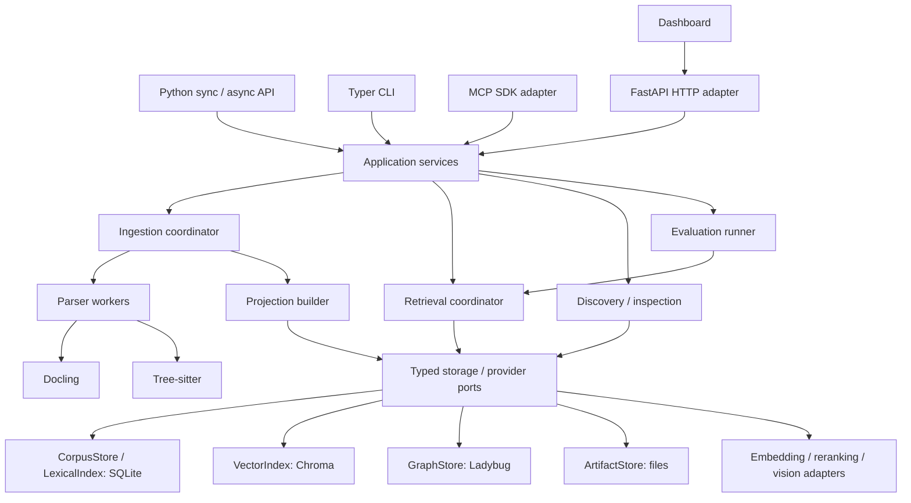

# Tychora — engineering design

Date: 2026-09-10
Status: engineering review draft; product direction accepted, application not implemented

This specification defines implementation contracts, storage boundaries and execution order. It supplements the [application design](2026-09-10-tychora-design.md) and [dashboard design](2026-09-10-tychora-dashboard-design.md). The [storage schema](2026-09-10-tychora-storage-schema.md) contains the SQLite DDL, vector records and graph model. The [pipeline algorithms](2026-09-10-tychora-pipeline-algorithms.md) define extraction, indexing, ranking and evaluation. The [Code retrieval profile](2026-09-10-tychora-code-retrieval-design.md) makes language adapters, structural context, code evaluation and cache benchmarks first-release contracts. Where an earlier product description leaves an implementation choice open, these engineering documents make the choice explicit.

## 1. Runtime topology and dependency direction



Domain objects contain source/evidence identity and policy, not framework clients. Application services coordinate use cases, not HTTP requests. Pipeline stages consume and return typed immutable records. Adapters contain backend syntax, SDK mapping and resource ownership. Dependency construction occurs only at an explicit client/workspace open, not at import time.

Proposed package layout:

```text
src/tychora/
  api.py                    # public Tychora / AsyncTychora clients
  contracts/                # request/result models, IDs, filter AST, error codes
  application/              # add, sync, query, inspect, maintain, evaluate
  ingestion/                # acquire, normalize, provenance, quality checks
  indexing/                 # batches, checkpoints, activation, cache keys
  retrieval/                # eligibility, channels, structural context, fusion, rerank, assemble
  ports/                    # storage, parsers, model providers, clock/events
  adapters/
    sqlite/                 # migrations, repositories, eligibility SQL, FTS
    chroma/                 # collections, eligible-ID search, receipts
    ladybug/                # generations, statements, graph validation
    files/                  # atomic artifact writes, manifests, recovery
    docling/                # structured extraction and normalization mapping
    code/                   # Git capture, language adapters, symbols and structural assertions
    voyage/                 # contextual text, multimodal, text reranking
    vision/                 # optional ingestion-only vision
  interfaces/cli.py
  interfaces/http/
  interfaces/mcp/
  evaluation/
  profiles/                 # generic declarative kinds and presets
```

One Python distribution exports the library and CLI. The recommended installation selects tested extras; base import/help remains lightweight. A future dashboard bundle has its own frontend build and calls HTTP, with no Node runtime required by library users.

## 2. Libraries and version policy

| Layer | Selected library | Why / boundary |
| --- | --- | --- |
| Packaging and environment | `uv`; Hatchling build backend | Reproducible lock, dependency groups, explicit wheel/sdist package allowlists |
| Formatting/lint/types | Ruff, `ty` | Independent lint, formatting and type checks in CI |
| Tests | pytest, pytest-asyncio, HTTPX test client | Unit, integration, async responsiveness and transport tests |
| Contracts | Pydantic 2 | Strict input validation, discriminated unions, serialization and JSON Schema |
| Configuration | `tomllib` + Pydantic | TOML is parsed by the standard library, semantic validation is shared |
| CLI | Typer + Rich | Positional commands, shell completion, human tables/help and progress |
| HTTP | FastAPI + Uvicorn + HTTPX | Versioned API, async client and service lifecycle; one worker per workspace owner |
| Async integration | AnyIO / standard executors | Bounded offload of blocking libraries, deadlines and cancellation boundaries |
| MCP | Official `mcp==2.2.0` Python SDK, `MCPServer` | SDK protocol lifecycle; no separately versioned third-party FastMCP dependency |
| SQLite | `sqlite3` | Explicit SQL, WAL, FTS5, transactions; no ORM or graph/vector scan layer |
| Vector database | `chromadb==1.5.9` initial candidate | Persistent embedded cosine HNSW; provider-supplied embeddings only |
| Graph database | `ladybug==0.20.3` initial candidate | Embedded property graph; gated by real installation/recovery checks |
| Documents | `docling` + its resolved `docling-core` | Retain structured document JSON, provenance and extracted assets |
| Markdown | `markdown-it-py` | Token structure and source line ranges; no regex-only interpretation of fenced code |
| Code | `tree-sitter`, `tree-sitter-python`, `tree-sitter-typescript`, `tree-sitter-javascript` | Explicit supported grammar wheels; no runtime grammar downloads |
| Source scanning | Git executable + `pathspec` | NUL-delimited Git file inventory and configurable excludes; never execute source code |
| Images | Pillow | Image validation, dimensions, normalized pixels and safe crop handling |
| Providers | `voyageai==0.5.0` initial candidate | Separate text, image and rerank ports; SDK capability checks |
| Optional vision | `anthropic` | Ingestion-only structured region interpretation; model explicitly configured |
| Files/locking | `platformdirs`, `filelock` | Protected runtime locations and workspace ownership; locks on supported local filesystems |
| Token accounting | provider tokenizer for provider limits; `tiktoken` for declared output-budget tokenizer | Record tokenizer identity; no unlabelled claim of exact tokens for every caller/model |

Candidate pins describe the first compatibility matrix to test, not a claim that an installation has run. Other packages are resolved and pinned together in `uv.lock` during implementation; we do not invent untested compatible patch versions. Support Python 3.12 first, SQLite >=3.38 with FTS5/JSON functions and local filesystems. Claim extra Python/OS versions only after binary installation and real adapter tests pass. Chroma's ID-filtering API is a required capability; Ladybug's wheel/platform and single-owner behavior are release gates.

Provider and parser model weights are separate from package versions. Persist model identifier, package version, normalization/chunker version, tokenizer and configuration hash in each build. Optional weights/extensions are acquired during explicit setup, never by `--help`, search fallback or implicit plugin loading.

Primary references: [uv](https://docs.astral.sh/uv/), [Typer](https://typer.tiangolo.com/), [Pydantic](https://docs.pydantic.dev/latest/), [MCP Python SDK](https://github.com/modelcontextprotocol/python-sdk), [selected SDK distribution](https://pypi.org/project/mcp/2.2.0/), [Chroma collection API](https://docs.trychroma.com/reference/python/collection), [Ladybug distributions](https://pypi.org/project/ladybug/), [Docling model](https://docling-project.github.io/docling/concepts/docling_document/), [Tree-sitter Python binding](https://github.com/tree-sitter/py-tree-sitter).

## 3. Identity: six things that must not be conflated

| Object | Identity and lifecycle |
| --- | --- |
| Source | A logical registered document or repository; stable workspace-relative source key |
| Revision | Original bytes/tree manifest, declared edition and immutable source metadata; never overwritten |
| Extraction | One revision processed with a particular parser/normalizer configuration |
| Evidence unit | Source paragraph/rule/row/figure/symbol with its exact structural locator |
| Search chunk | A retrieval window into one evidence unit, with canonical-text offsets |
| Published snapshot | The chosen revision/extraction membership plus completed projection receipts available to a query |

Use persisted UUIDs for workspaces/collections; source IDs are UUIDv5 of collection UUID and normalized registered source key. Other immutable IDs are SHA-256 of a canonical JSON tuple with a domain/version tag. Canonical JSON means UTF-8, sorted object keys, no insignificant whitespace, preserved array order and rejection of NaN/Infinity; text bytes are not Unicode-normalized for source hashing.

- `revision_id = H("revision-v1", source_id, original_sha, edition_key, immutable_metadata_sha)`.
- `extraction_id = H("extraction-v1", revision_id, parser_fingerprint, normalizer_fingerprint)`.
- `unit_id = H("unit-v1", extraction_id, native_ref, ordinal, text_sha)`.
- `chunk_id = H("chunk-v1", unit_id, char_start, char_end, chunker_fingerprint)`.
- `space_id = H("space-v1", modality, provider, model, dimensions, metric, representation_fingerprint)`.
- `vector_record_id = H("vector-v1", family_id, chunk_or_asset_id, exact_input_sha)`.

Changing an edition label can create a new revision even with unchanged bytes. Re-parsing unchanged originals creates a new extraction, preserving original revision identity. Absolute paths and embedding API keys never enter these identities. Source-path relocation changes a registration binding, not evidence IDs.

A repository is one Source. Its original artifact is a sorted file manifest: relative path, file mode, blob SHA and original artifact reference, plus recorded commit and dirty status. Revision artifacts retain every included file. Parse unchanged files from a cache keyed by blob/grammar/parser configuration; normalize their evidence under the new repository revision. This deliberately reuses expensive extraction/embedding computations while still writing revision-qualified units/index references. Initial projection writes can remain O(repository size); measure before claiming sublinear incremental indexing.

## 4. Storage views and atomic publication

The workspace has one canonical SQLite corpus file, one embedded Chroma directory, one Ladybug database and immutable artifact files. SQLite contains source records and projection manifests, not a copy of vector-search or graph-traversal implementations.

A vector/lexical **family** is a physical namespace with one immutable representation/configuration. A **batch** is a completed immutable set of entries for an extraction. New source revisions append entries to the same compatible family; changing a model/representation creates a different family. `snapshot_batches` binds the exact sealed batch receipts for every slot; queries search only those batches' eligible entry IDs. Unpublished or old entries in the physical family cannot enter retrieval. Shared FTS statistics can still change scores; record the lexical statistics epoch separately from membership identity.

Graph v1 deliberately uses a full immutable generation. Every graph node key includes generation ID; each new published content snapshot has a completed graph generation resolved against precisely its source membership. This costs O(V+E) copying/storage and avoids stale cross-revision symbol bindings. It reuses stored assertion/parse artifacts and does not repeat embeddings or model extraction. Keep active and previous generations, plus pinned ones; optimize graph deltas only after measurement.

```mermaid
sequenceDiagram
    participant C as Client
    participant O as Workspace owner
    participant A as Artifact store
    participant S as SQLite
    participant I as Index builders
    participant G as Graph store
    C->>O: add(source, idempotency_key)
    O->>S: Persist job and base snapshot ID
    O->>A: Atomic original / extraction / cache artifacts
    O->>S: Commit revision, units, chunks, pending batches
    O->>I: Build lexical and text/image entries
    I-->>O: Durable batch receipts
    O->>G: Build full graph generation from assertion artifacts
    G-->>O: Sealed generation receipt
    O->>S: Validate expected IDs, counts, hashes and membership
    O->>S: BEGIN IMMEDIATE; publish snapshot; COMMIT
    O-->>C: Job complete, snapshot ID, coverage
```

### Exact publication protocol

1. Acquire the workspace owner; create/reuse a job by idempotency key and record `base_snapshot_id`.
2. Write each artifact into a private staging path, flush/fsync, atomically rename to its hash-derived final path, fsync the containing directory, then add its SQLite reference. Never commit a reference to a not-yet-durable file.
3. Commit revision/extraction objects and source-local batch manifests as one SQLite transaction. No external API or parser runs inside a SQLite write transaction.
4. Build projections under non-active family/batch/generation IDs. Batch completion requires entry-ID digest, entry count, dimension/config validation and a backend durability receipt. A retry of the same immutable ID with different content is an integrity error.
5. Seal graph generation after validating endpoints, required evidence dependencies and counts. No sealed generation accepts further writes.
6. In one SQLite `BEGIN IMMEDIATE` transaction, compare current active snapshot with `base_snapshot_id`, create the new snapshot membership/slot/batch bindings, verify all required receipts (including one full generation for a graph slot) and switch `active_snapshot_id`. Serialized source jobs use the latest committed membership; a changed base requires rebase/revalidation, not blind overwrite.
7. Publish the completion event after commit. A query holds a lease on its snapshot/index generations until every associated worker/backend operation has actually exited. A client deadline or cancellation ends delivery, not the resource lease; release it in final cleanup after blocking work drains. Leases are in the sole owner process; parser child processes never open databases, and owner death cannot leave child database readers behind.
8. Revalidate current withdrawal/access-policy epoch before returning or sending a provider request. If policy changed, discard affected work and retry the eligibility phase once; a second change returns a retryable scope-changed error.

Snapshot pinning preserves corpus consistency; it does not grant perpetual access to subsequently withdrawn content. Once a provider request has been sent it cannot be recalled; checks occur before dispatch and delivery.

### Failure and recovery matrix

| Crash/failure point | What remains usable | Recovery |
| --- | --- | --- |
| Artifact write before SQLite commit | Previous snapshot | Remove unreferenced staging files after a grace period |
| Parser/normalizer failure | Originals and previous snapshot | Retry extraction without reacquiring unchanged bytes |
| Embedding failure halfway | Prior snapshot and completed cached batches | Resume only failed/missing groups; no old-vector deletion |
| Index committed but receipt absent | Prior snapshot | Reconcile IDs/hashes with intended manifest; record receipt or rebuild |
| Graph sealed before publication | Prior snapshot | Reuse matching sealed generation or GC if job abandoned |
| Publication committed before completion event | New snapshot | Reconcile job against snapshot receipt, append missing completion event |
| Missing/corrupt index after restart | Canonical evidence/exact inspection | Mark family unavailable; explicit degraded search or strict failure, rebuild from artifacts |
| Cancellation | Last active snapshot | Finish/rollback current bounded transaction; stop before next stage |

Startup verifies SQLite integrity/version, active manifests, backend namespaces and expected entries. Large hash/vector audits run as health jobs; activation verifies each newly written batch. A receipt is evidence of a completed write, not a substitute for handling later corruption.

## 5. Public API and replaceable ports

Public contract sketch (interface specification, not implemented code):

```python
with Tychora.open("./knowledge", scope=scope) as kb:
    kinds = kb.discover(DiscoverRequest(subject="kinds"))
    job = kb.sources.add(SourceInput(path="./manual.pdf", kind="manual"))
    kb.jobs.wait(job.id)
    result = kb.search(QueryRequest(question="How is verification recorded?", limit=8))
    exact = kb.evidence.get(result.segments[0].matched_unit_ids[0])

async with AsyncTychora.open("./knowledge", scope=scope) as kb:
    result = await kb.search(request)
```

`SourceInput` is a discriminated union: local file/folder/repository, in-memory text or bytes with metadata, or an explicitly enabled URL-acquisition adapter. QueryRequest is a discriminated question/passage/image input plus typed filters and budgets. `FilterExpr` supports registered-field `eq`, `in`, ordered range, `and`/`or`; unknown fields/operators fail. Registry filter scopes distinguish candidate selectors from all-unit constraints; mixed-scope OR expressions fail validation. Code context/support still obeys source/date/access/review and source-range restrictions. RequestScope is immutable and can only narrow the client's granted collections, access ceiling, uses and provider-upload permissions.

Both clients return the same immutable Pydantic DTOs, never private database handles. They expose no process exit, printing, CLI parsing or global logging side effects. Sync calls use the owner directly; async calls use native async providers and bounded offload for blocking libraries. A synchronous call made inside an async event loop is documented as blocking; use AsyncTychora there. No wrapper nests `asyncio.run` within an existing loop.

| Port | Required operations and semantics |
| --- | --- |
| CorpusStore | `commit_extraction`, `resolve_snapshot`, `compile_eligibility`, `hydrate`, `publish_snapshot`, `withdraw`, `record_review`, `record_assertion_decision`, `append_job_event` |
| LexicalIndex | `write_batch`, `search(eligible_chunks_and_owners, query, candidate_limit)`, `verify_batch`, `drop_batch` |
| VectorIndex | `create_family`, `upsert_batch`, `search(query_vector, eligible_records_and_owners, candidate_limit, work_limits)`, `verify_batch`, `drop_records` |
| GraphStore | `begin_generation`, `upsert_batch`, `seal_generation`, `expand(view, seed_unit_ids, limits)`, `structural_context(view, seed_unit_ids, limits)`, `get_assertions`, `drop_generation` |
| ArtifactStore | `put_stream`, `open_verified`, `stat`, `collect_unreferenced`; all access by registered hash/ref |
| Parser | `extract(original_ref, config) -> ExtractionArtifact`; progress and diagnostics, no database writes |
| LanguageAdapter | `capabilities`, `parse`, `definitions`, `references`, `resolve`, `context_spans`; code-specific typed ingestion contract |
| TextEmbedder | `embed_groups(groups)`, `embed_queries(queries)`, `capabilities` including declared joint/independent contextualization |
| VisualEmbedder | `embed_assets(items)`, `embed_query(text_or_image)`, `capabilities` |
| Reranker | `rank(query, representations) -> indexed_scores`; never invent result IDs |
| VisionProvider | `interpret(region, task_schema) -> DerivedObservation`; ingestion-only |

Ports carry deadline/cancellation context and return typed receipts or errors. Backends that cannot enforce required eligibility before bounded candidate selection are rejected for that operation; increasing an unfiltered top-k and filtering afterward is not equivalent.

An Agno adapter converts QueryResult segments into the framework's document objects and retains unit/revision IDs, locators, roles, asset references and run ID. Framework `limit` counts segments, not hidden neighbour nodes. It uses discover/search/inspect through public clients; it neither reembeds nor reaches into stores. Pin the framework version when implementing its knowledge interface. [Agno's current protocol](https://github.com/agno-agi/agno/blob/main/libs/agno/agno/knowledge/protocol.py) is an integration reference, not a core dependency.

## 6. Process ownership and concurrent clients

One owner holds SQLite write access, the Chroma persistent client and one Ladybug read/write Database object with shared connections. Parsing runs in at most two worker processes initially; all writes use bounded owner queues. External embedding/rerank concurrency starts at two requests/provider and respects configured rate limits. Do not configure multiple Uvicorn workers over one embedded workspace.

```mermaid
sequenceDiagram
    participant P as Python or CLI client
    participant L as Workspace lock/runtime file
    participant O as Existing owner
    participant S as Application service
    P->>L: Try owner lock; read protected endpoint if busy
    alt Owner available
        P->>S: Open embedded resources for client lifetime
        S-->>P: Local typed client
    else Verified service already owns workspace
        P->>O: Authenticated identity/version handshake
        O-->>P: Workspace UUID and protocol capabilities
        P->>O: Versioned request
        O->>S: Same application operation
        S-->>O: Typed result
        O-->>P: Serialized result
    else Busy standalone command or stale/untrusted endpoint
        L-->>P: Busy error with retry guidance
    end
```

`serve` hosts HTTP and MCP Streamable HTTP on loopback. Stdio mode reserves stdout for MCP and exposes a protected local control endpoint for sibling clients. Tokens remain in protected runtime files/environment, never corpora, URLs, public config exports or logs. Default principals are scoped; management/ingestion capabilities are not implied by read access. Authentication and origin checks precede request dispatch.

For the selected MCP SDK, construct `MCPServer.streamable_http_app()` once, mount it at `/mcp`, and explicitly enter its `session_manager.run()` in the host FastAPI lifespan alongside workspace resources. Mounted ASGI applications do not own the host lifespan. Shutdown unwinds sessions, jobs and storage in that order; test startup/restart and client reconnect against the pinned SDK. [SDK ASGI integration](https://py.sdk.modelcontextprotocol.io/run/asgi).

Run tasks are bounded and cooperative: cancellation stops new provider calls/workers and checks between batches. A blocking library operation that cannot be interrupted is allowed to finish its transaction; it cannot publish a cancelled job. Owner shutdown drains bounded work, releases handles and then releases the lock. Abrupt shutdown is covered by the recovery protocol above.

The owner retains bounded query-embedding and result caches as separate resources. The code-profile cache contract defines keys, TTL, purge and four benchmark states; it applies to every modality/profile using those shared caches. A result-cache hit revalidates policy and creates a fresh run ID. Code symbol records persist exact context spans, and extraction/index manifests retain overlapping-range and joint-group dependencies so parent representations cannot bypass child restrictions.

## 7. Errors, events and HTTP contracts

Error envelope: `schema_version`, `code`, `message`, `retryable`, `run_or_job_id`, and permitted diagnostic references. Error codes include `INVALID_REQUEST`, `FORBIDDEN_SCOPE`, `NOT_FOUND`, `WORKSPACE_BUSY`, `CAPABILITY_MISSING`, `INDEX_INCOMPLETE`, `PROVIDER_FAILURE`, `INTEGRITY_ERROR`, `CANCELLED`, `DEADLINE_EXCEEDED`, `SCOPE_CHANGED`. CLI maps invalid input to exit 2, operational failures to 1, success to 0, cancellation to 130; JSON error output is on stderr.

HTTP uses `/v1/discovery`, `/v1/sources`, `/v1/evidence`, `/v1/assets`, `/v1/relations`, `/v1/queries`, `/v1/jobs`, `/v1/evaluations`, `/v1/settings`. Search is `POST /v1/queries`; ingestion is `POST /v1/sources` returning 202 with a job ID; status/cancel/retry are job resources/actions. Exact reads take registered IDs, not arbitrary paths. Read and write methods require separate capabilities. Semantic errors map consistently to 400/403/404/409/503/504; internal SDK messages are sanitized.

Events contain `schema_version`, monotonically increasing per-job `sequence`, timestamp, job ID, stage, state, counters and diagnostic refs. SSE resumes after Last-Event-ID; database state is authoritative if old events have expired. A disconnected browser does not cancel a job. GET endpoints are bounded and cursor-paginated. Requests that retry writes supply an idempotency key scoped to workspace/principal/operation.

Operational query history defaults to IDs, counts, timing and configuration fingerprints for 30 days. Full request text/results live only in explicitly enabled retention-controlled artifacts, not mandatory `query_runs` columns. An evidence hash is not a privacy-preserving anonymizer and is not exposed as a substitute for deleted text. Source provenance survives query-history deletion.

## 8. Tests that make this architecture falsifiable

- Load and enforce the schema/foreign keys; duplicate immutable IDs with different hashes fail.
- Publish while a query is running: old query keeps its snapshot, next query sees new entries; neither sees a mixture.
- Withdraw evidence during a query: provider dispatch/delivery revalidation rejects the old authorization view.
- Force a process crash at every row in the failure matrix and confirm recoverability without reembedding completed groups.
- Check real graph queries with hidden intermediate/support evidence, immediate assertion rejection, cross-revision symbols, distinct-target pagination and graph GC leases surviving cancelled blocking calls.
- Verify Chroma within-ID search against exhaustive scoring on a small synthetic corpus; include one long unit owning hundreds of windows, bounded adaptive fetching and explicit truncation. Compare ANN recall separately on real embeddings.
- Confirm graph-only and image-only matches survive their reserved admission slots, and excerpt selection retains a match near the end of a long unit.
- Append unpublished FTS rows while retaining a snapshot: membership stays fixed, statistics epoch changes, and ranking caches invalidate.
- Open clients through sync Python, async Python, CLI, MCP and HTTP and compare typed results/policy behavior.
- Ensure event-loop responsiveness with two concurrent queries while a blocking parser runs; verify deadlines and queue bounds.
- Pass the language, symbol-collision, structural-context, resolution-diagnostic and cold/warm/cache acceptance cases in the code profile.
- Install from built wheel in a fresh supported environment; help/import perform no network or state creation.

The storage DDL can be syntax/integrity-checked independently as a design artifact. Graph/backend runtime qualification, provider live checks and retrieval-quality measurements are implementation acceptance tasks; this document does not claim those tests have passed.
