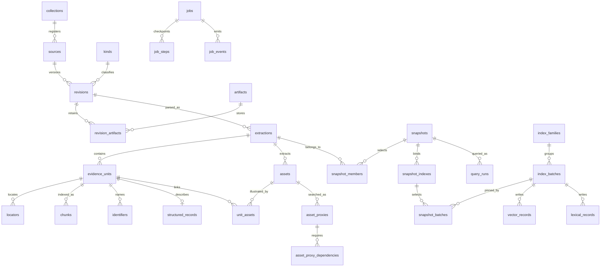

# Tychora — storage schema and invariants

Date: 2026-09-10
Status: engineering review draft
Parent: [Engineering design](2026-09-10-tychora-engineering-design.md)
Registry/format compatibility contract: [Configuration](2026-09-10-tychora-configuration-design.md)
Code record and structural-query contract: [Code retrieval profile](2026-09-10-tychora-code-retrieval-design.md)

## 1. Physical layout and ownership

```text
knowledge/
  tychora.toml
  .tychora/
    corpus.sqlite3                 # source records, FTS, manifests, jobs/history
    vectors/                       # Chroma-owned files; never edited directly
    graph/knowledge.lbdb           # Ladybug-owned files; one owner
    artifacts/sha256/ab/cd/<hash>   # original, extraction, assertion, vector-cache bytes
    staging/<job-id>/               # incomplete writes; not queryable
    runtime/owner.json              # protected endpoint/UUID, no corpus contents
    runtime/owner.lock
```

Artifact filenames are content hashes, not inferred source filenames. MIME type, original locator and artifact role are in SQLite. Writes use temporary file + fsync + atomic rename before referencing the final artifact in a transaction. Verify a file's SHA-256 when it enters the store and when a registered original is opened for indexing; scheduled full integrity scans catch later corruption. Do not follow symlinks out of the artifact root.

SQLite is canonical for source identity, normalized evidence, mutable access/withdrawal state, publication manifests and operational records. Original extraction/assertion artifacts allow rebuilding derived graph/vector/lexical representations. Graph edges are not traversed in SQLite; vectors are not scored there. A cached embedding is an optional immutable binary artifact, not an alternative vector database.

## 2. Relational model



### Tables and reasons they exist

| Family | Tables | Important distinction |
| --- | --- | --- |
| Workspace/config | `schema_migrations`, `workspaces`, `collections`, `kinds` | Migration version differs from source and model version |
| Originals | `sources`, `revisions`, `artifacts`, `revision_artifacts` | Logical source differs from immutable edition/tree snapshot |
| Extraction | `extractions`, `evidence_units`, `locators`, `assets`, `unit_assets`, `asset_proxies`, `asset_proxy_dependencies` | A parser upgrade must not overwrite an old cited extraction |
| Structured semantics | `structured_records`, `identifiers`, `facet_definitions`, `facet_values`, `review_events`, `assertion_decisions` | Rules/feedback stay typed; exact identifiers are not semantic matches |
| Search | `chunks`, `index_families`, `index_batches`, `vector_records`, `lexical_records`, `lexical_fts` | Index windows and cache representations are not the quoted source |
| Publication | `snapshots`, `snapshot_members`, `snapshot_indexes`, `snapshot_batches` | Completed per-source work is invisible until a snapshot publishes it |
| Operations | `jobs`, `job_steps`, `job_events`, `query_runs` | Job state, event stream and query retention have distinct lifecycles |
| Evaluation | `evaluation_datasets`, `evaluation_cases`, `evaluation_runs`, `evaluation_results` | Gold labels, execution settings and outcomes must be independently versioned |

`structured_records` stores one versioned schema-validated record associated with an evidence unit, with `record_type` equal to `rule`, `feedback`, `template_slot`, `code_symbol` or another registered type. This retains a generic core without creating a different physical database for every document kind. Required queryable fields have typed facets; arbitrary JSON is not automatically searchable or a source of SQL expressions.

A rule record requires identifier and requirement, with optional proof/control/foundation identifiers and declared status. Feedback requires literal annotation, target locator or quote, observation/action, author provenance and status; unknown values are explicit nulls. A generated interpretation is a separate derived record, never a rewrite of the literal annotation. These schemas belong to the kind registry and are versioned by digest.

## 3. SQLite DDL contract

The following is an executable schema sketch for design validation, not an installed application migration. It includes the reference/uniqueness constraints that implementations must preserve. SQL adapters use prepared parameters; no source text supplies identifiers or clauses. Immutable rows are append-only through repository methods; published data is removed only by explicit retention/GC transactions. `STRICT` tables and JSON checks require the declared SQLite feature baseline.

```sql
PRAGMA foreign_keys = ON;

CREATE TABLE schema_migrations (
  version INTEGER PRIMARY KEY,
  checksum TEXT NOT NULL,
  applied_at TEXT NOT NULL
) STRICT;

CREATE TABLE workspaces (
  workspace_id TEXT PRIMARY KEY,
  schema_version INTEGER NOT NULL,
  active_snapshot_id TEXT REFERENCES snapshots(snapshot_id),
  policy_epoch INTEGER NOT NULL DEFAULT 0,
  lexical_statistics_epoch INTEGER NOT NULL DEFAULT 0,
  created_at TEXT NOT NULL
) STRICT;

CREATE TABLE collections (
  collection_id TEXT PRIMARY KEY,
  workspace_id TEXT NOT NULL REFERENCES workspaces(workspace_id),
  slug TEXT NOT NULL,
  title TEXT NOT NULL,
  access_floor INTEGER NOT NULL DEFAULT 0 CHECK(access_floor BETWEEN 0 AND 3),
  policy_json TEXT NOT NULL CHECK(json_valid(policy_json)),
  UNIQUE(workspace_id, slug)
) STRICT;

CREATE TABLE kinds (
  kind_id TEXT PRIMARY KEY,
  definition_hash TEXT NOT NULL,
  label TEXT NOT NULL,
  description TEXT NOT NULL,
  role TEXT NOT NULL,
  definition_json TEXT NOT NULL CHECK(json_valid(definition_json))
) STRICT;

CREATE TABLE sources (
  source_id TEXT PRIMARY KEY,
  collection_id TEXT NOT NULL REFERENCES collections(collection_id),
  source_key TEXT NOT NULL,
  source_type TEXT NOT NULL CHECK(source_type IN ('document','repository')),
  registration_json TEXT NOT NULL CHECK(json_valid(registration_json)),
  access_floor INTEGER NOT NULL CHECK(access_floor BETWEEN 0 AND 3),
  withdrawn_at TEXT,
  created_at TEXT NOT NULL,
  UNIQUE(collection_id, source_key)
) STRICT;

CREATE TABLE artifacts (
  artifact_sha TEXT PRIMARY KEY CHECK(length(artifact_sha)=64),
  size_bytes INTEGER NOT NULL CHECK(size_bytes>=0),
  media_type TEXT NOT NULL,
  storage_key TEXT NOT NULL UNIQUE,
  created_at TEXT NOT NULL
) STRICT;

CREATE TABLE revisions (
  revision_id TEXT PRIMARY KEY,
  source_id TEXT NOT NULL REFERENCES sources(source_id),
  kind_id TEXT NOT NULL REFERENCES kinds(kind_id),
  original_sha TEXT NOT NULL REFERENCES artifacts(artifact_sha),
  edition_key TEXT NOT NULL,
  metadata_sha TEXT NOT NULL,
  title TEXT NOT NULL,
  published_on TEXT,
  effective_from TEXT,
  effective_until TEXT,
  access_rank INTEGER NOT NULL CHECK(access_rank BETWEEN 0 AND 3),
  declared_review_state TEXT NOT NULL,
  allowed_uses_json TEXT NOT NULL CHECK(json_valid(allowed_uses_json)),
  metadata_json TEXT NOT NULL CHECK(json_valid(metadata_json)),
  captured_at TEXT NOT NULL,
  CHECK(effective_from IS NULL OR effective_until IS NULL OR effective_from<effective_until),
  UNIQUE(source_id, original_sha, edition_key, metadata_sha),
  UNIQUE(revision_id, source_id)
) STRICT;

CREATE TABLE revision_artifacts (
  revision_id TEXT NOT NULL REFERENCES revisions(revision_id),
  role TEXT NOT NULL,
  source_ref TEXT NOT NULL,
  artifact_sha TEXT NOT NULL REFERENCES artifacts(artifact_sha),
  PRIMARY KEY(revision_id, role, source_ref)
) STRICT;

CREATE TABLE extractions (
  extraction_id TEXT PRIMARY KEY,
  revision_id TEXT NOT NULL REFERENCES revisions(revision_id),
  parser_fingerprint TEXT NOT NULL,
  normalizer_fingerprint TEXT NOT NULL,
  document_artifact_sha TEXT NOT NULL REFERENCES artifacts(artifact_sha),
  assertions_artifact_sha TEXT REFERENCES artifacts(artifact_sha),
  diagnostics_artifact_sha TEXT REFERENCES artifacts(artifact_sha),
  created_at TEXT NOT NULL,
  UNIQUE(revision_id, parser_fingerprint, normalizer_fingerprint),
  UNIQUE(extraction_id, revision_id)
) STRICT;

CREATE TABLE evidence_units (
  unit_id TEXT PRIMARY KEY,
  extraction_id TEXT NOT NULL REFERENCES extractions(extraction_id),
  parent_id TEXT,
  ordinal INTEGER NOT NULL CHECK(ordinal>=0),
  unit_type TEXT NOT NULL,
  native_ref TEXT NOT NULL,
  boundary_key TEXT NOT NULL,
  heading_path_json TEXT NOT NULL CHECK(json_valid(heading_path_json)),
  text TEXT NOT NULL,
  text_sha TEXT NOT NULL,
  text_origin TEXT NOT NULL CHECK(text_origin IN ('source','ocr','derived')),
  citable INTEGER NOT NULL CHECK(citable IN (0,1)),
  declared_review_state TEXT NOT NULL,
  attributes_json TEXT NOT NULL CHECK(json_valid(attributes_json)),
  UNIQUE(extraction_id, ordinal),
  UNIQUE(unit_id, extraction_id),
  FOREIGN KEY(parent_id, extraction_id)
    REFERENCES evidence_units(unit_id, extraction_id) DEFERRABLE INITIALLY DEFERRED
) STRICT;

CREATE TABLE locators (
  locator_id TEXT PRIMARY KEY,
  unit_id TEXT NOT NULL REFERENCES evidence_units(unit_id),
  fragment_ordinal INTEGER NOT NULL,
  locator_type TEXT NOT NULL CHECK(locator_type IN ('document','code','text','image')),
  artifact_sha TEXT NOT NULL REFERENCES artifacts(artifact_sha),
  source_ref TEXT NOT NULL,
  physical_page INTEGER CHECK(physical_page IS NULL OR physical_page>=1),
  page_label TEXT,
  line_start INTEGER,
  line_end INTEGER,
  byte_start INTEGER,
  byte_end INTEGER,
  geometry_json TEXT CHECK(geometry_json IS NULL OR json_valid(geometry_json)),
  details_json TEXT NOT NULL CHECK(json_valid(details_json)),
  UNIQUE(unit_id, fragment_ordinal)
) STRICT;

CREATE TABLE assets (
  asset_id TEXT PRIMARY KEY,
  extraction_id TEXT NOT NULL REFERENCES extractions(extraction_id),
  artifact_sha TEXT NOT NULL REFERENCES artifacts(artifact_sha),
  asset_type TEXT NOT NULL,
  native_ref TEXT NOT NULL,
  locator_json TEXT NOT NULL CHECK(json_valid(locator_json)),
  caption TEXT NOT NULL DEFAULT '',
  declared_review_state TEXT NOT NULL,
  UNIQUE(extraction_id, native_ref, artifact_sha)
) STRICT;

CREATE TABLE unit_assets (
  unit_id TEXT NOT NULL REFERENCES evidence_units(unit_id),
  asset_id TEXT NOT NULL REFERENCES assets(asset_id),
  role TEXT NOT NULL,
  PRIMARY KEY(unit_id, asset_id, role)
) STRICT;

CREATE TABLE asset_proxies (
  proxy_unit_id TEXT PRIMARY KEY REFERENCES evidence_units(unit_id),
  asset_id TEXT NOT NULL REFERENCES assets(asset_id),
  origin_type TEXT NOT NULL CHECK(origin_type IN ('caption_copy','ocr','description','structured_values')),
  derivation_sha TEXT NOT NULL REFERENCES artifacts(artifact_sha)
) STRICT;

CREATE TABLE asset_proxy_dependencies (
  proxy_unit_id TEXT NOT NULL REFERENCES asset_proxies(proxy_unit_id),
  required_unit_id TEXT NOT NULL REFERENCES evidence_units(unit_id),
  PRIMARY KEY(proxy_unit_id,required_unit_id),
  CHECK(proxy_unit_id<>required_unit_id)
) STRICT;

CREATE TABLE structured_records (
  unit_id TEXT PRIMARY KEY REFERENCES evidence_units(unit_id),
  record_type TEXT NOT NULL,
  schema_hash TEXT NOT NULL,
  data_json TEXT NOT NULL CHECK(json_valid(data_json))
) STRICT;

CREATE TABLE chunks (
  chunk_id TEXT PRIMARY KEY,
  unit_id TEXT NOT NULL,
  extraction_id TEXT NOT NULL,
  ordinal_in_unit INTEGER NOT NULL,
  char_start INTEGER NOT NULL CHECK(char_start>=0),
  char_end INTEGER NOT NULL CHECK(char_end>char_start),
  context_group_key TEXT NOT NULL,
  chunker_fingerprint TEXT NOT NULL,
  token_count INTEGER NOT NULL CHECK(token_count>0),
  UNIQUE(unit_id, ordinal_in_unit, chunker_fingerprint),
  FOREIGN KEY(unit_id, extraction_id) REFERENCES evidence_units(unit_id, extraction_id)
) STRICT;

CREATE TABLE identifiers (
  namespace TEXT NOT NULL,
  normalized_value TEXT NOT NULL,
  original_value TEXT NOT NULL,
  unit_id TEXT NOT NULL REFERENCES evidence_units(unit_id),
  PRIMARY KEY(namespace, normalized_value, unit_id)
) STRICT;

CREATE TABLE facet_definitions (
  facet_key TEXT PRIMARY KEY,
  value_type TEXT NOT NULL CHECK(value_type IN ('text','number','boolean','date')),
  operators_json TEXT NOT NULL CHECK(json_valid(operators_json)),
  filter_scope TEXT NOT NULL DEFAULT 'all_units'
    CHECK(filter_scope IN ('all_units','matched_candidates')),
  definition_hash TEXT NOT NULL
) STRICT;

CREATE TABLE facet_values (
  id INTEGER PRIMARY KEY,
  revision_id TEXT REFERENCES revisions(revision_id),
  unit_id TEXT REFERENCES evidence_units(unit_id),
  facet_key TEXT NOT NULL REFERENCES facet_definitions(facet_key),
  ordinal INTEGER NOT NULL DEFAULT 0,
  text_value TEXT,
  number_value REAL,
  boolean_value INTEGER CHECK(boolean_value IS NULL OR boolean_value IN (0,1)),
  CHECK((revision_id IS NOT NULL)+(unit_id IS NOT NULL)=1),
  CHECK((text_value IS NOT NULL)+(number_value IS NOT NULL)+(boolean_value IS NOT NULL)=1)
) STRICT;
CREATE UNIQUE INDEX facets_revision_unique ON facet_values(revision_id,facet_key,ordinal)
  WHERE revision_id IS NOT NULL;
CREATE UNIQUE INDEX facets_unit_unique ON facet_values(unit_id,facet_key,ordinal)
  WHERE unit_id IS NOT NULL;
CREATE INDEX facets_text ON facet_values(facet_key,text_value);
CREATE INDEX facets_number ON facet_values(facet_key,number_value);

CREATE TABLE review_events (
  review_event_id INTEGER PRIMARY KEY,
  revision_id TEXT REFERENCES revisions(revision_id),
  unit_id TEXT REFERENCES evidence_units(unit_id),
  asset_id TEXT REFERENCES assets(asset_id),
  state TEXT NOT NULL CHECK(state IN ('unreviewed','needs_review','accepted','rejected')),
  actor_id TEXT NOT NULL,
  reason_artifact_sha TEXT REFERENCES artifacts(artifact_sha),
  created_at TEXT NOT NULL,
  CHECK((revision_id IS NOT NULL)+(unit_id IS NOT NULL)+(asset_id IS NOT NULL)=1)
) STRICT;
CREATE INDEX review_revision_latest ON review_events(revision_id,review_event_id DESC);
CREATE INDEX review_unit_latest ON review_events(unit_id,review_event_id DESC);
CREATE INDEX review_asset_latest ON review_events(asset_id,review_event_id DESC);

CREATE TABLE assertion_decisions (
  decision_id INTEGER PRIMARY KEY,
  assertion_id TEXT NOT NULL,
  provenance_artifact_sha TEXT NOT NULL REFERENCES artifacts(artifact_sha),
  provenance_record_id TEXT NOT NULL,
  state TEXT NOT NULL CHECK(state IN ('recorded','proposed','confirmed','rejected')),
  actor_id TEXT NOT NULL,
  reason_artifact_sha TEXT REFERENCES artifacts(artifact_sha),
  created_at TEXT NOT NULL
) STRICT;
CREATE INDEX assertion_decisions_latest ON assertion_decisions(assertion_id,decision_id DESC);

CREATE TABLE index_families (
  family_id TEXT PRIMARY KEY,
  channel TEXT NOT NULL CHECK(channel IN ('lexical','text','image','graph')),
  backend TEXT NOT NULL,
  provider TEXT,
  model TEXT,
  dimension INTEGER CHECK(dimension IS NULL OR dimension>0),
  config_sha TEXT NOT NULL,
  config_json TEXT NOT NULL CHECK(json_valid(config_json)),
  backend_namespace TEXT NOT NULL,
  created_at TEXT NOT NULL
) STRICT;

CREATE TABLE index_batches (
  batch_id TEXT PRIMARY KEY,
  family_id TEXT NOT NULL REFERENCES index_families(family_id),
  extraction_id TEXT REFERENCES extractions(extraction_id),
  input_manifest_sha TEXT NOT NULL REFERENCES artifacts(artifact_sha),
  expected_count INTEGER NOT NULL CHECK(expected_count>=0),
  actual_count INTEGER CHECK(actual_count IS NULL OR actual_count>=0),
  entry_ids_sha TEXT,
  state TEXT NOT NULL CHECK(state IN ('pending','building','ready','failed','removed')),
  receipt_json TEXT CHECK(receipt_json IS NULL OR json_valid(receipt_json)),
  UNIQUE(batch_id,family_id),
  UNIQUE(family_id,extraction_id)
) STRICT;

CREATE TABLE vector_records (
  record_id TEXT PRIMARY KEY,
  batch_id TEXT NOT NULL REFERENCES index_batches(batch_id),
  chunk_id TEXT REFERENCES chunks(chunk_id),
  asset_id TEXT REFERENCES assets(asset_id),
  input_sha TEXT NOT NULL,
  embedding_cache_sha TEXT REFERENCES artifacts(artifact_sha),
  CHECK((chunk_id IS NOT NULL)+(asset_id IS NOT NULL)=1),
  UNIQUE(batch_id,chunk_id),
  UNIQUE(batch_id,asset_id)
) STRICT;

CREATE TABLE lexical_records (
  rowid INTEGER PRIMARY KEY,
  batch_id TEXT NOT NULL REFERENCES index_batches(batch_id),
  chunk_id TEXT NOT NULL REFERENCES chunks(chunk_id),
  identifiers TEXT NOT NULL,
  title TEXT NOT NULL,
  headings TEXT NOT NULL,
  body TEXT NOT NULL,
  context TEXT NOT NULL,
  UNIQUE(batch_id,chunk_id)
) STRICT;
CREATE VIRTUAL TABLE lexical_fts USING fts5(
  identifiers,title,headings,body,context,
  content='lexical_records',content_rowid='rowid',
  tokenize='unicode61 remove_diacritics 2'
);
CREATE TRIGGER lexical_insert AFTER INSERT ON lexical_records BEGIN
  INSERT INTO lexical_fts(rowid,identifiers,title,headings,body,context)
  VALUES(new.rowid,new.identifiers,new.title,new.headings,new.body,new.context);
  UPDATE workspaces SET lexical_statistics_epoch=lexical_statistics_epoch+1;
END;
CREATE TRIGGER lexical_delete AFTER DELETE ON lexical_records BEGIN
  INSERT INTO lexical_fts(lexical_fts,rowid,identifiers,title,headings,body,context)
  VALUES('delete',old.rowid,old.identifiers,old.title,old.headings,old.body,old.context);
  UPDATE workspaces SET lexical_statistics_epoch=lexical_statistics_epoch+1;
END;
CREATE TRIGGER lexical_no_update BEFORE UPDATE ON lexical_records BEGIN
  SELECT RAISE(ABORT,'lexical records are immutable; replace the batch');
END;

CREATE TABLE snapshots (
  snapshot_id TEXT PRIMARY KEY,
  workspace_id TEXT NOT NULL REFERENCES workspaces(workspace_id),
  parent_snapshot_id TEXT REFERENCES snapshots(snapshot_id),
  membership_sha TEXT NOT NULL,
  config_sha TEXT NOT NULL,
  manifest_sha TEXT NOT NULL REFERENCES artifacts(artifact_sha),
  published_at TEXT NOT NULL
) STRICT;

CREATE TABLE snapshot_members (
  snapshot_id TEXT NOT NULL REFERENCES snapshots(snapshot_id),
  source_id TEXT NOT NULL,
  revision_id TEXT NOT NULL,
  extraction_id TEXT NOT NULL,
  is_default INTEGER NOT NULL CHECK(is_default IN (0,1)),
  PRIMARY KEY(snapshot_id,revision_id),
  FOREIGN KEY(revision_id,source_id) REFERENCES revisions(revision_id,source_id),
  FOREIGN KEY(extraction_id,revision_id) REFERENCES extractions(extraction_id,revision_id)
) STRICT;
CREATE UNIQUE INDEX snapshot_default_source ON snapshot_members(snapshot_id,source_id)
  WHERE is_default=1;

CREATE TABLE snapshot_indexes (
  snapshot_id TEXT NOT NULL REFERENCES snapshots(snapshot_id),
  slot TEXT NOT NULL,
  family_id TEXT NOT NULL REFERENCES index_families(family_id),
  required INTEGER NOT NULL CHECK(required IN (0,1)),
  PRIMARY KEY(snapshot_id,slot),
  UNIQUE(snapshot_id,slot,family_id)
) STRICT;

CREATE TABLE snapshot_batches (
  snapshot_id TEXT NOT NULL,
  slot TEXT NOT NULL,
  family_id TEXT NOT NULL,
  batch_id TEXT NOT NULL,
  PRIMARY KEY(snapshot_id,slot,batch_id),
  FOREIGN KEY(snapshot_id,slot,family_id) REFERENCES snapshot_indexes(snapshot_id,slot,family_id),
  FOREIGN KEY(batch_id,family_id) REFERENCES index_batches(batch_id,family_id)
) STRICT;

CREATE TABLE jobs (
  job_id TEXT PRIMARY KEY,
  operation TEXT NOT NULL,
  principal_id TEXT NOT NULL,
  idempotency_key TEXT,
  state TEXT NOT NULL CHECK(state IN ('queued','running','cancelling','cancelled','failed','complete')),
  base_snapshot_id TEXT REFERENCES snapshots(snapshot_id),
  result_snapshot_id TEXT REFERENCES snapshots(snapshot_id),
  request_artifact_sha TEXT REFERENCES artifacts(artifact_sha),
  created_at TEXT NOT NULL,
  updated_at TEXT NOT NULL,
  error_code TEXT,
  UNIQUE(principal_id,operation,idempotency_key)
) STRICT;

CREATE TABLE job_steps (
  job_id TEXT NOT NULL REFERENCES jobs(job_id),
  step_key TEXT NOT NULL,
  input_sha TEXT NOT NULL,
  state TEXT NOT NULL,
  output_artifact_sha TEXT REFERENCES artifacts(artifact_sha),
  completed_count INTEGER NOT NULL DEFAULT 0,
  total_count INTEGER,
  attempt INTEGER NOT NULL DEFAULT 0,
  PRIMARY KEY(job_id,step_key)
) STRICT;

CREATE TABLE job_events (
  job_id TEXT NOT NULL REFERENCES jobs(job_id),
  sequence INTEGER NOT NULL,
  event_type TEXT NOT NULL,
  payload_json TEXT NOT NULL CHECK(json_valid(payload_json)),
  created_at TEXT NOT NULL,
  PRIMARY KEY(job_id,sequence)
) STRICT;

CREATE TABLE query_runs (
  run_id TEXT PRIMARY KEY,
  snapshot_id TEXT NOT NULL REFERENCES snapshots(snapshot_id),
  principal_id TEXT NOT NULL,
  scope_digest TEXT NOT NULL,
  policy_epoch INTEGER NOT NULL,
  lexical_statistics_epoch INTEGER NOT NULL,
  config_sha TEXT NOT NULL,
  state TEXT NOT NULL,
  metrics_json TEXT NOT NULL CHECK(json_valid(metrics_json)),
  result_ids_json TEXT NOT NULL CHECK(json_valid(result_ids_json)),
  retained_payload_sha TEXT REFERENCES artifacts(artifact_sha),
  created_at TEXT NOT NULL,
  expires_at TEXT NOT NULL
) STRICT;

CREATE TABLE evaluation_datasets (
  dataset_id TEXT PRIMARY KEY,
  name TEXT NOT NULL,
  version_sha TEXT NOT NULL UNIQUE,
  manifest_sha TEXT NOT NULL REFERENCES artifacts(artifact_sha),
  created_at TEXT NOT NULL
) STRICT;

CREATE TABLE evaluation_cases (
  dataset_id TEXT NOT NULL REFERENCES evaluation_datasets(dataset_id),
  case_id TEXT NOT NULL,
  split TEXT NOT NULL CHECK(split IN ('development','test')),
  family_key TEXT NOT NULL,
  payload_sha TEXT NOT NULL REFERENCES artifacts(artifact_sha),
  PRIMARY KEY(dataset_id,case_id)
) STRICT;

CREATE TABLE evaluation_runs (
  evaluation_id TEXT PRIMARY KEY,
  dataset_id TEXT NOT NULL REFERENCES evaluation_datasets(dataset_id),
  snapshot_id TEXT NOT NULL REFERENCES snapshots(snapshot_id),
  job_id TEXT NOT NULL REFERENCES jobs(job_id),
  policy_epoch INTEGER NOT NULL,
  lexical_statistics_epoch INTEGER NOT NULL,
  config_sha TEXT NOT NULL,
  hardware_json TEXT NOT NULL CHECK(json_valid(hardware_json)),
  aggregate_json TEXT NOT NULL CHECK(json_valid(aggregate_json)),
  created_at TEXT NOT NULL
) STRICT;

CREATE TABLE evaluation_results (
  evaluation_id TEXT NOT NULL REFERENCES evaluation_runs(evaluation_id),
  case_id TEXT NOT NULL,
  result_artifact_sha TEXT NOT NULL REFERENCES artifacts(artifact_sha),
  metrics_json TEXT NOT NULL CHECK(json_valid(metrics_json)),
  PRIMARY KEY(evaluation_id,case_id)
) STRICT;

CREATE INDEX revisions_source_dates ON revisions(source_id,published_on,effective_from,effective_until);
CREATE INDEX units_extraction_boundary ON evidence_units(extraction_id,boundary_key,ordinal);
CREATE INDEX chunks_extraction_group ON chunks(extraction_id,context_group_key);
CREATE INDEX batches_family_extraction ON index_batches(family_id,extraction_id,state);
CREATE INDEX vector_chunk ON vector_records(chunk_id,batch_id);
CREATE INDEX vector_asset ON vector_records(asset_id,batch_id);
CREATE INDEX members_extraction ON snapshot_members(extraction_id,snapshot_id);
CREATE INDEX queries_expiration ON query_runs(expires_at);
```

### Validation beyond SQL

Dates are strict ISO dates. Effective intervals are `[effective_from, effective_until)`; null `effective_until` means open-ended, while null start/publication dates mean unknown. Strict mode requires only the dates used by requested predicates: a publication cutoff requires `published_on`; an effective-date predicate requires `effective_from`, never a non-null end. Omitted dates are not guessed. SQLite CHECK clauses do not validate every date string; contract validation does. Source metadata corrections create a new revision; review state changes append an event. The latest applicable event by event ID overrides declared state, without rewriting the quoted text. Revision-level rejection restricts all descendant evidence regardless of a child acceptance event.

`access_floor` is current minimum classification at collection/source level. Registration/re-ingestion can raise it but cannot automatically lower it. Review/withdrawal/access and assertion-decision mutations increment the workspace policy epoch in the same transaction. Secrets and principal authentication material are outside this schema. Local server capabilities map to an immutable granted RequestScope.

Enforce same-extraction asset links, locator span bounds, exact chunk substring bounds, type-compatible facets, schema-validated structured records, channel-compatible batches, and one immutable batch for each `(family, extraction)`; changing its expected inputs requires a new family or extraction. Graph batches have no single extraction: their input manifest hashes the entire selected membership. Sealing/publication verifies these conditions, plus required zero-count batches when a source has no applicable image assets. Each published slot binds exact ready batch IDs through `snapshot_batches`: non-graph batch extractions must belong to that snapshot, with one required batch per selected extraction applicable to the slot; a graph slot binds exactly one ready full generation. A later batch in the same physical family cannot become visible to an old snapshot. Evaluation results must reference a case in their run's dataset; enforce this in the evaluation repository transaction.

`asset_proxies` maps each proxy unit to exactly one asset; an asset can own several caption-copy/OCR/description/value proxies. These units always have `citable=0` and separate derivation artifacts. Every proxy has a nonempty dependency set of original source units from its extraction. Reject cyclic/proxy dependencies and cross-extraction asset links. Original caption units remain independently citable and link through `unit_assets`; a copied caption does not replace them. Proxy chunks enter asset ranking only, subject to asset/source/dependency eligibility and the explicit retrieval-proxy policy. A `needs_review` description can be a labelled retrieval aid in a permissive profile without being accepted evidence.

Assertion decisions reference the stable assertion ID and immutable artifact record; validate that binding before appending because the assertion itself lives in a file/graph rather than a SQL adjacency table. Latest rejected/proposed decisions immediately block normal traversal through the policy overlay. Every graph receipt stores `decision_sequence_max`; any assertion with a decision newer than that applied watermark is blocked in that generation until a rebuilt generation applies the decision. This includes confirmations and re-acceptance, so a stale recorded edge cannot be accidentally reactivated. Restrictive decisions remain blocked regardless of the watermark. Keep original assertion observations unchanged.

Code uses existing rows: revision artifacts retain files; a non-searchable file-container unit owns top-level definitions; `code_symbol` structured records and registered `code.*` facets describe definitions; exact identifier namespaces preserve file/revision-qualified identity. Symbol records persist dependency-bound `context_spans` for parent declarations and referenced imports; these refer to actual source units and cannot quote empty file containers. The extraction artifact also maps overlapping source ranges to every owning unit; index manifests carry complete representation/group dependencies. Per-reference resolved/ambiguous/unresolved records live in immutable diagnostic artifacts. Cross-record validation and lookup keys are specified in the code profile. `facet_definitions.filter_scope` distinguishes matched-candidate selectors from constraints applying to all support/context units. Code symbol-kind/name facets are candidate selectors; path/language and all authorization/date/use constraints remain all-unit. Mixed-scope OR expressions are rejected; conjunctions can be split into validated scoped subtrees. No SQL adjacency table is introduced.

The resolved kind/role/lane/facet/relation/mode/renderer registry is an immutable `artifacts` object referenced through configuration/snapshot manifests. Relation definitions require no SQL adjacency table. Predicate version/schema digests bind assertion artifacts and graph-family configuration. Facet keys are semantically immutable; changed type/scope/global semantics require a new key with an explicit registry alias, preserving old facet values. Explicit global-facet applicability is validated revision metadata; missing values are not automatically global.

Kind definitions are immutable per version-qualified `kind_id` (for example `standard@1`), with a human-facing stable key in the JSON definition. Updating the description/schema creates a new kind version; old revisions retain theirs. A profile determines which registered version new ingestion uses.

### Query-critical indexes and eligibility

The main eligibility query joins snapshot_members → sources/collections → revisions → extractions → evidence_units/chunks, then applies version selector, access floors, allowed uses, review states, dates and typed facets. It materializes separate context-eligible and matched-candidate unit sets (the latter also applies selection-only facets), plus eligible chunk/asset IDs and compatible ready vector-record IDs, joining the exact batches selected by `snapshot_batches`. Every representation is also checked against its overlapping source-range and contextual-group dependencies; parent units cannot expose forbidden child text. Non-searchable file-container IDs form a separate permitted structural-unit set for graph grounding; they are never text candidates. Proxy IDs are a separate allowed retrieval set; they do not enter citable source-unit eligibility. This is not a persisted global permission table. Cache it only by `(snapshot, policy_epoch, granted_scope_digest, complete_filter_digest)`.

Revision-selection precedence is: exact `revision_ids`, otherwise `all`, otherwise `current`; each still undergoes all policy/date filters. Explicit IDs and `all` retain every qualifying requested member. Undated `current` uses `is_default`. When an effective date or publication cutoff is supplied, `current` evaluates **all retained editions first**, applies those predicates, then chooses the latest known applicable date per source (effective start for an effective-date query, otherwise publication date; publication date is the secondary key). Tied/overlapping winners are all returned with an ambiguity warning; never choose one by hash. In permissive mode undated editions are supplemental, clearly uncertain results, and never replace a dated winner. At most one extraction per revision belongs to one published snapshot; old extraction revisions remain inspectable by explicit ID if retained and permitted. A snapshot may contain many editions of one source, so historic document retrieval does not depend on retaining every former workspace snapshot.

Do not hold a SQLite read transaction open during provider calls. Read membership and eligibility at one policy epoch, pin the logical snapshot in the owner, then recheck epoch before external dispatch/delivery. Hydration always uses stable IDs from that pinned extraction membership.

FTS5 body/context rows are immutable and transactionally indexed by triggers. Query BM25 with weights `5,3,2,1,0.5` and ascending score; join against eligible rows before LIMIT. A separate exact-ID path preserves punctuation/case rules that the Unicode tokenizer may erase. FTS corpus statistics include all retained physical rows, even other/unpublished batches. Snapshots therefore freeze evidence membership, **not bit-identical BM25 ranking**. `lexical_statistics_epoch` increments transactionally on row insertion/deletion and explicitly on rebuild. Record it with query/evaluation runs and in ranking-cache keys; execute the lexical read and epoch capture in one short SQLite read transaction. Comparable A/B evaluations pause lexical writes/GC/rebuild for the run and use one policy/statistics epoch. Historical exact-rank replay requires a frozen database backup, not just a snapshot ID. Scores are not calibrated confidence measures. Bulk stale-family cleanup and FTS rebuild are explicit maintenance jobs. [FTS5 reference](https://www.sqlite.org/fts5.html).

Enable `foreign_keys=ON`, `journal_mode=WAL`, `synchronous=FULL` and a bounded busy timeout on the owned SQLite database. WAL is for local storage, not shared network-file concurrency. Migrations have checksums, preflight/backup and explicit schema compatibility; opening for query never silently runs an incompatible migration. Backup captures a consistent SQLite backup plus referenced artifact/index manifests through the workspace owner. [WAL](https://www.sqlite.org/wal.html), [backup API](https://www.sqlite.org/backup.html).

## 4. Chroma collections and vector records

One collection per compatible family: `ty_<workspace_hash>_<channel>_<family_hash>`. The full workspace/config/model IDs are validated in collection metadata. Text and image are always separate, including when both have 1,024 dimensions. Code may choose a separate text embedding family. HNSW uses cosine, with initial `ef_search=200`; construction settings remain explicitly recorded defaults until measured.

A vector record has immutable record ID, normalized finite vector, chunk/asset binding, input hash and family/batch identity. Chroma stores the vector and minimal technical metadata. Canonical text, access decisions and citations come from SQLite. Set `embedding_function=None`; pass `query_embeddings`, never `query_texts`, to avoid a hidden embedding provider. Chroma's current API supports `query(..., ids=eligible_ids, include=['distances'])`. [Collection API](https://docs.trychroma.com/reference/python/collection).

Before search, intersect intended IDs with verified present backend IDs and mark missing expected IDs as incomplete coverage. Search only the resulting eligible set. Candidate budgets count distinct unit/asset owners, not windows. The adapter receives a record-to-candidate map compiled from canonical bindings.

Partition large eligible-ID sets into disjoint partitions of at most 5,000. In each partition request `min(2*k, partition_size)` records initially; double the requested count for partitions whose tail can improve the current kth unique candidate, or all nonexhausted partitions if fewer than k unique candidates exist. Merge by cosine distance/record ID, collapse owners by best distance, and retain supporting window IDs. Stop at k unique candidates with no potentially improving tail, exhaustion, deadline, or the work cap. HNSW remains approximate, including its tail-based stopping heuristic; measure recall rather than claiming exact global top-k. Re-sort collapsed candidates and assign dense integer ranks 1..n.

Initial per-family work bounds are 64 partitions and 20,000 returned records counted across all requests, plus the query deadline. If these limits prevent completion, report `candidate_search_truncated` with permitted counters; strict coverage fails. A too-large eligibility set returns a size/capability error, not a dropped filter or silently omitted partition. Admission caps and maximum ANN work are separate settings.

Point identity includes the exact contextual input hash. Context changes invalidate the affected group's entries even if one chunk's body remains the same. A vector cache artifact has little-endian float32 bytes plus a manifest with dimension, space/input hash, checksum, unit-normalization policy and provider metadata; it is never unpickled. A compatible source refresh can import cached vectors under new record IDs without calling the provider. Family migration/rebuild is offline when all required caches are present; missing caches require explicit authorized reembedding.

## 5. Ladybug graph projection

A full graph generation is an index batch in the graph family. Its receipt binds generation ID to snapshot membership/assertion-artifact hashes and the applied assertion-decision sequence watermark. The build reads decisions at that watermark; later decisions are handled by the immediate policy overlay until a subsequent rebuild. Project evidence-qualified occurrences, not merged global concepts: a symbol named `validate` in two repositories has two entity IDs. Cross-source equivalence is an explicit assertion.

Proposed schema, verified against documentation but requiring runtime qualification:

```cypher
CREATE NODE TABLE Entity(
  pk STRING PRIMARY KEY, generation_id STRING, entity_id STRING,
  kind STRING, display_name STRING, content_hash STRING
);
CREATE NODE TABLE Evidence(
  pk STRING PRIMARY KEY, generation_id STRING, evidence_id STRING,
  revision_id STRING, extraction_id STRING, locator_json STRING,
  content_hash STRING
);
CREATE NODE TABLE RelationAssertion(
  pk STRING PRIMARY KEY, generation_id STRING, assertion_id STRING,
  predicate STRING, status STRING, confidence DOUBLE, method STRING,
  origin_evidence_id STRING, required_support_ids STRING[],
  artifact_hash STRING, artifact_record_id STRING, content_hash STRING
);
CREATE REL TABLE GroundedIn(FROM Entity TO Evidence, MANY_ONE);
CREATE REL TABLE Subject(FROM RelationAssertion TO Entity, MANY_ONE);
CREATE REL TABLE Object(FROM RelationAssertion TO Entity, MANY_ONE);
CREATE REL TABLE SupportedBy(FROM RelationAssertion TO Evidence);
```

`pk=H(generation_id, external_id)`. Ladybug relationship records cannot have user-defined primary keys, so a first-class assertion node carries identity/provenance; its Subject/Object/SupportedBy edges are structural. MANY_ONE enforces at most one target, while sealing verifies exactly one grounding/subject/object. [DDL](https://docs.ladybugdb.com/cypher/data-definition/create-table/).

Assertion status is `recorded`, `proposed`, `confirmed` or `rejected`; method is independently `native`, `parser_inferred`, `human` or `model`. Registered predicates specify endpoint constraints, direction/inverse label and diagnostic purpose, as defined in the configuration spec. Defaults cannot promote model-derived assertions or weaken required supports. Default traversal allows recorded/confirmed assertions in the sealed generation after excluding IDs blocked by current assertion decisions; proposed/rejected relations do not enter normal search. A parser-inferred call is thus inspectable without pretending a human verified it. Confidence is a heuristic score, not a probability. All underlying source review/access restrictions still apply.

The JSONL assertion artifact stores the registered version-qualified predicate ID, subject/object external IDs, complete supporting-unit IDs, optional exact support/target character spans, origin locator, derivation fingerprint and dependency bindings. Validate any support span against its canonical unit text; an omitted span means unit-level grounding, never an invented quotation range. Independent observations of one relationship have separate assertion IDs. An assertion requires all its listed supports; alternatives must be separate assertions, not a permissive OR across mixed restricted supports.

`Evidence.evidence_id` equals canonical `evidence_units.unit_id`; seal-time validation checks its revision/extraction and locator against SQLite. The GraphStore accepts **unit IDs** as seeds, resolves their grounded entities internally, and returns target unit IDs plus assertion/support IDs and path metadata. Internal graph primary keys never stand in for public evidence IDs.

The code structural-context operation uses the same generation and decision overlay. Sparse `contains` and `precedes` assertions support explicit parent/sibling/adjacency patterns; same-parent lookup is a bounded child-parent-child pattern, not general two-hop semantic search. All parent/end/support units must be permitted, and returned candidates must be searchable source units. Structural and semantic operations receive applicable subsets of one coordinator-owned five-seed list and a shared remaining candidate/work budget; a two-assertion sibling path consumes two work units.

Traversal uses repeated bounded one-hop semantic graph queries. Example outgoing page (the incoming variant reverses seed direction and applies candidate eligibility to the returned endpoint):

```cypher
MATCH (u:Entity)-[:GroundedIn]->(ue:Evidence),
      (a:RelationAssertion)-[:Subject]->(u),
      (a)-[:Object]->(v:Entity),
      (v)-[:GroundedIn]->(ve:Evidence)
WHERE ue.evidence_id IN $seed_unit_ids
  AND u.generation_id = $gid AND v.generation_id = $gid
  AND a.generation_id = $gid AND ue.generation_id = $gid
  AND ve.generation_id = $gid
  AND ue.evidence_id IN $eligible AND ve.evidence_id IN $eligible
  AND ve.evidence_id IN $candidate_eligible
  AND a.origin_evidence_id IN $eligible
  AND a.status IN $statuses AND a.predicate IN $predicates
  AND NOT (a.assertion_id IN $blocked_assertion_ids)
  AND size(a.required_support_ids) > 0
  AND all(eid IN a.required_support_ids WHERE eid IN $eligible)
RETURN ue.evidence_id, ve.evidence_id, a.assertion_id,
       a.required_support_ids, a.predicate, a.status, a.confidence,
       a.pk, u.pk, v.pk
ORDER BY CASE a.status WHEN 'confirmed' THEN 0 ELSE 1 END,
         a.confidence DESC, ve.evidence_id, a.pk, u.pk, v.pk
SKIP $offset LIMIT $page_size;
```

Every admitted frontier and every required supporting unit passes the same pinned generation/eligibility check, so a hidden intermediate cannot connect otherwise visible results. Page a deterministic sealed view (initial page size 128) with a one-row lookahead; merge incoming/outgoing page streams by the same status/confidence/target-ID tuple before applying global admission limits; deduplicate targets against initial candidates and previous pages. Search augmentation stops at 32 new unit IDs or 2,000 inspected eligible assertion rows across all seeds/directions, whichever comes first. Distinguish candidate-cap truncation, edge-work truncation and true exhaustion. Policy epoch changes restart the view; pagination must not span different overlays. Explicit relationship inspection instead budgets returned edges, with its own 100-edge cap. SupportedBy edges must match the support-ID list at seal time. [List predicates](https://docs.ladybugdb.com/cypher/expressions/list-functions/), [prepared statements](https://docs.ladybugdb.com/get-started/prepared-statements/).

`eligible` in the graph contract is the union of context-eligible source units and structural containers, constrained by all-unit filters and current policy; `candidate_eligible` contains only searchable source evidence. Structural containers can support a traversal without being returned as passages.

Only unsealed generations accept upserts. Retry compares immutable content hashes; conflicting data fails. Merge nodes and structural edges separately because MERGE matches a complete pattern. Store nodes/edges in bounded single-writer transactions, using connections from one owning Database object. [MERGE](https://docs.ladybugdb.com/cypher/data-manipulation-clauses/merge/), [concurrency](https://docs.ladybugdb.com/concurrency/).

GC removes only unreferenced and unleased generations: assertions first, then entity/evidence stubs, with structural edges detached. Retain active/previous plus pinned evaluation/query generations. Snapshot manifests persist after graph GC; exact evidence remains accessible, but replay must rebuild a missing graph generation before claiming identical capabilities. Neo4j supplies its own constraints/queries for the same GraphStore contract; arbitrary Cypher portability is not promised.

## 6. Design validation performed

The SQL block was executed on SQLite 3.53.2 in memory on 2026-09-10: **38 application tables plus one FTS5 virtual table**, with empty `foreign_key_check` and `integrity_check=ok`. Seventeen fixture/negative checks passed, covering snapshot batch filtering, distinct-unit FTS grouping, insert/delete statistics epochs, immutable lexical rows, family/extraction uniqueness, cross-family/cross-revision foreign keys, invalid ranges/JSON, review/vector ownership, proxy constraints and registered facet scopes.

These checks validate the documented SQL and selected constraints. Cross-record publication rules, temporal/profile semantics, Ladybug Cypher, real Chroma/Docling integration and provider quality remain implementation acceptance tests. No application or live-provider validation is claimed by this design check.
